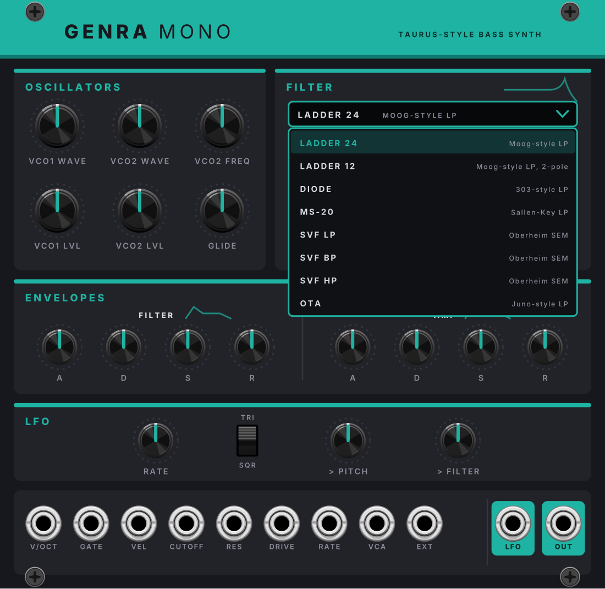

# GENRA v3 – Generativer 4-Spur-Sequencer für VCV Rack 2

Breite: **64 HP** (GENRA) und **50 HP** (Grid Editor). Dazu im selben Plugin die drei JIANT-Stimmen **VOICE** (26 HP), **DRUM-X** (32 HP) und **ANIMAL** (26 HP), **MONK** (26 HP) sowie der Bass-Synth **GENRA MONO** (26 HP). Projektstand und Entscheidungen: `PROJEKT.md`.

## GENRA Grid Editor (zweites Modul)


Ein zweites Modul im selben Plugin (50 HP) zum vollständigen Bearbeiten des Loops: Drum-Raster, Piano-Roll für Bass, Melodie und Pads, Velocity-Spur.

- **Verbindung:** direkt links oder rechts neben GENRA setzen (LINK-LED leuchtet). Oder im Rechtsklick-Menü *Verbinden mit…* ein beliebiges GENRA im Patch wählen.
- **TRACK:** Spur wählen. **VIEW:** BAR (erster sichtbarer Takt), ZOOM (1/2/4/8 Takte), PITCH (Tonbereich), AUTO SCROLL (Ansicht läuft mit).
- **Drums:** Klick setzt/löscht einen Schlag, Ziehen malt bzw. radiert, Mausrad = Velocity, Rechtsklick = Roll 2–4×, Velocity, Löschen. Klick auf den Stimmennamen wählt die Stimme der Velocity-Spur.
- **Piano-Roll:** Klick setzt eine Note (Länge LEN, Velocity VEL), Ziehen am rechten Rand ändert die Länge, Ziehen der Note verschiebt sie, Doppelklick löscht. Rechtsklick: Akzent, Slide, Velocity. Tonleitertöne sind heller, Akkordtöne blaugrün hinterlegt, die Akkordfolge steht darüber.
- **SNAP:** AUS / SCALE / CHORD für neue und verschobene Noten; mit Shift gedrückt: alle Noten der Spur einrasten.
- **CHORD FOLLOW:** bearbeitete Noten folgen neuen Akkorden (HARMONY NEW): Grundtöne werden zum neuen Grundton, alle anderen Töne wandern in der Tonleiter mit.
- **CHANCE:** Wahrscheinlichkeit neuer Noten (Regler). Jede Note/jeder Schlag kann eine eigene Wahrscheinlichkeit haben und „nur jeden 2. Durchlauf“ spielen (Rechtsklick). Solche Noten sind gestrichelt und zeigen ihren Wert. Die untere Spur schaltet per Klick auf „VEL“/„CHANCE“ um – dort zieht man Velocity bzw. Chance mit der Maus.
- **Mehrfachauswahl:** Shift + Ziehen = Rahmen, Strg + Klick = Note an-/abwählen, Strg+A = alles. Ausgewählte Noten zusammen ziehen; Pfeile ↑↓ = Tonhöhe (Shift: Oktave; Drums: Stimme), ←→ = Position (Shift: ein Takt); Entf = löschen; Strg+C / Strg+V = kopieren / an der Mausposition einfügen; Strg+D = dahinter duplizieren; Esc = Auswahl aufheben. Mausrad und Rechtsklick-Menü wirken auf die ganze Auswahl.
- **EDIT:** UNDO, REDO, COPY/PASTE BAR (erster sichtbarer Takt), CLEAR TRACK, GEN TRACK (Spur wieder generativ).
- **Was „bearbeitet“ heisst:** Sobald du etwas änderst, spielt die Spur feste Noten – genau das, was vorher zu hören war, plus deine Änderungen. DENSITY/COMPLEX wirken dann nicht mehr auf diese Spur, FILL (Fills und Drops) und Humanize schon. MUTATE verändert auch bearbeitete Spuren – LOCK schützt sie vor MUTATE und NEW ALL.

## JIANT-Stimmen: VOICE, DRUM-X, ANIMAL

| VOICE | DRUM-X | ANIMAL |
|---|---|---|
|  |  |  |

Drei Klangerzeuger aus der Firmware von [JIANT FM](https://github.com/juanjiant-bit/JIANT) (Juan Jiant, ein Fork von [Felucca](https://github.com/hugelton/Felucca), GPL-3.0), im GENRA-Look und jeweils in einer eigenen Farbe: **VOICE rot**, **DRUM-X lila**, **ANIMAL grün**. Das Display zeigt links die Zeichnung der Firmware (Vokaltrakt, Kit-Kolonie, Kreatur), rechts Preset bzw. Kit und die Einstellungen.

- **VOICE** (26 HP): Formant-Sänger. ◀ PRE ▶ (15 Presets), LANG im Display (OFF singt Vokale, ES/EN/JA singen Wörter), ◀ LYR ▶ wählt TEXT, W1–W16 oder S1–S8, das Textfeld im Display nimmt einen eigenen Text (bis 63 Zeichen). Jede neue Note singt die nächste Silbe, WORD ↺ startet den Text neu. 8 Klangregler mit CV, ihre Namen wechseln mit LANG.
- **DRUM-X** (32 HP): 8 synthetische Drum-Spuren mit Varianten A/B und MORPH, 9 Kits (◀ KIT ▶). Klick auf Spurname, Pad oder Spur-Chip im Display wählt die Spur für SOUND (PITCH … COLOR, A | B). 7 Kit-Makros mit CV, pro Spur TRIG, LEVEL und Einzelausgang (OUT), V/OCT + GATE nach General MIDI, ACC, DLY, REV, LVL, Mix L/R.
- **ANIMAL** (26 HP): Tierrufe aus physikalischen Modellen. MODE als Regler oder per Klick im Display (CMOS, PULSE, WHSTL, WING, GLOTT), ◀ PRE ▶ (24 Presets), 7 Klangregler mit CV, ihre Namen wechseln mit MODE.
- **Gemeinsam (VOICE, ANIMAL):** CALL spielt einen Ton ohne Kabel (auch per Gate am CALL-Eingang), POLY · MONO · LEGATO per Klick auf die Lampen, Hüllkurve ATK–REL, FX DIST–REVERB, V/OCT, GATE, VEL polyphon, LEVEL und Stereo-Ausgang (nur L gesteckt = Mono).
- Presets bzw. Kits gibt es auch im Rechtsklick-Menü. Alte Patches mit den einzelnen Plugins *JiantVoice*, *JiantDrumX*, *JiantAnimal* finden die Module hier nicht automatisch – dort einmal neu einsetzen.

## MONK: der Sänger aus MONK-1


Der Vokal-Synthesizer aus der FM-1-Firmware [MONK-1](https://github.com/charlesvestal/fm1-monk) (Charles Vestal, GPL-3.0), dessen Klang [MonkSynth](https://github.com/JonET/monksynth) ist (Jonathan Taylor, MIT; eine Hommage an Delay Lama). FOF-Formantsynthese: pro Periode ein Korn aus drei abklingenden Formant-Sinus plus Atem, fünf Vokale OO–OH–AH–EH–EE. Farbe: **safran**.

- **Display:** links singt der Sänger, gezeichnet vom Originalcode der Firmware (Mund folgt Vokal und Lautstärke, ohne Ton blinzelt er und probt Vokale), rechts Name, Note, Stimmen, ob die Stimme bearbeitet ist, Vokal-Chips (Klick setzt VOWEL), PRESS und ENV.
- **◀ SING ▶:** die zwölf Sänger (Jerry, Guppo, Philip, Suze, Gerald, Bess, EeOo, Snider, Fipsy, Peppo, Marley, Razor). Ein Sänger lädt seine Stimme auf alle Regler. Auch per SINGER-CV (0–10 V) und Rechtsklick-Menü, dort auch *Stimme wie geliefert*.
- **SING · CHOIR** (je mit CV, ±5 V = ganzer Reglerweg): VOWEL, HEAD (Vokaltrakt in cm), BREATH, GLIDE, VOICES (Unisono 1–10), DETUNE (Cent), SPREAD (Kopfgrössen der Stimmen), TUNE (±12 Halbtöne).
- **PRESS →** VOWEL · PITCH · BOTH · INV: wohin der PRESS-Eingang (Aftertouch, 0–10 V) wirkt; P.DEPTH wie weit, VEL wie stark VEL die Lautstärke setzt.
- **ENVELOPE** ATK DEC SUS REL (bis 5 s), **VIBRATO · ECHO** DEPTH, RATE, ECHO (Menge), TIME, FDBK (neu, im Original fest 50 %).
- **Ein/Aus:** V/OCT (C4 = 0 V), GATE, VEL, PRESS, SINGER · ENV (0–10 V), DRY (mono ohne Echo), L, R. Einstimmig wie das Original: GATE startet die Note, V/OCT bei gehaltenem Gate gleitet ohne neuen Anschlag (GLIDE).
- Mit MIDI: MIDI-CV-Modul → V/OCT, GATE, VEL und AFT → PRESS.

## GENRA MONO: Bass-Synth nach dem Moog Minitaur

| | |
|---|---|
|  |  |

Monophoner Synth (26 HP) im GENRA-Look, Akzentfarbe **Türkis**.

- **Oszillatoren:** VCO1/VCO2 WAVE stufenlos Dreieck → Sägezahn → Rechteck → schmaler Puls, VCO2 FREQ ±12 Halbtöne (fein um die Mitte), Pegel pro Oszillator (hohe Pegel übersteuern das Filter), GLIDE.
- **Filter:** Klick auf das Feld öffnet die Liste, das Mausrad blättert: LADDER 24 (Moog, Standard, Bass bleibt bei Resonanz erhalten), LADDER 12, DIODE (303), MS-20, SVF LP/BP/HP (Oberheim SEM), OTA (Juno). CUTOFF, RES, EG AMT (bipolar), DRIVE, KEY TRK.
- **Hüllkurven:** Filter- und Amp-ADSR mit analogen Kurven (1 ms … 10 s).
- **LFO:** RATE (0,05–50 Hz), TRI/SQR, Stärke auf Tonhöhe und Filter, eigener LFO-Ausgang.
- **Eingänge:** V/OCT (0 V = C4), GATE, VEL, CV für CUTOFF (1 V/Okt.), RES, DRIVE, RATE (1 V/Okt.), VCA, EXT (externes Audio durchs Filter). **Ausgänge:** LFO, OUT.
- Oszillatoren und Filter laufen mit 2-facher Überabtastung.

## Neu in v3

- **Genre pro Spur:** Unter den Reglern jeder Spur sitzt ein Genre-Feld. Klick öffnet das Menü: *Global (folgt GENRE)* oder ein eigenes Genre, nach Familien sortiert, mit Varianten. Der Wechsel greift am nächsten Taktanfang (Feld und Display zeigen „…“). Ein eigenes Genre-Feld würfelt die Spur auch bei LOCK neu – die Auswahl ist ein bewusster Befehl. Der globale GENRE-Regler ändert nur Spuren auf *Global*.
- **GENRE-CV pro Spur** (Buchse neben dem Feld): Mit Kabel wählt die Spannung das Genre der Spur, die Variante kommt aus dem Feld (falls gleiches Genre) oder vom VARIANT-Regler. Rechtsklick-Menü → *Genre-CV-Eingänge*: 0–10 V über alle 37 Genres oder 1/12 V pro Genre (Halbtöne – ein Keyboard über MIDI-CV wählt Genres per Taste, C = House).
- **Swing pro Spur:** Jede Spur swingt wie das Genre, das sie spielt (Lo-Fi-Melodie über geradem Techno). SWING verschiebt alle gemeinsam. Gilt auch für den MIDI-Export.
- **Neue CV-Eingänge:** FILL (Trigger: Fill/Drop am Loop-Ende), VARIANT, COMPLEX, COLOR (0–10 V, zum Regler addiert), DENS-CV pro Spur.
- **HARMONY** (früher CHORDS, jetzt blaugrün): NEW, LOCK, TRIG für die gemeinsame Akkordfolge, der Bass, Melodie und Pads folgen.
- **Ein- und Ausgänge (v3.1):** neue CV-Eingänge SWING (0–10 V addiert), BPM (interne Clock, 10 BPM pro Volt), LENGTH. Spalte **OUT**: CLOCK (16tel), RESET (Loop-Anfang), RUN (Gate), BAR (pro Takt), END (letzter Step), FILL (Gate während Fill/Drop), ROOT (Grundton des aktuellen Akkords, V/Oct zwischen C4 und B4), CHORD (ganzer Akkord, polyphon).
- **Szenen (8 Plätze):** Taster-Farbe: dunkel = leer, rot = Pattern gespeichert, grün = aktiv (blinkt bis zum Wechsel). Leerer Platz drücken = aktuellen Loop speichern (alle Spuren, Akkorde, Spur-Genres, Länge). Belegter Platz = abrufen, beim Spielen am nächsten Taktanfang (blinkt bis dahin). Überschreiben: STORE drücken (blinkt), dann den Platz. NEXT-Trigger = nächste belegte Szene, CV 0–10 V = Szene 1–8. Rechtsklick-Menü: *Alle Szenen löschen*. Szenen werden im Patch gespeichert.
- **Display:** Genre jeder Spur neben ihren Lauflichtern, aktive Szene, Akkordnamen mit # oder b passend zur Tonart.
- **Fehlerkorrekturen:** MIDI-Export/-Import mit exakter Länge und Akkordfolge, threadsichere Akkord-Bearbeitung, neues Speicherformat (v2-Patches werden übernommen; Spuren stehen dann auf *Global*).


GENRA erfindet genretypische Loops: **8 Drumspuren, Bass, Melodie und polyphone Pads**, die sich eine gemeinsame Tonart und Akkordfolge teilen. **37 Genres mit 83 Varianten**, alle Regler wirken live. Breite: 44 HP.

| Familie | Genres (Varianten) |
|---|---|
| House | House (Classic, Piano) · Deep House (Stabs, Pads) · Speed Garage (Warp, Organ) · UK Garage (4x4) · 2-Step |
| Techno | Techno (Rolling, Peak, Hypnotic) · Minimal · Acid (Classic, Double, Poly 12) · Electro (Classic, Funk, Detroit) · Trance (Uplifting, Psy) |
| Breaks & Bass | Breakbeat (Classic, Nu-Skool, Big Beat) · Jungle (Classic, Ragga, Dark) · Drum & Bass (Classic, Liquid, Neuro) · Dubstep (Deep, Heavy) · Grime (Eski, Sino) |
| Hip-Hop & Downtempo | Hip-Hop (Boom Bap) · Lo-Fi · Trap · Drill (UK) · Trip-Hop · Downtempo (Chillout, Organic) |
| Weitere | Dub (Roots, Steppers) · Synthwave (Classic, Outrun) · Ambient (Classic, Bright) |
| Afro (neu in v3) | Afrobeat (Classic, Tony Allen, Afro-Funk) · Afrobeats (Afropop, Afro-Swing, Afro-Piano) · Amapiano (Classic, Soulful, Log Drum) · Afro House (Classic, Organic, 3-Step) |
| Techno Styles (neu in v3) | Dub Techno (Classic, Deep Chord) · Melodic Techno (Afterlife, House) · Hard Techno (Industrial, Schranz, Rave) · Tech House (Classic, Rolling, Minimal) · Detroit Techno (Strings, Electro, Deep) |
| Latin & Club (neu in v3) | Baile Funk (Tamborzao, 150 BPM, Volt Mix) · Reggaeton (Perreo, Clasico, Dominicano) · Footwork (Battle, Soul, Juke) · Breakcore (Amen, Gabber, Melodic) |

---

## Installation unter Windows (über GitHub)

1. Diese Dateien im Repository ersetzen bzw. hochladen: `src/`, `res/`, `plugin.json`, `Makefile`, `.github/workflows/main.yml` (und optional `README.md`, `docs/`, `tools/`, `test/`).
2. Unter **Actions** startet der Build automatisch (3–5 Minuten).
3. Grünen Lauf öffnen → unten bei **Artifacts** `genra-windows` laden → Zip entpacken.
4. **Nur** `Genra-2.3.0-win-x64.vcvplugin` nach `%LOCALAPPDATA%\Rack2\plugins-win-x64\` kopieren. Ältere `Genra-2.x-…vcvplugin`-Dateien und den Ordner `Genra` dort vorher löschen.
5. Rack neu starten.

Die Versionsnummer liest der Workflow jetzt selbst aus `plugin.json`, für künftige Versionen genügt es, sie dort zu erhöhen.

> Patches aus v1 laden, aber das gespeicherte Pattern wird neu erzeugt (das Format hat sich geändert), und die Genre-Nummern sind neu sortiert.

---

## Neu in v2

- **NEW pro Spur + TRIG-Eingang:** würfelt nur Drums, Bass, Melodie oder Pads neu – auch wenn LOCK an ist (LOCK schützt nur vor NEW ALL, Genrewechsel und MUTATE).
- **Akkord-Bereich:** NEW (neue Akkordfolge, Spuren folgen live), CHORD LOCK, TRIG-Eingang.
- **VARIANT:** Spielart des Genres; Name im Display und beim Darüberfahren. Wechsel greift wie GENRE am nächsten Taktanfang.
- **SLIDE-Ausgänge** (Bass, Melodie): 10 V zu Beginn eines Glides, z. B. für Portamento am VCO oder einen Slew-Limiter. Der Gate bleibt dabei durchgehend offen (303-Stil).
- **Genre-Merkmale:** 2-Takt-Raster (Drill), Hi-Hat-Rolls/Triolen, Break-Chops (Jungle, D&B, Breakbeat), Drops und Breaks am Loop-Ende (Speed Garage, Jungle, Grime), Humanize (Lo-Fi, Hip-Hop, Trip-Hop), Polymeter-Bass (Acid Poly 12), zweite 303-Linie (Acid), genre-eigene Fills.

**Welcher Regler steuert was?**
- **COMPLEX** → Synkopen, Hi-Hat-Rolls/Triolen, wie wild Breaks gechoppt werden, Slides der Melodie
- **MOVE** → Bassbewegung und Bass-Slides
- **FILL** → Wahrscheinlichkeit für Fill **und** Drop am Loop-Ende
- **DENSITY** (Pads) → bei Grime sind Pads standardmässig aus; über der Mitte kommen sie dazu

---

## Bedienung (alle Elemente)

**Global:** GENRE, BPM (interne Clock), KEY, SCALE (Auto = Genre), VARIANT, COMPLEX, COLOR (Harmonik), MUTATE, SWING (relativ zum Genre jeder Spur), LENGTH (1/2/4/8 Takte), NEW ALL, RUN.
**Harmony:** NEW, LOCK, TRIG.
**Pro Spur:** DENSITY + DENS-CV · zweiter Regler (Drums: FILL, GHOST; Bass: MOVE; Melodie: RANGE; Pads: VOICING) · OCT (Bass/Melodie/Pads) · Genre-Feld + GENRE-CV · MUTE · LOCK · NEW · TRIG.
**Szenen:** 8 Plätze, STORE, CV, NEXT.
**Eingänge:** CLOCK, RESET, RUN, NEW, FILL, MUTATE, GENRE, VARIANT, TRANSP (V/Oct), COMPLEX, COLOR, CHORD (poly) · pro Spur GENRE-CV, DENS-CV, TRIG · Szenen CV, NEXT · HARMONY TRIG.
**Ausgänge:** 8 Drum-Trigger (Höhe = Velocity) · Bass/Melodie: V/OCT, GATE, VEL, ACC, SLIDE · Pads: V/OCT + GATE (poly 4), VEL, MOD.

**Display:** Akkord anklicken = nächste Alternative, Rechtsklick = Liste, Mausrad = mehr/weniger Farbe.
**Rechtsklick-Menü:** MIDI-Export/-Import, Akkord-Modus, Akkord-Vorlage, nur Akkorde neu würfeln, Genre-CV-Modus, alle Spuren auf Global, alle Szenen löschen, Clock-Auflösung.

---

## Projektstruktur
```
src/Engine.hpp/.cpp   Theorie, Akkorde, Generierung, Auswertung pro Step
src/Genres.cpp        24 Genres / 46 Profile (Raster in derselben Notation wie die Spezifikation)
src/Midi.cpp          MIDI-Export/-Import
src/Store.cpp         Speicherformat (pattern3) + Übernahme von v2-Patches
src/Edit.cpp          Bearbeiten: Einfrieren, Noten schreiben, Chord Follow, Snap, Copy/Paste
src/GenraModule.hpp   GENRA-Moduldefinition (auch vom Editor genutzt)
src/GenraGrid.cpp     Grid-Editor-Modul
res/GenraGrid.svg     Frontplatte des Editors (tools/grid_panel.py real)
src/Genra.cpp         Rack-Modul, Display, Menüs
res/Genra.svg         Frontplatte (tools/panel.py real), Vorschau: tools/panel.py preview <datei.svg>
src/jiant/            JIANT-Stimmen VOICE, DRUM-X, ANIMAL (Module, Kern-Lader, gemeinsamer Look JiantUI.hpp)
jiantcore/            die drei Firmware-Kerne als eigene kleine Bibliotheken (res/*core.dll beim Build)
jiant.tar.gz          Firmware-Quellen von JIANT FM (beim ersten Build nach jiant/ entpackt)
res/Jiant*.svg        Frontplatten (tools/jiant_panel.py real), Vorschau: tools/jiant_panel.py preview <ordner> <Rack>
src/mono/             GENRA MONO: Modul (GenraMono.cpp) und Klang-Engine (MonoDsp.hpp, ohne Rack testbar)
res/GenraMono.svg     Frontplatte (tools/mono_panel.py real), Vorschau: tools/mono_panel.py preview <datei.png> <Rack> [menu]
test/                 Engine- und MIDI-Tests (g++, ohne Rack)
```
