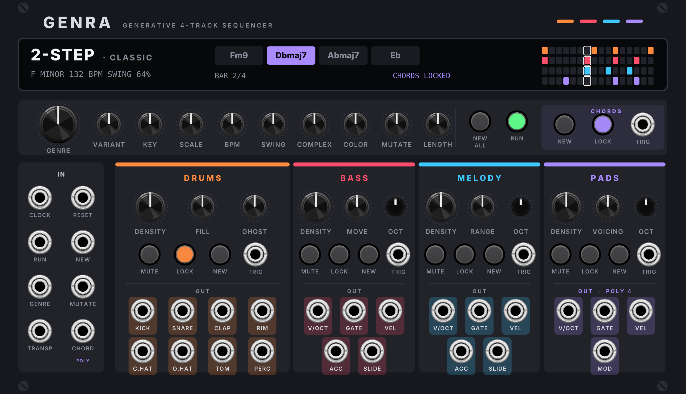

# GENRA v3 – Generativer 4-Spur-Sequencer für VCV Rack 2

> **In Arbeit.** Dieser Stand ist v2 (2.1.0) plus Fehlerkorrekturen; die neuen v3-Funktionen (Genre pro Spur, CV-Eingänge, Szenen, 58 HP) folgen. Projektstand: `PROJEKT.md`.



GENRA erfindet genretypische Loops: **8 Drumspuren, Bass, Melodie und polyphone Pads**, die sich eine gemeinsame Tonart und Akkordfolge teilen. **24 Genres mit 46 Varianten**, alle Regler wirken live. Breite: 44 HP.

| Familie | Genres (Varianten) |
|---|---|
| House | House (Classic, Piano) · Deep House (Stabs, Pads) · Speed Garage (Warp, Organ) · UK Garage (4x4) · 2-Step |
| Techno | Techno (Rolling, Peak, Hypnotic) · Minimal · Acid (Classic, Double, Poly 12) · Electro (Classic, Funk, Detroit) · Trance (Uplifting, Psy) |
| Breaks & Bass | Breakbeat (Classic, Nu-Skool, Big Beat) · Jungle (Classic, Ragga, Dark) · Drum & Bass (Classic, Liquid, Neuro) · Dubstep (Deep, Heavy) · Grime (Eski, Sino) |
| Hip-Hop & Downtempo | Hip-Hop (Boom Bap) · Lo-Fi · Trap · Drill (UK) · Trip-Hop · Downtempo (Chillout, Organic) |
| Weitere | Dub (Roots, Steppers) · Synthwave (Classic, Outrun) · Ambient (Classic, Bright) |

---

## Installation unter Windows (über GitHub)

1. Diese Dateien im Repository ersetzen bzw. hochladen: `src/`, `res/`, `plugin.json`, `Makefile`, `.github/workflows/main.yml` (und optional `README.md`, `docs/`, `tools/`, `test/`).
2. Unter **Actions** startet der Build automatisch (3–5 Minuten).
3. Grünen Lauf öffnen → unten bei **Artifacts** `genra-windows` laden → Zip entpacken.
4. **Nur** `Genra-2.2.0-win-x64.vcvplugin` nach `%LOCALAPPDATA%\Rack2\plugins-win-x64\` kopieren. Ältere `Genra-2.x-…vcvplugin`-Dateien und den Ordner `Genra` dort vorher löschen.
5. Rack neu starten.

Die Versionsnummer liest der Workflow jetzt selbst aus `plugin.json`, für künftige Versionen genügt es, sie dort zu erhöhen.

> Patches aus v1 laden, aber das gespeicherte Pattern wird neu erzeugt (das Format hat sich geändert), und die Genre-Nummern sind neu sortiert.

---

## Neu in v2

- **NEW pro Spur + TRIG-Eingang:** würfelt nur Drums, Bass, Melodie oder Pads neu – auch wenn LOCK an ist (LOCK schützt nur vor NEW ALL, Genrewechsel und MUTATE).
- **Akkord-Bereich:** NEW (neue Akkordfolge, Spuren folgen live), CHORD LOCK, TRIG-Eingang.
- **VARIANT:** Spielart des Genres; Name im Display und beim Darüberfahren. Wechsel greift wie GENRE am nächsten Taktanfang.
- **SLIDE-Ausgänge** (Bass, Melodie): 10 V zu Beginn eines Glides, z. B. für Portamento am VCO oder einen Slew-Limiter. Der Gate bleibt dabei durchgehend offen (303-Stil).
- **Genre-Merkmale:** 2-Takt-Raster (Drill), Hi-Hat-Rolls/Triolen, Break-Chops (Jungle, D&B, Breakbeat), Drops und Breaks am Loop-Ende (Speed Garage, Jungle, Grime), Humanize (Lo-Fi, Hip-Hop, Trip-Hop), Polymeter-Bass (Acid Poly 12), zweite 303-Linie (Acid), genre-eigene Fills.

**Welcher Regler steuert was?**
- **COMPLEX** → Synkopen, Hi-Hat-Rolls/Triolen, wie wild Breaks gechoppt werden, Slides der Melodie
- **MOVE** → Bassbewegung und Bass-Slides
- **FILL** → Wahrscheinlichkeit für Fill **und** Drop am Loop-Ende
- **DENSITY** (Pads) → bei Grime sind Pads standardmässig aus; über der Mitte kommen sie dazu

---

## Bedienung (alle Elemente)

**Global:** GENRE, VARIANT, KEY, SCALE (Auto = Genre), BPM (interne Clock), SWING (relativ zum Genre), COMPLEX, COLOR (Harmonik), MUTATE, LENGTH (1/2/4/8 Takte), NEW ALL, RUN.
**Akkorde:** NEW, LOCK, TRIG.
**Pro Spur:** DENSITY · zweiter Regler (Drums: FILL, GHOST; Bass: MOVE; Melodie: RANGE; Pads: VOICING) · OCT (Bass/Melodie/Pads) · MUTE · LOCK · NEW · TRIG.
**Eingänge:** CLOCK, RESET, RUN, NEW, GENRE CV, MUTATE CV, TRANSP (V/Oct), CHORD (poly).
**Ausgänge:** 8 Drum-Trigger (Höhe = Velocity) · Bass/Melodie: V/OCT, GATE, VEL, ACC, SLIDE · Pads: V/OCT + GATE (poly 4), VEL, MOD.

**Display:** Akkord anklicken = nächste Alternative, Rechtsklick = Liste, Mausrad = mehr/weniger Farbe.
**Rechtsklick-Menü:** MIDI-Export/-Import, Akkord-Modus, Akkord-Vorlage, nur Akkorde neu würfeln, Clock-Auflösung.

---

## Projektstruktur
```
src/Engine.hpp/.cpp   Theorie, Akkorde, Generierung, Auswertung pro Step
src/Genres.cpp        24 Genres / 46 Profile (Raster in derselben Notation wie die Spezifikation)
src/Midi.cpp          MIDI-Export/-Import
src/Genra.cpp         Rack-Modul, Display, Menüs
res/Genra.svg         Frontplatte (tools/panel.py real), Vorschau: tools/panel.py preview <datei.svg>
test/                 Engine- und MIDI-Tests (g++, ohne Rack)
```
