# GENRA – Plugin für VCV Rack 2

Ein generativer, genreabhängiger 4-Spur-Sequencer mit MIDI-Grid, Performance-Effekten und passenden Instrumenten, alle im selben Look. Plugin-Version **2.16.0**, 18 Module. Projektstand und Entscheidungen: `PROJEKT.md`.

| Modul | Breite | Farbe | Was es ist |
|---|---|---|---|
| **GENRA** | 58 HP | – | Generativer Sequencer: 8 Drumspuren, Bass, Melodie, Pads, 37 Genres |
| **ABLAUF** | 30 HP | gelb | Song-Arranger: 128 Pattern-Plätze mit Namen, Song-Liste, Varianten für Intro, Build, Drop … |
| **GENRA Grid** | 50 HP | – | MIDI-Grid für GENRA: Drum-Raster, Piano-Roll, Velocity/Chance |
| **STOTTER** | 30 HP | – | Performance-Effekte: 16 Effekt-Pads, DJ-EQ und -Filter |
| **GENRA MONO** | 28 HP | säuregrün | Monophoner Bass-Synth nach dem Moog Minitaur, mit Presets |
| **K-WASUB** + **FX** | je 40 HP | säuregrün | Modern-Bass-Synth aus der FM-1-Firmware K-WASUB, mit Effekt-Expander |
| **FUNKE** | 30 HP | cyan | Melodiestimme: 8 Modelle von Rhodes bis Saw Lead |
| **SCHMELZ** | 32 HP | rosa | String Machine nach Waldorf Streichfett, für die Pads |
| **JIANT DRUM-X** | 32 HP | blau-violett | 8-spuriger Drum-Synth aus der JIANT-FM-Firmware |
| **JIANT VOICE** | 26 HP | rot | Formant-Sänger aus der JIANT-FM-Firmware |
| **JIANT ANIMAL** | 26 HP | grün | Tierrufe aus physikalischen Modellen (JIANT FM) |
| **MONK** | 26 HP | safran | Vokal-Synth aus der FM-1-Firmware MONK-1 |
| **UMLAUF** + **FX** | 54 / 36 HP | Sith-Rot | Orbit-Vektor-Synth mit der Engine von VADER, mit Expander |
| **MIX** | 28 HP | Spurfarben | 4-Kanal-Stereomixer für die GENRA-Spuren |

Die Farben folgen GENRAs Spuren: **Drums blau-violett**, **Bass säuregrün**, **Melodie cyan**, **Pads rosa**.

---

## GENRA: der Generator

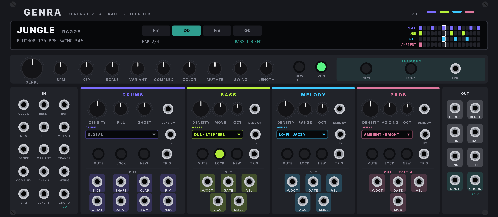

GENRA erfindet genretypische Loops (1/2/4/8 Takte) für **8 Drumspuren, Bass, Melodie und polyphone Pads (4 Stimmen)**, die sich eine gemeinsame Tonart und Akkordfolge teilen. **37 Genres mit 83 Varianten**, jede Spur kann ihr eigenes Genre spielen, und alle Regler wirken live.

### Genres

| Familie | Genres (Varianten) |
|---|---|
| House | House (Classic, Piano) · Deep House (Stabs, Pads) · Speed Garage (Warp, Organ) · UK Garage (4x4) · 2-Step |
| Techno | Techno (Rolling, Peak, Hypnotic) · Minimal · Acid (Classic, Double, Poly 12) · Electro (Classic, Funk, Detroit) · Trance (Uplifting, Psy) |
| Breaks & Bass | Breakbeat (Classic, Nu-Skool, Big Beat) · Jungle (Classic, Ragga, Dark) · Drum & Bass (Classic, Liquid, Neuro) · Dubstep (Deep, Heavy) · Grime (Eski, Sino) |
| Hip-Hop & Downtempo | Hip-Hop (Boom Bap) · Lo-Fi · Trap · Drill (UK) · Trip-Hop · Downtempo (Chillout, Organic) |
| Weitere | Dub (Roots, Steppers) · Synthwave (Classic, Outrun) · Ambient (Classic, Bright) |
| Afro | Afrobeat (Classic, Tony Allen, Afro-Funk) · Afrobeats (Afropop, Afro-Swing, Afro-Piano) · Amapiano (Classic, Soulful, Log Drum) · Afro House (Classic, Organic, 3-Step) |
| Techno Styles | Dub Techno (Classic, Deep Chord) · Melodic Techno (Afterlife, House) · Hard Techno (Industrial, Schranz, Rave) · Tech House (Classic, Rolling, Minimal) · Detroit Techno (Strings, Electro, Deep) |
| Latin & Club | Baile Funk (Tamborzao, 150 BPM, Volt Mix) · Reggaeton (Perreo, Clasico, Dominicano) · Footwork (Battle, Soul, Juke) · Breakcore (Amen, Gabber, Melodic) |

### Bedienung

- **Global:** GENRE, BPM (interne Clock), KEY, SCALE (Auto = Genre), VARIANT, COMPLEX, COLOR (Harmonik), MUTATE, SWING (relativ zum Genre jeder Spur), LENGTH (1/2/4/8 Takte), NEW ALL, RUN.
- **HARMONY** (blaugrün): NEW, LOCK, TRIG für die gemeinsame Akkordfolge, der Bass, Melodie und Pads folgen.
- **Pro Spur:** DENSITY + DENS-CV · zweiter Regler (Drums: FILL, GHOST · Bass: MOVE · Melodie: RANGE · Pads: VOICING) · OCT (Bass/Melodie/Pads) · Genre-Feld + GENRE-CV · MUTE · LOCK · NEW · TRIG.
- **Eingänge (IN):** CLOCK, RESET, RUN, NEW, FILL, MUTATE, GENRE, VARIANT, TRANSP (V/Oct), COMPLEX, COLOR, SWING, BPM, LENGTH, CHORD (poly) · pro Spur GENRE-CV, DENS-CV, TRIG · HARMONY TRIG.
- **Ausgänge pro Spur:** 8 Drum-Trigger (Höhe = Velocity) · Bass/Melodie: V/OCT, GATE, VEL, ACC, SLIDE · Pads: V/OCT + GATE (poly 4), VEL, MOD.
- **Ausgänge (OUT):** CLOCK (16tel), RESET (Loop-Anfang), RUN (Gate), BAR (pro Takt), END (letzter Step), FILL (Gate während Fill/Drop), ROOT (Grundton des aktuellen Akkords, V/Oct zwischen C4 und B4), CHORD (ganzer Akkord, polyphon), **DRUMS** (alle 8 Drumspuren auf einem Poly-Kabel in GENRAs Reihenfolge, z. B. in DRUM-X; die 8 Einzelausgänge bleiben).
- **Display:** Genre und Variante, Tonart, BPM, Swing, Akkordfolge, Genre jeder Spur neben ihren Lauflichtern. Akkord anklicken = nächste Alternative, Rechtsklick = Liste, Mausrad = mehr/weniger Farbe. Akkordnamen mit # oder b passend zur Tonart.
- **Rechtsklick-Menü:** MIDI-Export/-Import, Akkord-Modus, Akkord-Vorlage, nur Akkorde neu würfeln, Genre-CV-Modus, alle Spuren auf Global, Clock-Auflösung, *Verbinden mit…* (Grid Editor).

**Welcher Regler steuert was?**
- **COMPLEX** → Synkopen, Hi-Hat-Rolls/Triolen, wie wild Breaks gechoppt werden, Slides der Melodie
- **MOVE** → Bassbewegung und Bass-Slides
- **FILL** → Wahrscheinlichkeit für Fill **und** Drop am Loop-Ende
- **DENSITY** (Pads) → bei Grime sind Pads standardmässig aus; über der Mitte kommen sie dazu

### Genre pro Spur, Swing und CV

- **Genre-Feld pro Spur:** Klick öffnet das Menü: *Global (folgt GENRE)* oder ein eigenes Genre, nach Familien sortiert, mit Varianten. Der Wechsel greift am nächsten Taktanfang (Feld und Display zeigen „…“). Ein eigenes Genre-Feld würfelt die Spur auch bei LOCK neu – die Auswahl ist ein bewusster Befehl. Der globale GENRE-Regler ändert nur Spuren auf *Global*.
- **GENRE-CV pro Spur:** Mit Kabel wählt die Spannung das Genre der Spur, die Variante kommt aus dem Feld (falls gleiches Genre) oder vom VARIANT-Regler. Rechtsklick-Menü → *Genre-CV-Eingänge*: 0–10 V über alle 37 Genres oder 1/12 V pro Genre (Halbtöne – ein Keyboard über MIDI-CV wählt Genres per Taste, C = House).
- **Swing pro Spur:** Jede Spur swingt wie das Genre, das sie spielt (Lo-Fi-Melodie über geradem Techno). SWING verschiebt alle gemeinsam. Gilt auch für den MIDI-Export.
- **CV-Eingänge** VARIANT, COMPLEX, COLOR, SWING (0–10 V, zum Regler addiert), BPM (10 BPM pro Volt), LENGTH, DENS-CV pro Spur, FILL (Trigger: Fill/Drop am Loop-Ende).

### Szenen (bis 2.10.0)

Die 8 Szenen-Plätze sind seit 2.11.0 entfernt, das Panel ist dadurch 58 statt 64 HP breit. Patterns speichern und Songs bauen übernimmt jetzt **ABLAUF**. In alten Patches gespeicherte Szenen werden beim Laden ignoriert, Kabel an SCENE CV und NEXT fallen weg.

### NEW, LOCK und Genre-Merkmale

- **NEW pro Spur + TRIG-Eingang:** würfelt nur Drums, Bass, Melodie oder Pads neu – auch wenn LOCK an ist (LOCK schützt nur vor NEW ALL, Genrewechsel und MUTATE).
- **VARIANT:** Spielart des Genres; Name im Display und beim Darüberfahren. Wechsel greift wie GENRE am nächsten Taktanfang.
- **SLIDE-Ausgänge** (Bass, Melodie): 10 V zu Beginn eines Glides, z. B. für Portamento am VCO oder einen Slew-Limiter. Das Gate bleibt dabei durchgehend offen (303-Stil).
- **Genre-Merkmale:** 2-Takt-Raster (Drill), Hi-Hat-Rolls/Triolen, Break-Chops (Jungle, D&B, Breakbeat), Drops und Breaks am Loop-Ende (Speed Garage, Jungle, Grime), Humanize (Lo-Fi, Hip-Hop, Trip-Hop), Polymeter-Bass (Acid Poly 12), zweite 303-Linie (Acid), genre-eigene Fills.
- **MIDI:** Export als Typ-1-Datei (Drums Kanal 10/GM, Bass 1, Melodie 2, Pads 3, Swing inklusive, exakte Länge und Akkordfolge). Import spielt notengenau ab.

> v2-Patches werden übernommen (Spuren stehen dann auf *Global*). Patches aus v1 laden, aber das Pattern wird neu erzeugt, und die Genre-Nummern sind neu sortiert.

---

## GENRA Grid Editor: das MIDI-Grid

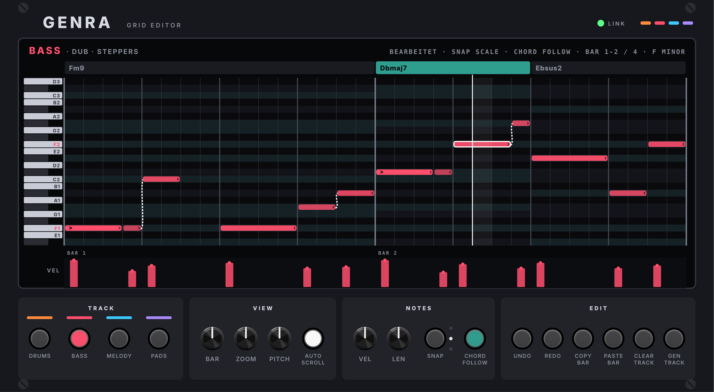

Das MIDI-Grid zu GENRA (50 HP): Hier bearbeitest du den erzeugten Loop Note für Note – Drum-Raster, Piano-Roll für Bass, Melodie und Pads, Velocity- und Chance-Spur.

- **Verbindung:** direkt links oder rechts neben GENRA setzen (LINK-LED leuchtet). Oder im Rechtsklick-Menü *Verbinden mit…* ein beliebiges GENRA im Patch wählen.
- **TRACK:** Spur wählen. **VIEW:** BAR (erster sichtbarer Takt), ZOOM (1/2/4/8 Takte), PITCH (Tonbereich), AUTO SCROLL (Ansicht läuft mit).
- **Drums:** Klick setzt/löscht einen Schlag, Ziehen malt bzw. radiert, Mausrad = Velocity, Rechtsklick = Roll 2–4×, Velocity, Löschen. Klick auf den Stimmennamen wählt die Stimme der Velocity-Spur.
- **Piano-Roll:** Klick setzt eine Note (Länge LEN, Velocity VEL), Ziehen am rechten Rand ändert die Länge, Ziehen der Note verschiebt sie, Doppelklick löscht. Rechtsklick: Akzent, Slide, Velocity. Tonleitertöne sind heller, Akkordtöne blaugrün hinterlegt, die Akkordfolge steht darüber.
- **SNAP:** AUS / SCALE / CHORD für neue und verschobene Noten; mit Shift gedrückt: alle Noten der Spur einrasten.
- **CHORD FOLLOW:** bearbeitete Noten folgen neuen Akkorden (HARMONY NEW): Grundtöne werden zum neuen Grundton, alle anderen Töne wandern in der Tonleiter mit.
- **CHANCE:** Wahrscheinlichkeit neuer Noten (Regler). Jede Note/jeder Schlag kann eine eigene Wahrscheinlichkeit haben und „nur jeden 2. Durchlauf“ spielen (Rechtsklick). Solche Noten sind gestrichelt und zeigen ihren Wert. Die untere Spur schaltet per Klick auf „VEL“/„CHANCE“ um – dort zieht man Velocity bzw. Chance mit der Maus.
- **Mehrfachauswahl:** Shift + Ziehen = Rahmen, Strg + Klick = Note an-/abwählen, Strg+A = alles. Ausgewählte Noten zusammen ziehen; Pfeile ↑↓ = Tonhöhe (Shift: Oktave; Drums: Stimme), ←→ = Position (Shift: ein Takt); Entf = löschen; Strg+C / Strg+V = kopieren / an der Mausposition einfügen; Strg+D = dahinter duplizieren; Esc = Auswahl aufheben. Mausrad und Rechtsklick-Menü wirken auf die ganze Auswahl.
- **EDIT:** UNDO, REDO (64 Schritte), COPY/PASTE BAR (erster sichtbarer Takt), CLEAR TRACK, GEN TRACK (Spur wieder generativ).
- **MIDI (Rechtsklick):** *Export as MIDI file…* speichert alle vier Spuren wie bei GENRA, *Export … only…* nur die gewählte Spur; *Import MIDI file…* wie bei GENRA.
- **Was „bearbeitet“ heisst:** Sobald du etwas änderst, spielt die Spur feste Noten – genau das, was vorher zu hören war, plus deine Änderungen. DENSITY/COMPLEX wirken dann nicht mehr auf diese Spur, FILL (Fills und Drops) und Humanize schon. MUTATE verändert auch bearbeitete Spuren – LOCK schützt sie vor MUTATE und NEW ALL.

---

## ABLAUF: Patterns speichern, Songs bauen

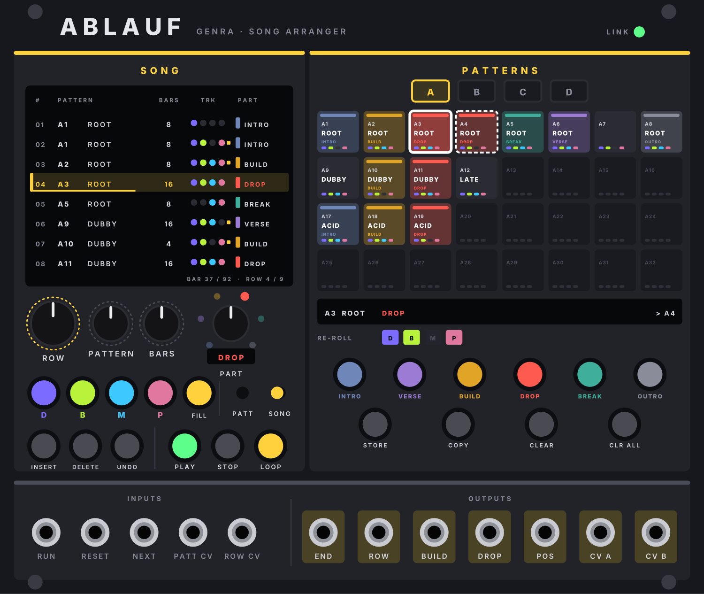

Song-Arranger für GENRA, 30 HP. Verbindung wie beim Grid Editor: links oder rechts neben GENRA setzen (LINK-LED leuchtet) oder im Rechtsklick-Menü *Verbinden mit…* ein beliebiges GENRA im Patch wählen.

**Patterns (rechts):** 128 Plätze in den Banks A–D, je 8 × 4 Pads. Ein **leeres Pad antippen** speichert, was GENRA gerade spielt (alle Spuren, Akkorde, Spur-Genres, Länge). **STORE**, dann ein Pad: dasselbe, überschreibt aber auch einen belegten Platz. **COPY**: erst Quelle, dann Ziel. **CLEAR**, dann ein Pad: löscht den Platz. **CLR ALL** zweimal drücken: leert alle 128 Pads (die Song-Liste bleibt, UNDO holt sie zurück). Einzelne Banks leeren: Rechtsklick › Clear bank A–D. Im Modus **PATT** spielt ein angetipptes Pad ab dem nächsten Takt (bei gestopptem GENRA sofort). Die Pads haben die Farbe ihres Song-Teils; die kleinen Balken zeigen, welche Spuren etwas spielen. Weisser Rahmen = läuft, gestrichelt = kommt am nächsten Takt. Rechtsklick aufs Pad: umbenennen, Abschnitt setzen, in den Song einfügen, löschen.

**Namen:** Jedes Pad kann einen Namen tragen (bis 8 Zeichen, A–Z, 0–9, Leerzeichen, -). Das allererste Pattern, das du speicherst, heisst automatisch **ROOT**. Varianten aus den Teil-Tastern erben den Namen ihres Ausgangs-Patterns, COPY nimmt ihn mit; ein neu gespeichertes anderes Pattern hat zunächst keinen. Umbenennen: Rechtsklick aufs Pad › Namen tippen, Enter (UNDO macht es rückgängig); *Clear name* entfernt ihn. Der Name steht auf dem Pad, in der Song-Liste und in der Zeile unter den Pads.

**Varianten: „das Pattern ist super – mach mir ein Intro“.** Ein Taster pro Song-Teil (INTRO, VERSE, BUILD, DROP, BREAK, OUTRO) macht aus dem laufenden Pattern eine Variante auf dem nächsten freien Pad und spielt sie zum Anhören ab. Jeder weitere Druck legt eine neue Variante auf das nächste freie Pad (die vorige bleibt), immer aus dem ursprünglichen Pattern – auch die anderen Teile kommen aus diesem, solange eine seiner Varianten läuft. Ist die Bank voll, geht es in den folgenden Banks weiter; sind alle 128 Pads belegt, steht ein Hinweis in der Zeile unter den Pads. **RE-ROLL D B M P** wählt, welche Spuren neues Material bekommen; die anderen bleiben exakt (so bleiben die Teile verwandt). Akkorde bleiben immer gleich.
- **INTRO:** Drums sparsam (Snare/Clap erst ab der Hälfte, Hats auf Achteln, Toms/Perc weg, leise beginnend), Bass setzt zur Hälfte mit Grundtönen ein, Melodie dünn, Pads präsenter.
- **VERSE:** Groove etwas leichter, Melodie lässt Platz (bleibt generiert, folgt den Reglern).
- **BUILD:** Snare-Wirbel Viertel → Achtel → 16tel → 32tel, lauter werdend, 16tel-Hats in der zweiten Hälfte; im letzten Takt Kick auf Vierteln und eine Lücke auf dem letzten Schlag, der Bass fällt weg, die Melodie im letzten Viertel eine Oktave höher.
- **DROP:** dichter, Bass auf der Eins (bleibt generiert, folgt den Reglern).
- **BREAK:** keine Kick, leise Hats, lange Grundtöne im Bass, Pads im Vordergrund, kurzer Snare-Auftakt am Ende.
- **OUTRO:** dünnt Takt für Takt aus, im letzten Takt nur noch Kick (und Pads).

INTRO, BUILD, BREAK und OUTRO werden als exakte Noten gebaut (auch im Grid Editor bearbeitbar); VERSE und DROP bleiben generiert und bringen nur Dichte-Versätze mit, die zu GENRAs Reglern addiert werden, solange das Pattern läuft.

**Song (links):** eine Liste von Zeilen: Pattern · Takte · Spuren (D B M P an/aus) · Fill · Abschnitt. Pad antippen, dann **INSERT**: neue Zeile nach der gewählten, mit Länge und Abschnitt des Pads. **ROW** wählt die Zeile (oder Klick in die Liste, Mausrad), **PATTERN**, **BARS** (1–32) und **PART** (Farbskala um den Regler) ändern sie, die farbigen Taster schalten Spuren der Zeile stumm, **FILL** setzt einen Fill am Ende der Zeile. **DELETE** entfernt die Zeile, **UNDO** macht Schritte rückgängig (auch Strg+Z). Rechtsklick auf eine Zeile: CV A / CV B, duplizieren, löschen. Im Modus **SONG** startet **PLAY** ab der gewählten Zeile, GENRA wechselt taktgenau. **STOP** lässt die Markierung auf der Zeile stehen, die gerade lief; **STOP** ein zweites Mal setzt sie an den Song-Anfang; **LOOP** wiederholt den Song, sonst stoppt er am Ende.

**Eingänge:** RUN (Trigger: Play/Stop), RESET (Song an den Anfang), NEXT (nächste Zeile bzw. nächstes Pattern am nächsten Takt), PATT CV (0–10 V über die 128 Plätze, Pattern-Modus), ROW CV (0–10 V über die Song-Liste, springt am nächsten Takt).
**Ausgänge:** END (Trigger am Song-Ende und beim Wiederholen), ROW (Trigger bei jeder neuen Zeile), BUILD und DROP (Gates, solange ein Build bzw. Drop läuft – auch im Pattern-Modus), POS (Song-Position 0–10 V), CV A / CV B (Werte der laufenden Zeile).

GENRA zeigt im Display den laufenden Song-Teil, seine MUTE-Lampen leuchten gedimmt für Spuren, die ABLAUF stummschaltet.

---

## STOTTER: Performance-Effekte

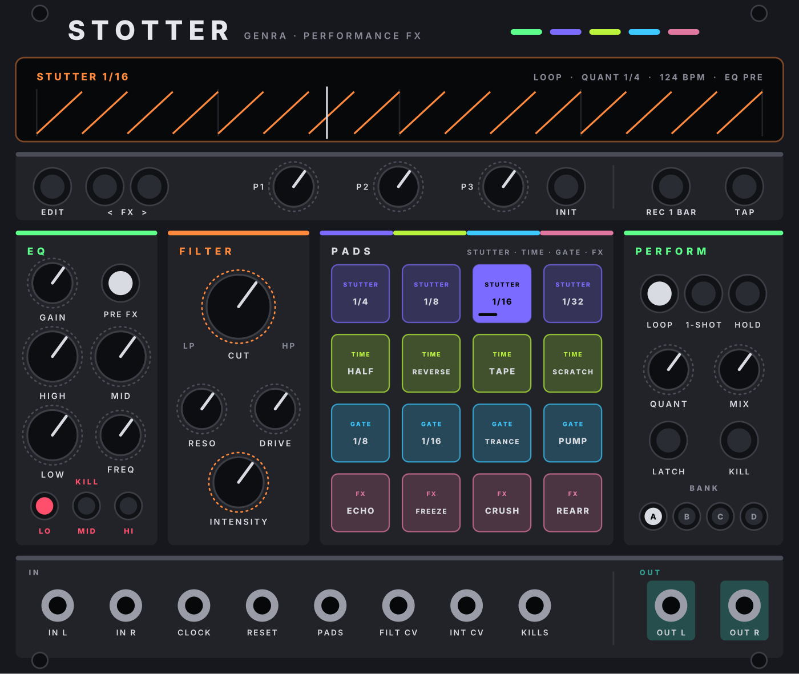

DJ-Effektpad nach dem Perform-Modus des Polyend Play und Akai Flex Beat, 30 HP, im Farbsystem des GENRA-Hauptmoduls.
Stereo-Effekt: z. B. GENRAs Drums oder MIX-Ausgang hinein, CLOCK von GENRA.

- **16 Pads** in vier Reihen (Farben der GENRA-Spuren): STUTTER 1/4 … 1/32 · TIME (Halftime, Reverse, Tape Stop,
  Scratch) · GATE (1/8, 1/16, Trance, Pump) · FX (Echo Out, Freeze, Bitcrush, Rearrange). Jedes Pad spielt ein Muster
  über einen Takt (das Display zeigt es mit Laufbalken). **4 Bänke** A–D, je 16 Pads.
- **PERFORM:** LOOP (läuft bis zum nächsten Pad, dasselbe Pad stoppt), 1-SHOT (ein Takt, dann zurück), HOLD (solange
  gedrückt; LATCH: Druck startet, nächster stoppt), QUANT (Start auf 1/16 … 1 Takt oder sofort), MIX, KILL.
- **EDIT-Streifen:** P1–P3 stellen das laufende Pad ein (mit EDIT: das angetippte, ohne es zu spielen), < > wählen den
  Effekt des Pads, INIT setzt es zurück. Alle Pads werden im Patch gespeichert.
- **EQ** wie ein DJ-Isolator (Linkwitz-Riley, −∞ … +6 dB): GAIN, HIGH, MID, LOW, FREQ (Mitte 200 Hz … 5 kHz), KILL LO/MID/HI,
  PRE FX (vor oder nach den Effekten). **FILTER:** links Tiefpass, rechts Hochpass, Mitte aus; RESO, DRIVE, INTENSITY
  (100 %: Pads wie eingestellt, weniger: weicher, mehr: härter).
- **REC 1 BAR:** nimmt den nächsten Takt auf und spielt ihn statt des Eingangs als Loop. **TAP** ohne Clock.
- **Eingänge:** IN L/R, CLOCK, RESET (Auflösung im Menü wie GENRA), PADS (poly Gates, Kanal 1 = Pad 1), FILT CV, INT CV,
  KILLS (poly: Low, Mid, High). **MIDI** im Rechtsklick-Menü: Noten C1–D#2 spielen die Pads, MIDI learn.

---

## Follow GENRA: verbinden ohne Kabel

Alle Instrumente mit GENRA-Leiste (MONO, K-WASUB, FUNKE, SCHMELZ, UMLAUF, MONK, VOICE, ANIMAL, DRUM-X) können eine GENRA-Spur ohne Kabel übernehmen: **Rechtsklick › Follow GENRA** › Bass, Melody oder Pad (DRUM-X: Drums). Darunter wählst du, welches GENRA („Automatic“ nimmt das einzige bzw. erste im Patch). Dann kommen V/OCT, GATE, VEL, ACC, SLIDE, MOD sowie CLOCK und RESET direkt von GENRA, soweit das Instrument die Buchse hat und die Spur das Signal liefert (MOD nur bei Pad, ACC/SLIDE nur bei Bass und Melody).

- **Die Leiste zeigt es an:** Die Linie über den Buchsen ist gedimmt gedruckt. Kommt ein Signal von GENRA, leuchtet das Segment über dieser Buchse in der Spurfarbe (CLOCK/RESET weiss) und flackert bei jeder Note kurz auf.
- **Ein Kabel hat immer Vorrang:** Steckt ein Kabel in einer Buchse, gilt das Kabel, das Segment darüber geht aus. Alle Buchsen bleiben, andere Sequenzer und Module funktionieren wie bisher.

**MIX:** **Rechtsklick › CH 1–4 input from** › Off, **Auto** oder ein Instrument aus dem Patch (auch STOTTER). „Auto“ nimmt das Instrument, das der Spur des Kanals folgt (CH 1 Drums, CH 2 Bass, CH 3 Melody, CH 4 Pad). Der Name der Quelle steht dann im Kanal statt „CH n“; steckt ein Kabel in IN L/R, wird er dunkel mit „CABLE“. **DUCK from › GENRA KICK** lässt DUCK ohne Kabel der Kick folgen. Die Verbindung klingt wie ein Kabel (auch ein Kabel verzögert in Rack um ein Sample); Effekte dazwischen (z. B. STOTTER) werden wie gewohnt verkabelt oder im MIX als Quelle gewählt.

## Instrumente

Das passende Set zu GENRA: **GENRA MONO** oder **K-WASUB** für den Bass, **FUNKE** für die Melodie, **SCHMELZ** für die Pads, **DRUM-X** für die Drums – zusammengeführt im **MIX**. Dazu weitere Stimmen: VOICE, ANIMAL, MONK und UMLAUF.

**Die GENRA-Leiste (ab 2.13.0):** Jedes Instrument nimmt GENRAs Spur-Ausgänge an derselben Stelle auf – unten links, gleich beschriftet, in derselben Reihenfolge: **V/OCT · GATE · VEL · ACC · SLIDE · MOD** auf einer Fläche mit einer Linie in der Spurfarbe, rechts daneben **CLOCK · RESET** (graue Linie). Was ein Instrument nicht braucht, lässt es weg; die Reihenfolge bleibt. Alle Buchsen sind normale Ein- und Ausgänge, also auch mit anderen VCV-Modulen nutzbar. Neu dafür: MOD an SCHMELZ (auf Crescendo, Animate oder Tone, Rechtsklick-Menü), ACC und SLIDE an K-WASUB, RESET an FUNKE, DRUMS-Eingang an DRUM-X; bei MONO heissen SYNC und RETRIG jetzt CLOCK und RESET, bei FUNKE VIB jetzt MOD. Alle Module haben dieselben dunklen Regler (`res/knob/`).

> SCHMELZ, MIX, K-WASUB und UMLAUF entstanden im eigenen Repo `CamilloGF/vcv-synthis` (Plugin GENRA SYNTHIS) und sind seit 2.6.0 Teil des GENRA-Plugins. Ihre Modul-Slugs sind gleich geblieben; Patches, die sie aus dem GENRA-SYNTHIS-Plugin geladen haben, müssen sie neu einsetzen. Das GENRA-SYNTHIS-Plugin am besten deinstallieren, sonst stehen die Module doppelt im Browser.

### GENRA MONO: Bass-Synth nach dem Moog Minitaur

| | |
|---|---|
| 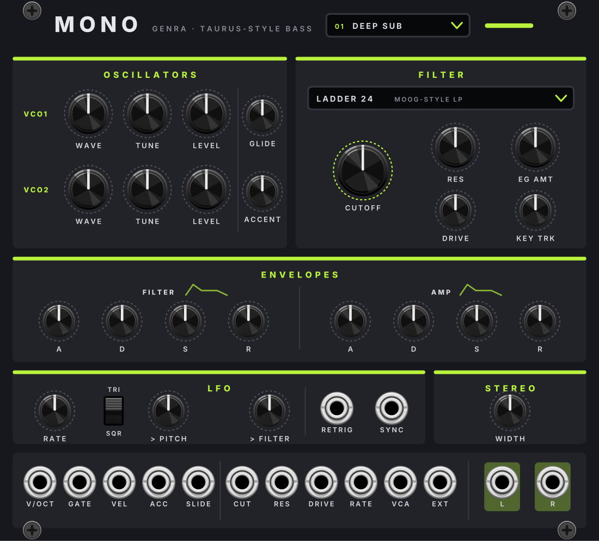 | 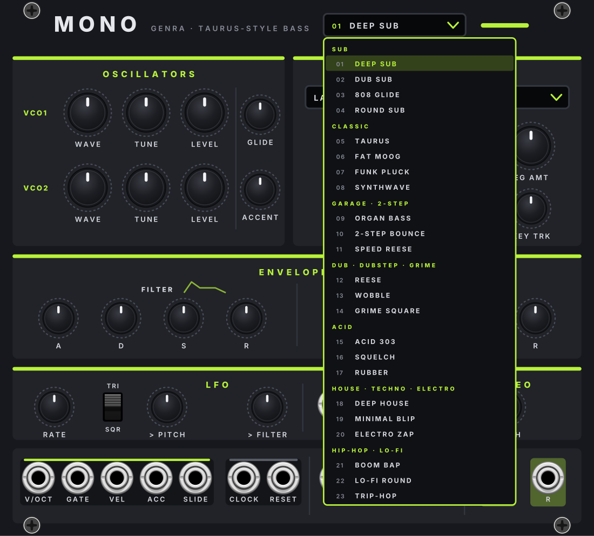 |

Monophoner Synth (28 HP, Stand 2.10.0) im Look von MONK und den JIANT-Stimmen, Farbe **säuregrün** (GENRAs Bass-Farbe, wie K-WASUB).

- **Oszillatoren:** pro VCO WAVE (stufenlos Dreieck → Sägezahn → Rechteck → schmaler Puls), TUNE (±12 Halbtöne, fein um die Mitte – zum leichten Verstimmen) und LEVEL (hohe Pegel übersteuern das Filter); GLIDE; ACCENT (wie stark ACC wirkt).
- **Filter:** Klick auf das Feld öffnet die Liste, das Mausrad blättert: LADDER 24 (Moog, Standard, Bass bleibt bei Resonanz erhalten), LADDER 12, DIODE (303), MS-20, SVF LP/BP/HP (Oberheim SEM), OTA (Juno). CUTOFF, RES, EG AMT (bipolar), DRIVE, KEY TRK.
- **Hüllkurven:** Filter- und Amp-ADSR mit analogen Kurven (1 ms … 10 s).
- **LFO:** RATE (0,05–50 Hz), TRI/SQR, Stärke auf Tonhöhe und Filter. **RESET** (früher RETRIG) startet die Welle neu (z. B. GENRAs GATE). **CLOCK** (früher SYNC): Steckt eine Clock, läuft der LFO im Takt und RATE wählt den Notenwert (4 Takte … 1/32, auch punktiert und triolisch, im Tooltip); Clock-Auflösung im Rechtsklick-Menü, Standard 16tel wie GENRA.
- **STEREO:** WIDTH verteilt die beiden VCOs leicht nach links und rechts und legt einen feinen Chorus auf die Höhen; unter 150 Hz bleibt der Bass immer mono. Ohne Kabel in R ist L der Mono-Ausgang.
- **Eingänge:** V/OCT (0 V = C4), GATE, VEL, **ACC**, **SLIDE** – in derselben Reihenfolge wie GENRAs Bass-Ausgänge – und CV für CUT (1 V/Okt.), RES, DRIVE, RATE (1 V/Okt.; mit CLOCK: 1 V = 2 Notenwerte), VCA, EXT (externes Audio durchs Filter). **Ausgänge:** L, R.
- **ACC:** Eine akzentuierte Note (ACC beim Notenstart über 1 V) wird lauter und bekommt mehr Filterhüllkurve, wie bei der 303. **SLIDE:** Ist der Eingang gesteckt, gleitet MONO nur, solange SLIDE anliegt (Gleitzeit GLIDE, bei 0 eine kurze 303-Gleitzeit); die Hüllkurven starten dabei nicht neu, weil GENRA das Gate offen hält. Ohne Kabel wirkt GLIDE wie bisher auf jede Note.
- Oszillatoren und Filter laufen mit 2-facher Überabtastung.
- **Presets (ab 2.9.0):** Feld oben im Kopf – Klick öffnet die Liste, das Mausrad blättert. 23 Werks-Presets nach Stil (SUB, CLASSIC, GARAGE · 2-STEP, DUB · DUBSTEP · GRIME, ACID, HOUSE · TECHNO · ELECTRO, HIP-HOP · LO-FI). Ein grüner Punkt hinter dem Namen zeigt, dass seit dem Laden ein Regler bewegt wurde. Eigene Presets: Rechtsklick → *Save preset as …* (Name, Enter), sie liegen in `Rack2/Genra/MonoPresets/` und erscheinen unter USER.

### K-WASUB: Modern-Bass-Synth (Firmware von Omnipotard)

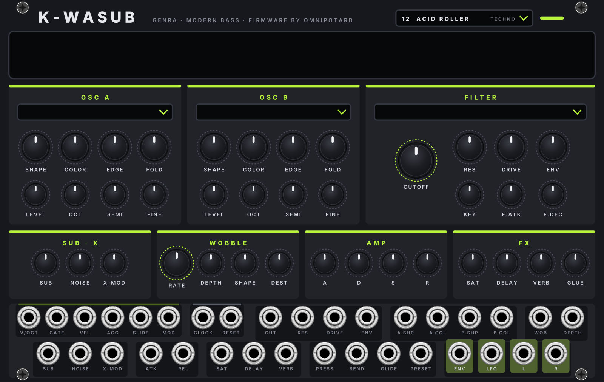

Die Firmware [K-WASUB](https://github.com/Guizmoh/K-WASUB_Firmware_for_FM1) für den M-VAVE FM-1 von Omnipotard (GPL-3.0)
als Modul, 40 HP, Farbe **säuregrün**. Der Klang ist die Original-Firmware, unverändert (`kwasub/`): Sie läuft als
eigene kleine Bibliothek (`res/kwcore.*`, eine Kopie pro Modul) mit 44,1 kHz, das Modul rechnet auf die Rack-Rate um.

- **OSC A / OSC B:** ENGINE-Feld (Klick = Liste, Mausrad): ANALOG, 808, CS, WAVETABLE, FM, GROWL, ADDITIVE, PHASE DIST,
  HARD SYNC. SHAPE, COLOR, EDGE, FOLD sind die vier Klangregler der Engine (was sie bei der gewählten Engine heissen
  und welchen Wert sie haben, steht im Display und im Tooltip), LEVEL, OCT, SEMI, FINE.
- **FILTER:** Typ-Feld (LP 24, LP 12, BAND, HIGH, NOTCH, VOWEL, COMB), CUTOFF, RES, DRIVE, ENV, KEY, Filterhüllkurve.
- **SUB · X:** Sub, Rauschen, X-Mod · **WOBBLE:** LFO 1 im Tempo (RATE = Notenwert), DEPTH, SHAPE, DEST ·
  **AMP:** ADSR · **FX:** SAT, DELAY, VERB, GLUE (schalten ihren Effekt ein).
- **Presets:** das Feld im Kopf wie bei GRUND, FUNKE und SCHMELZ: Nummer, Name, Stil, ein Punkt, sobald ein Regler
  verstellt ist. Klick (auch auf den Namen im Display) öffnet die 97 Werksklänge nach Stil (DNB, DUB, DUBSTEP …, je ein
  Untermenü, Namen A–Z), das Mausrad blättert in dieser Reihenfolge; Laden lässt sich rückgängig machen. Eigene Presets
  per Rechtsklick (*Save preset as …*, löschen, Ordner `Rack2/Genra/KwasubPresets`): Sie speichern den ganzen Klang,
  auch was kein Regler zeigt, samt den Werten von K-WASUB FX.
- **Eingänge:** V/OCT, GATE, VEL (bis 4 Stimmen, auf Halbtöne gerundet), CLOCK (setzt das Tempo; Standard 16tel wie
  GENRA, im Menü 8tel, Viertel, 24 PPQN), RESET (Taktanfang), CV für CUT, RES, DRIVE, ENV, A/B SHAPE und COLOR, WOB,
  DEPTH, PRESET (0–10 V über alle Presets), SUB, NOISE, X-MOD, ATK, REL, SAT, DELAY, VERB, GLIDE; MOD (Modrad),
  PRESS (Druck), BEND (±5 V). **Ausgänge:** ENV, LFO, L, R.
- Rechtsklick: Presets (Liste, speichern, löschen, Ordner), Stimmen (Mono, Legato, Poly), Clock-Auflösung. Der ganze Klang wird im Patch gespeichert,
  auch was kein Regler zeigt (LFO 2, Matrix, OSC C …).

### K-WASUB FX: Effekt-Expander

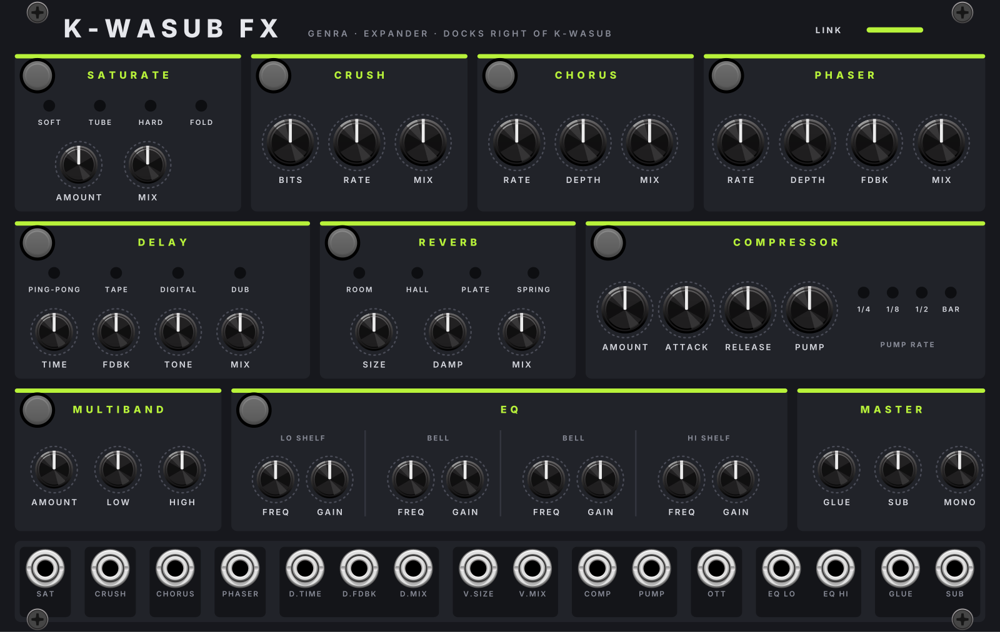

Rechts neben K-WASUB setzen (LINK leuchtet): alle Einstellungen des Effekt-Racks der Firmware. SATURATE (Typ, Amount,
Mix), CRUSH, CHORUS, PHASER, DELAY (Typ, Zeit im Tempo, Feedback, Ton, Mix), REVERB (Typ, Grösse, Dämpfung, Mix),
COMPRESSOR (mit PUMP und PUMP RATE), MULTIBAND, EQ (4 Bänder), MASTER (Glue, Sub-Boost, Mono-Bass). Jeder Block mit
EIN-Taster; 16 CV-Eingänge, nach Effekt gruppiert. Regler, die es auf beiden Panels gibt (SAT, DELAY, VERB, GLUE),
folgen einander. Ohne Expander gelten die Effekte des Presets.

### FUNKE: Melodiestimme

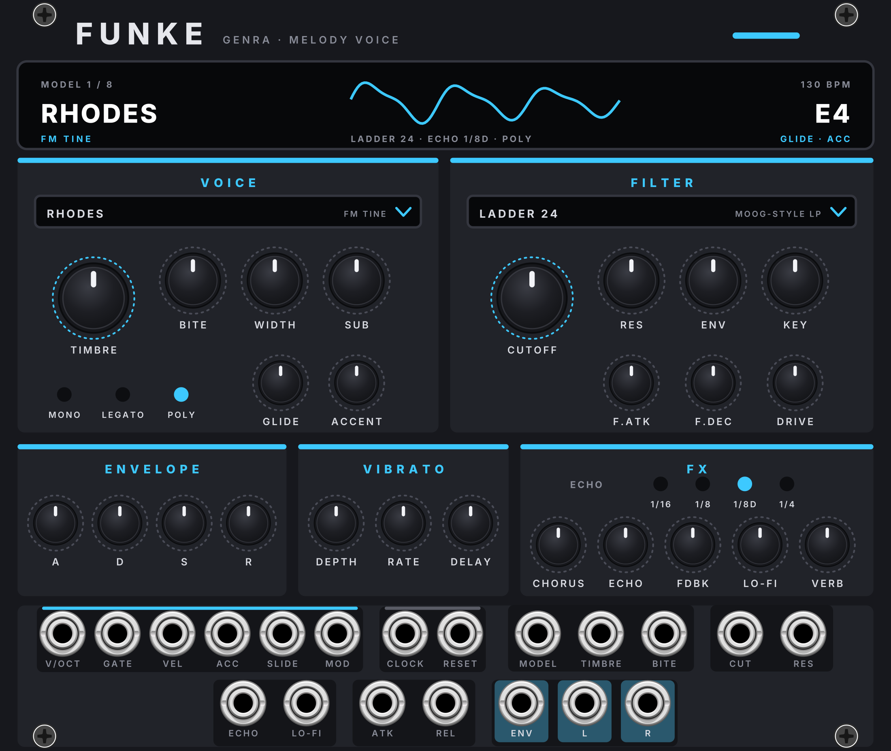

Die Stimme für GENRAs Melodiespur, 30 HP, Farbe **cyan** (GENRAs Melodiefarbe). Die Eingänge passen zu GENRAs
Melodie-Ausgängen: V/OCT, GATE, VEL, ACC, SLIDE und CLOCK.

- **MODEL** (Feld: Klick öffnet die Liste, Mausrad blättert; CV-Eingang, übernommen bei jeder neuen Note):
  RHODES (FM-Tine) · ORGAN (Zugriegel, M1) · BELL (FM-Glocke) · MARIMBA · PLUCK (Karplus-Strong) · SQUARE (Puls,
  Grime) · SAW LEAD (drei verstimmte Sägen) · FLUTE (Sinus mit Atem).
- **TIMBRE / BITE** je nach Modell, z. B. Rhodes: Helligkeit und Bark der Tine / Hammeranschlag; Square: Pulsbreite /
  Tonhöhen-Blip im Anschlag; Pluck: Saite hell und lang / Anschlag hell. Der Tooltip nennt die Bedeutung fürs aktuelle Modell.
- **WIDTH** (Stereobreite), **SUB** (Sinus eine Oktave tiefer), **MONO · LEGATO · POLY** (8 Stimmen; bei POLY
  klingen auch mit einem einzelnen GENRA-Kabel die Ausklänge übereinander).
- **GLIDE** auf GENRAs SLIDE (ohne SLIDE-Kabel in MONO/LEGATO auf jeder Note, LEGATO auch zwischen gehaltenen Noten),
  **ACCENT**: was ACC bewirkt (lauter, mehr Filterhüllkurve, mehr Biss).
- **FILTER:** die acht Filter von GENRA MONO (LADDER 24/12, DIODE, MS-20, SVF LP/BP/HP, OTA) im Feld wie bei MONO,
  CUTOFF, RES, ENV (bipolar), KEY, eigene Filterhüllkurve F.ATK/F.DEC, DRIVE.
- **ENVELOPE** ADSR, **VIBRATO** DEPTH/RATE/DELAY (setzt nach DELAY langsam ein).
- **FX:** LO-FI (Bandeiern, weniger Bits und Samples), CHORUS, ECHO im Takt (1/16, 1/8, 1/8D, 1/4 von CLOCK; ohne
  Clock 120 BPM; Pingpong, FDBK), VERB. CLOCK-Auflösung im Kontextmenü (Standard 16tel wie GENRA).
- **CV:** MODEL, TIMBRE, BITE, CUT (1 V/Okt.), RES, MOD (Vibrato-Tiefe wie ein Modrad, früher VIB), RESET (Tempo neu messen), ECHO, LO-FI, ATK, REL.
  **Ausgänge:** ENV (Hüllkurve der neuesten Note), L, R (nur L gesteckt: mono).
- **Presets:** 26 ab Werk nach Stil (Feld oben rechts, Klick = Liste, Mausrad blättert, Punkt = verändert), eigene
  über Rechtsklick → Save preset as … (`Rack2/Genra/FunkePresets`), dort auch Delete user preset und Open user preset
  folder. Laden lässt sich rückgängig machen; der Patch merkt sich den Namen.

| Stil | Presets (Modell) |
|---|---|
| SOUL · JAZZ · LO-FI | CLASSIC RHODES (RHODES) · NEO SOUL KEYS (RHODES) · LO-FI KEYS (RHODES) · JAZZ ORGAN (ORGAN) · VIBES (MARIMBA) |
| HOUSE · GARAGE | M1 ORGAN (ORGAN) · GARAGE BELL (BELL) · DEEP CHORD STAB (SAW LEAD) · FILTER HOUSE STAB (SAW LEAD) |
| DUB · REGGAE | DUB SKANK (ORGAN) · DUB MELODICA (FLUTE) |
| TECHNO · ELECTRO | ACID LEAD (SQUARE) · HYPNOTIC BLIP (MARIMBA) · DETROIT STRINGS (SAW LEAD) · DUB TECHNO STAB (SAW LEAD) · ELECTRO ZAP (SQUARE) |
| GRIME · DUBSTEP · DRILL | GRIME PULSE (SQUARE) · DRILL BELL (BELL) · DUBSTEP PLUCK (PLUCK) |
| POP · SYNTHWAVE · TRANCE | SUPERSAW (SAW LEAD) · 80S POLY (SAW LEAD) · KALIMBA (PLUCK) · FLUTE SOLO (FLUTE) |
| AMBIENT | AMBIENT BELLS (BELL) · SPACE RHODES (RHODES) · AIR PAD (FLUTE) |

### GRUND: Bassstimme

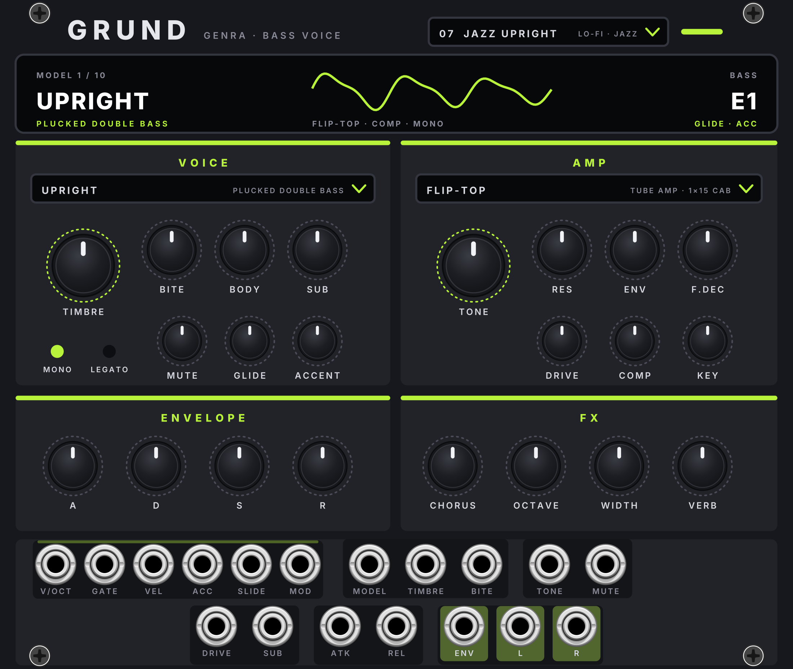

Die Stimme für GENRAs Bassspur, 30 HP, Farbe **grün** (GENRAs Bassfarbe). Eingänge wie bei FUNKE: V/OCT, GATE, VEL,
ACC, SLIDE, MOD; ohne Kabel über Rechtsklick → Follow GENRA → Bass.

- **MODEL** (Feld, Klick = Liste, Mausrad blättert; CV): UPRIGHT (Kontrabass gezupft) · ARCO (Kontrabass gestrichen) ·
  FINGER (E-Bass mit Fingern) · PICK (Plektrum) · SLAP (Daumen und Pop) · FRETLESS (mit „Mwah“) · SYNTH (Säge/Puls) ·
  REESE (verstimmte Sägen) · FM (2-Op, DX-Bass) · 808 (Sinus mit Pitch-Drop). Saiten als Karplus-Strong-Modell.
- **TIMBRE / BITE** je nach Modell (Tooltip), **BODY** (Holz, Box), **SUB** (Oktave tiefer), **MUTE** (Handballen:
  kürzer, trockener), **MONO · LEGATO**, **GLIDE** auf SLIDE, **ACCENT** (bei SLAP: Pop).
- **AMP:** DI · FLIP-TOP · STACK · FUZZ (Feld), TONE (Tiefpass), RES, F.ENV/F.DEC, DRIVE, COMP, KEY.
- **ENVELOPE** ADSR. **FX:** CHORUS, OCTAVE (Oktaver), WIDTH (nur die Höhen), VERB.
- **Presets:** 30 ab Werk nach Stil (Feld oben rechts, Klick = Liste, Mausrad blättert, Punkt = verändert),
  eigene über Rechtsklick → Save preset as … (`Rack2/Genra/GrundPresets`). Presets speichern auch die FX-Einstellungen.
- **CV:** MODEL, TIMBRE, BITE, CUT (1 V/Okt.), MUTE, DRIVE, SUB, ATK, REL. **Ausgänge:** ENV, L, R (nur L: mono).

| Stil | Presets (Modell) |
|---|---|
| FUNK · SOUL · DISCO | MOTOWN P-BASS (FINGER) · FUNK SLAP (SLAP) · DISCO PICK (PICK) · FRETLESS SING (FRETLESS) |
| JAZZ · LO-FI · TRIP-HOP | JAZZ UPRIGHT (UPRIGHT) · WALKING BASS (UPRIGHT) · LO-FI FINGER (FINGER) · ARCO DARK (ARCO) |
| DUB · REGGAE | DUB ROOTS (FINGER) · STEPPERS SUB (SYNTH) |
| HOUSE · GARAGE | DEEP HOUSE (SYNTH) · ORGAN BASS (FM) · 2-STEP SUB (808) |
| TECHNO | TECHNO ROLL (SYNTH) · RUMBLE (808) · HARD RUMBLE (808) · HYPNOTIC PLUCK (SYNTH) · OFFBEAT SUB (SYNTH) · DUB TECHNO (SYNTH) · INDUSTRIAL (FM) |
| DRUM'N'BASS · JUNGLE | REESE (REESE) · NEURO REESE (REESE) · JUNGLE SUB (808) |
| HIP-HOP · TRAP · DRILL | 808 BOOM (808) · DRILL SLIDE (808) · BOOM BAP (UPRIGHT) |
| DUBSTEP · GRIME | GRIME SQUARE (SYNTH) · GROWL (FM) |
| ROCK · POP | ROCK PICK (PICK) · 80S DX BASS (FM) |

### GRUND FX: Effekt-Expander

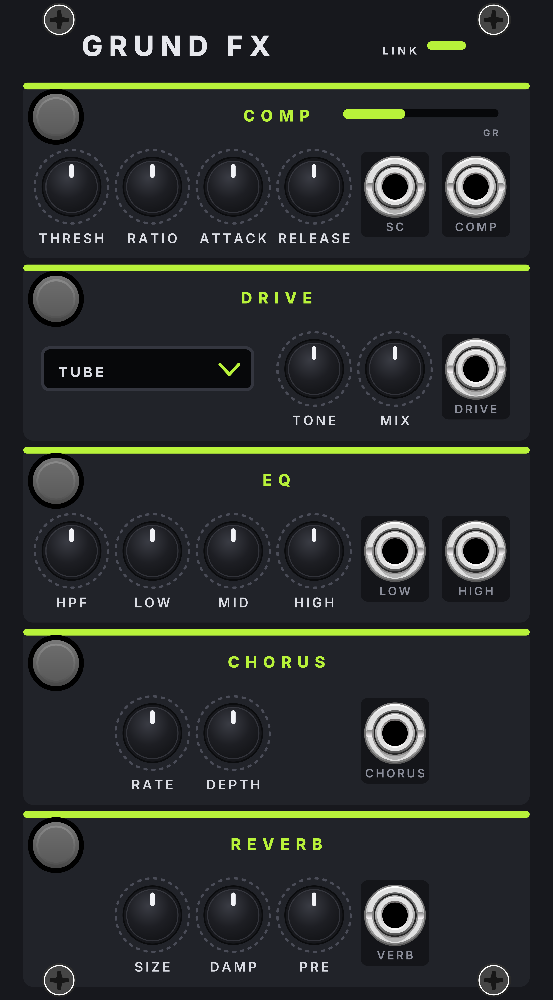

14 HP, rechts an GRUND andocken (LINK leuchtet). Fünf Sektionen, jede mit Ein/Aus-Taster und ihrem CV-Eingang direkt
in der Sektion: **COMP** (THRESH, RATIO, ATK, REL, Sidechain-Eingang SC: eine Kick duckt den Bass, GR-Anzeige) ·
**DRIVE** (TUBE, FET, FUZZ, CRUSH; TONE, MIX) · **EQ** (HPF 20–200 Hz, LOW, MID, HIGH ±12 dB) · **CHORUS** (RATE,
DEPTH) · **VERB** (SIZE, DAMP, PRE). Chorus und Reverb wirken standardmässig nur auf die Höhen (Kontextmenü), der Bass
bleibt mono. Die Einstellungen gehören zu GRUND: Ohne Expander klingen die Presets gleich, beim Andocken übernimmt der
Expander GRUNDs Werte.

### SCHMELZ: String Machine

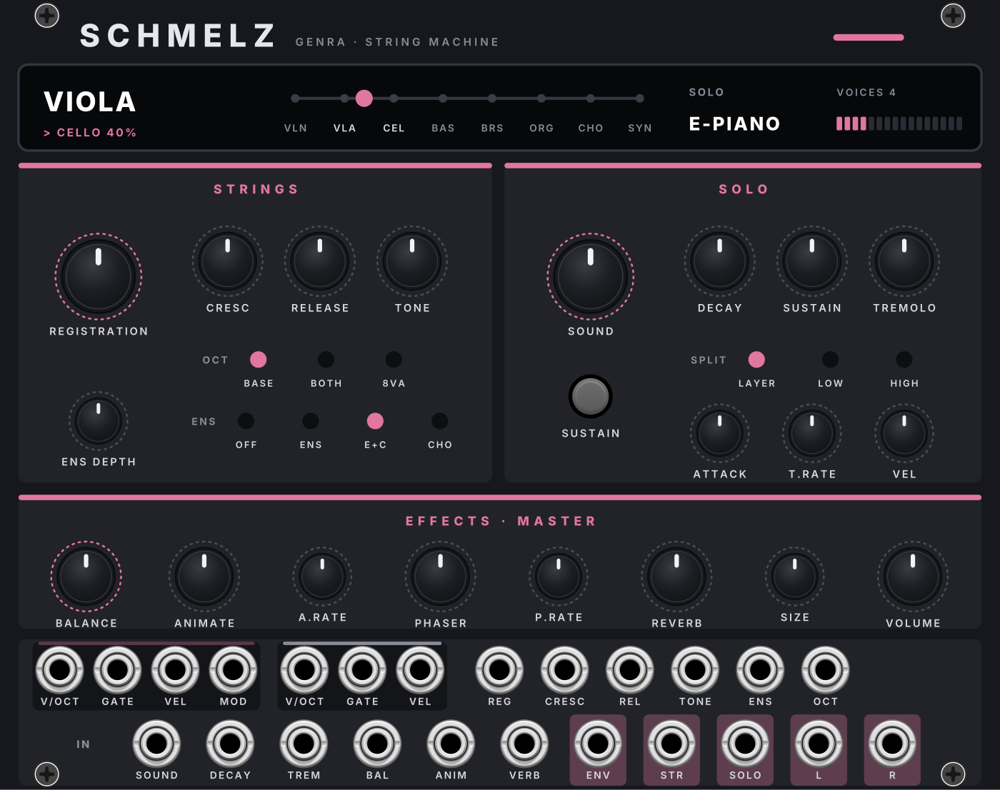

String Machine im Geist der 70er/80er (Vorbild: Waldorf Streichfett), 32 HP, Farbe **rosa** (GENRAs Pad-Farbe). Zwei Klangteile, je bis
16 Stimmen, dazu Effekte.

- **Strings:** REGISTRATION überblendet stufenlos BASS · CELLO · VIOLA · VIOLIN · BRASS · ORGAN · CHOIR · SYNTH (ab 2.17
  von tief nach hoch; vorher stand BASS in der Mitte).
  CRESC (Einschwingen 3 ms … 6 s), RELEASE (10 ms … 8 s), TONE (dunkel … hell). OCT: BASE · BOTH · 8VA.
  ENS: OFF · ENS (Ensemble, drei modulierte Verzögerungen wie bei den String-Ensembles) · E+C (Ensemble + Chorus) ·
  CHO (Chorus); ENS DEPTH.
- **Solo:** SOUND überblendet BASS · E-PIANO · CLAVI · SYNTH · BELL. ATTACK, DECAY (zugleich Release), SUSTAIN,
  TREMOLO mit T.RATE (Stereo), VEL (Anschlagsempfindlichkeit), SUSTAIN-Taster (hält die Solo-Noten wie ein Pedal).
  SPLIT (LAYER · LOW · HIGH, Splitpunkt C4) gilt, wenn das Solo über die Strings-Eingänge spielt.
- **Effects · Master:** BALANCE Strings/Solo, ANIMATE (LFO bewegt die Registration) mit A.RATE, PHASER (nur Strings)
  mit P.RATE, REVERB mit SIZE, VOLUME.
- **Eingänge:** Strings V/OCT, GATE, VEL · Solo V/OCT, GATE, VEL (alle polyphon; ohne Solo-GATE spielt das Solo die
  Strings-Noten) · CV für REG (polyphon, pro Stimme), CRESC, REL, TONE, ENS, OCT, SOUND, DECAY, TREM, BAL, ANIM, VERB
  (0–10 V zum Regler addiert; ENS und OCT schalten in Stufen).
- **Ausgänge:** ENV (Strings-Hüllkurve, polyphon, 0–10 V), STR (Strings mit Ensemble, ohne Phaser/Hall), SOLO
  (trocken), L, R.
- **Mit GENRA:** PADS (V/OCT + GATE, poly) → Strings, MELODY → Solo, MOD → REG oder ANIM.
- **Presets:** 25 ab Werk nach Stil, wie bei FUNKE und GRUND (Feld oben rechts; eigene in `Rack2/Genra/SchmelzPresets`).

| Stil | Presets (Registration) |
|---|---|
| STRING MACHINE CLASSICS | SOLINA DREAM (VIOLIN) · CRUMAR STRINGS (VIOLA) · ANALOG CELLO (CELLO) · STRING + BRASS (VIOLIN) · PHASED STRINGS (VIOLIN) |
| HOUSE · GARAGE · DISCO | DISCO STRINGS (VIOLIN) · DEEP HOUSE PAD (ORGAN) · GARAGE CHORDS (ORGAN) · PIANO HOUSE STAB (ORGAN) |
| AMBIENT · LO-FI · TRIP-HOP | AMBIENT CLOUD (CHOIR) · LO-FI TAPE PAD (VIOLA) · TRIP-HOP NOIR (CELLO) · EP + STRINGS (VIOLA) · GLASS CHOIR (CHOIR) |
| TECHNO · DUB TECHNO | DUB TECHNO CHORD (SYNTH) · DETROIT PAD (SYNTH) · DARK DRONE (BASS) · HYPNOTIC SWEEP (CHOIR) |
| DUB · REGGAE | DUB ORGAN PAD (ORGAN) |
| GRIME · DRILL · DUBSTEP | GRIME STRINGS (VIOLIN) · DRILL CHOIR (CHOIR) |
| POP · SYNTHWAVE · TRANCE | SYNTHWAVE PAD (SYNTH) · TRANCE SWELL (SYNTH) · CINEMATIC (CELLO) · ANALOG BRASS (BRASS) |

### JIANT-Stimmen: DRUM-X, VOICE, ANIMAL

| VOICE | DRUM-X | ANIMAL |
|---|---|---|
| 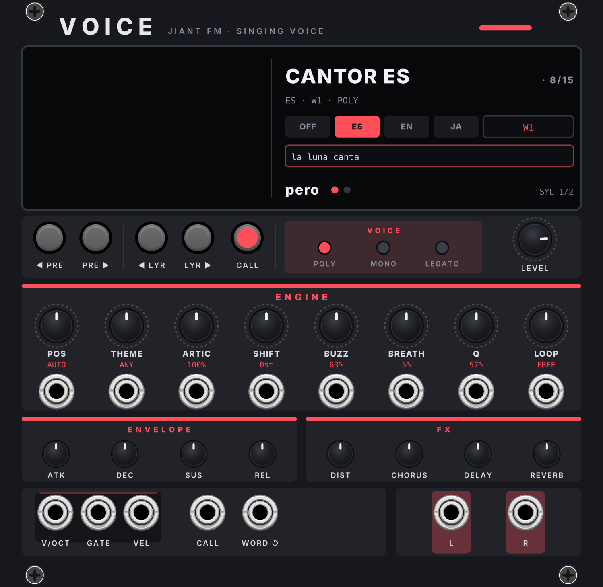 | 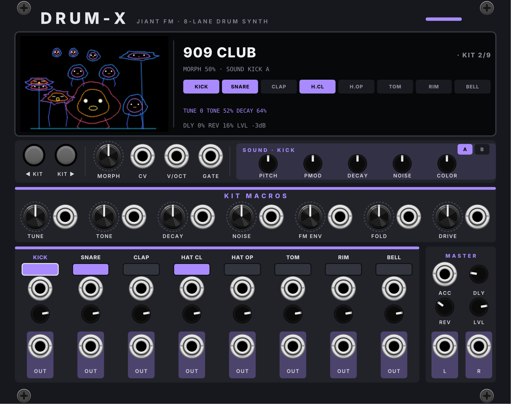 | 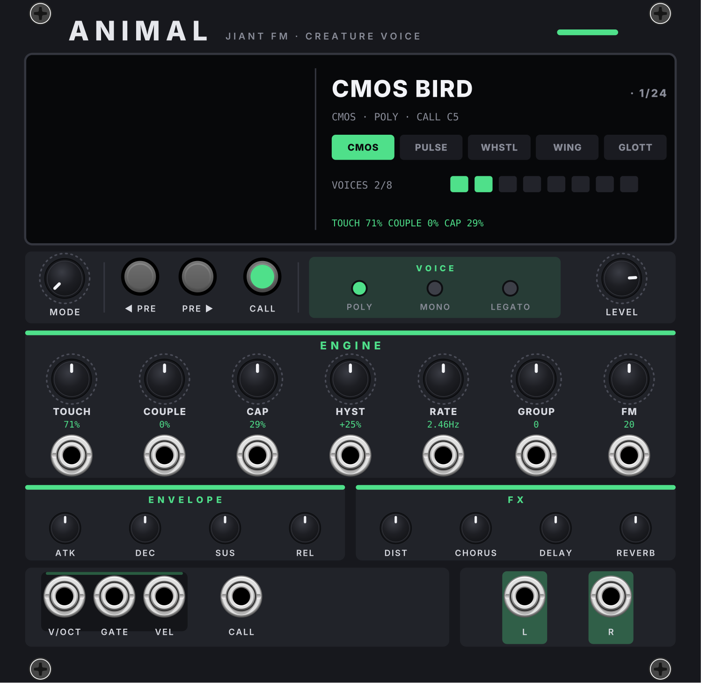 |

Drei Klangerzeuger aus der Firmware von [JIANT FM](https://github.com/juanjiant-bit/JIANT) (Juan Jiant, ein Fork von [Felucca](https://github.com/hugelton/Felucca), GPL-3.0), im GENRA-Look und jeweils in einer eigenen Farbe: **VOICE rot**, **DRUM-X blau-violett** (GENRAs Drum-Farbe), **ANIMAL grün**. Das Display zeigt links die Zeichnung der Firmware (Vokaltrakt, Kit-Kolonie, Kreatur), rechts Preset bzw. Kit und die Einstellungen.

- **VOICE** (26 HP): Formant-Sänger. ◀ PRE ▶ (15 Presets), LANG im Display (OFF singt Vokale, ES/EN/JA singen Wörter), ◀ LYR ▶ wählt TEXT, W1–W16 oder S1–S8, das Textfeld im Display nimmt einen eigenen Text (bis 63 Zeichen). Jede neue Note singt die nächste Silbe, WORD ↺ startet den Text neu. 8 Klangregler mit CV, ihre Namen wechseln mit LANG.
- **DRUM-X** (32 HP): 8 synthetische Drum-Spuren mit Varianten A/B und MORPH, 9 Kits (◀ KIT ▶). Klick auf Spurname, Pad oder Spur-Chip im Display wählt die Spur für SOUND (PITCH … COLOR, A | B). 7 Kit-Makros mit CV, pro Spur TRIG, LEVEL und Einzelausgang (OUT), V/OCT + GATE nach General MIDI, ACC, DLY, REV, LVL, Mix L/R.
- **ANIMAL** (26 HP): Tierrufe aus physikalischen Modellen. MODE als Regler oder per Klick im Display (CMOS, PULSE, WHSTL, WING, GLOTT), ◀ PRE ▶ (24 Presets), 7 Klangregler mit CV, ihre Namen wechseln mit MODE.
- **Gemeinsam (VOICE, ANIMAL):** CALL spielt einen Ton ohne Kabel (auch per Gate am CALL-Eingang), POLY · MONO · LEGATO per Klick auf die Lampen, Hüllkurve ATK–REL, FX DIST–REVERB, V/OCT, GATE, VEL polyphon, LEVEL und Stereo-Ausgang (nur L gesteckt = Mono).
- Presets bzw. Kits gibt es auch im Rechtsklick-Menü. Alte Patches mit den einzelnen Plugins *JiantVoice*, *JiantDrumX*, *JiantAnimal* finden die Module hier nicht automatisch – dort einmal neu einsetzen.

### MONK: der Sänger aus MONK-1

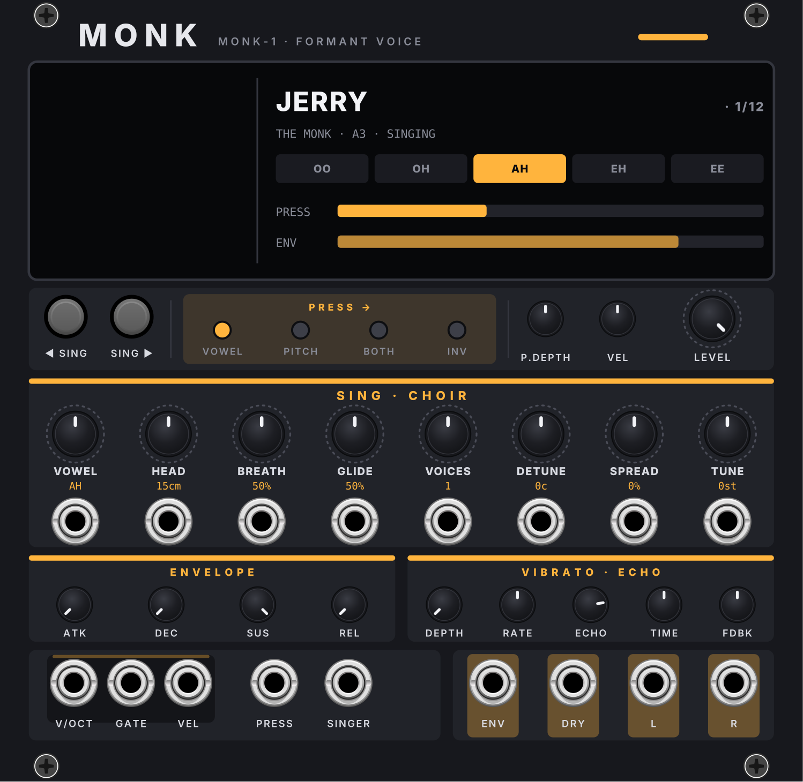

Der Vokal-Synthesizer (26 HP) aus der FM-1-Firmware [MONK-1](https://github.com/charlesvestal/fm1-monk) (Charles Vestal, GPL-3.0), dessen Klang [MonkSynth](https://github.com/JonET/monksynth) ist (Jonathan Taylor, MIT; eine Hommage an Delay Lama). FOF-Formantsynthese: pro Periode ein Korn aus drei abklingenden Formant-Sinus plus Atem, fünf Vokale OO–OH–AH–EH–EE. Farbe: **safran**.

- **Display:** links singt der Sänger, gezeichnet vom Originalcode der Firmware (Mund folgt Vokal und Lautstärke, ohne Ton blinzelt er und probt Vokale), rechts Name, Note, Stimmen, ob die Stimme bearbeitet ist, Vokal-Chips (Klick setzt VOWEL), PRESS und ENV.
- **◀ SING ▶:** die zwölf Sänger (Jerry, Guppo, Philip, Suze, Gerald, Bess, EeOo, Snider, Fipsy, Peppo, Marley, Razor). Ein Sänger lädt seine Stimme auf alle Regler. Auch per SINGER-CV (0–10 V) und Rechtsklick-Menü, dort auch *Stimme wie geliefert*.
- **SING · CHOIR** (je mit CV, ±5 V = ganzer Reglerweg): VOWEL, HEAD (Vokaltrakt in cm), BREATH, GLIDE, VOICES (Unisono 1–10), DETUNE (Cent), SPREAD (Kopfgrössen der Stimmen), TUNE (±12 Halbtöne).
- **PRESS →** VOWEL · PITCH · BOTH · INV: wohin der PRESS-Eingang (Aftertouch, 0–10 V) wirkt; P.DEPTH wie weit, VEL wie stark VEL die Lautstärke setzt.
- **ENVELOPE** ATK DEC SUS REL (bis 5 s), **VIBRATO · ECHO** DEPTH, RATE, ECHO (Menge), TIME, FDBK (neu, im Original fest 50 %).
- **Ein/Aus:** V/OCT (C4 = 0 V), GATE, VEL, PRESS, SINGER · ENV (0–10 V), DRY (mono ohne Echo), L, R. Einstimmig wie das Original: GATE startet die Note, V/OCT bei gehaltenem Gate gleitet ohne neuen Anschlag (GLIDE).
- Mit MIDI: MIDI-CV-Modul → V/OCT, GATE, VEL und AFT → PRESS.

### UMLAUF: Orbit-Vektor-Synth (Engine von VADER)

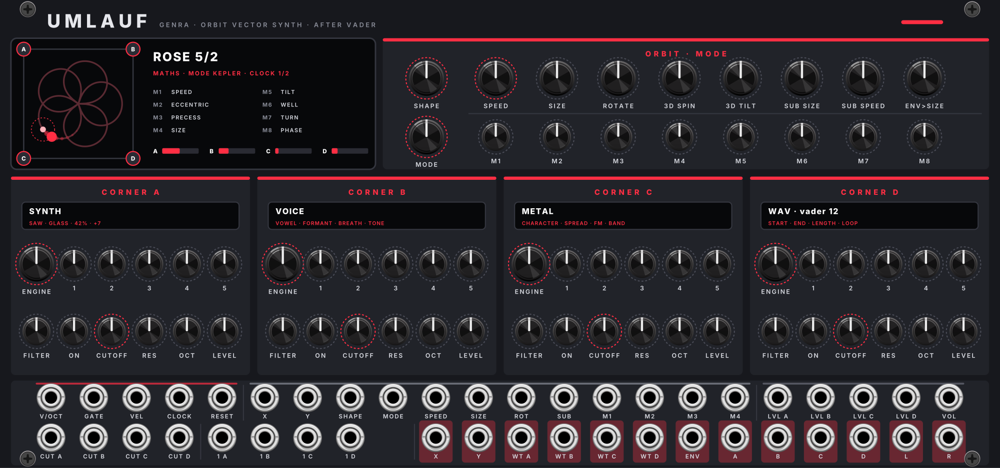

Die Engine von [VADER](https://github.com/sunskiefer/VADER) (L'Cronx, MIT) als Modul, 54 HP, Farbe **Sith-Rot**. Ein
Punkt, der **Orbiter**, läuft auf einer Bahn in einem Quadrat; in den vier Ecken spielt je ein Klang, und wo der
Orbiter gerade ist, entscheidet, wie viel man von jeder Ecke hört. Die Engine läuft wie im Original mit 44,1 kHz
(`vader/`, bis auf wenige markierte Änderungen, siehe `vader/README-UMLAUF.md`), das Modul rechnet auf die Rack-Rate um.

- **Display:** das Quadrat mit Bahn, Orbiter, Sub-Orbit-Punkt und den Bällen der Modi; daneben Form, Modus, Clock und
  die Live-Namen von M1–M8 (sonst die Engines der Ecken), unten der Anteil jeder Ecke.
- **ORBIT · MODE:** SHAPE (15 eingebaute Formen, USER = eigene Datei, 35 Mathe-Formen), SPEED, SIZE, ROTATE, 3D SPIN,
  3D TILT (für Würfel, Ikosaeder, OBJ), SUB SIZE, SUB SPEED, ENV>SIZE (die Hüllkurve öffnet oder schliesst die Bahn).
  MODE: PATH (die Form) oder eine von 26 Simulationen (CHASE, KEPLER, LORENZ, PENDULUM, BOIDS, MEDUSA, THUNDER …);
  M1–M8 sind ihre Regler, die Namen stehen im Display.
- **CORNER A–D:** ENGINE: SYNTH (VADERs zwei Oberton-Generatoren mit je 32 Spektren und BLEND: MIX, AM, PM, AM+PM, PD,
  RING, FOLD), die 14 Stimmen ANALOG, TRIO, WAVE, CHIP, MACRO, WHEEL, VOICE, NOISE, TONE, METAL, BAZZ, DRONE,
  TEXTURE, FX oder WAV (ein Sample). Die Regler 1–5 wechseln mit der Engine, das Mini-Display zeigt ihre Namen
  (SYNTH: GEN 1, GEN 2, BLEND, B.MODE, G2 TUNE · Stimmen: ihre vier Klangregler + LIMIT · WAV: START, END, LENGTH,
  LIMIT). Darunter FILTER (LP12, LP24, BP, HP, LADDER), ON (nach dem Blend, auf GEN 1 oder GEN 2), CUTOFF, RES, OCT,
  LEVEL. Klick aufs Mini-Display: Engine- und Sample-Auswahl.
- **Eingänge:** V/OCT, GATE (polyphon, bis 16 Stimmen), VEL, CLOCK (Tempo und Takt für Arpeggiator, synchrone Bahnen,
  Delay; Standard 16tel wie GENRA), RESET, X/Y (steuern den Orbiter von Hand, ±5 V), CV für SHAPE, MODE, SPEED, SIZE,
  ROT, SUB, M1–M4, Pegel A–D, VOL, Cutoff A–D und Regler 1 jeder Ecke.
- **Ausgänge:** X, Y (wo der Orbiter ist, ±5 V), WT A–D (Anteil jeder Ecke, 0–10 V), ENV, A–D (jede Ecke einzeln,
  trocken), L, R.
- **Ordner:** Beim ersten Start legt UMLAUF `Rack2/GenraSynthis/Umlauf/` an: `Samples` (eigene WAVs, auch in
  Unterordnern) und `Shapes` (die 7 Beispiel-Formen von VADER; eigene SVG, OBJ, PNG, JPG dazulegen). Die
  Beispiel-Samples von VADER sind nicht dabei (sie stammen aus kommerziellen Sample-Packs).
- **Presets:** das Feld im Kopf wie bei GRUND, FUNKE und SCHMELZ (Nummer, Name, Stil, Punkt bei verstellten Reglern;
  Klick = Liste nach Stil, Mausrad blättert, Laden lässt sich rückgängig machen). 28 eigene Werksklänge, dahinter als
  Gruppe *VADER* die 22 Presets von VADER (die sechs Sample-Presets brauchen eigene WAVs). Eigene Presets per
  Rechtsklick (*Save preset as …*, löschen, Ordner `Rack2/Genra/UmlaufPresets`): der ganze Zustand der Engine samt
  UMLAUF FX.

| Stil | Presets |
|---|---|
| TECHNO | HYPNO STAB, WAREHOUSE DRONE, ACID ORBIT, RAVE CHORD |
| HOUSE · DEEP | DEEP CHORD, ORGAN HOUSE, GARAGE PLUCK, DISCO STRINGS |
| DUB · DUB TECHNO | DUB TECHNO CHORD, DUB SKANK, MELODICA, SPACE ECHO |
| AMBIENT · DRONE | GLACIER PAD, TIDAL DRONE, CHOIR CLOUD, TEXTURE FIELD |
| BASS | SUB ORBIT, REESE ORBIT, FM BASS, WOBBLE ORBIT |
| KEYS · LEADS | ORBIT E-PIANO, SYNC LEAD, CHIP ARP, BELL TREE |
| CINEMATIC · FX | LORENZ STORM, BOIDS SWARM, THUNDER RISER, DARK HORIZON |
| VADER | INIT ORBIT, GLASS STAR, DARK FIGURE … SAMPLE TEXTURES (22) |

- **Rechtsklick:** Presets, Formdatei für USER wählen oder laden, pro Ecke Engine, Sample und Abspielart (One Shot, Loop 1–4 Takte), Ordner öffnen, neu einlesen,
  Clock-Auflösung, Delay im Takt.
- Pro Modul ein Timbre (VADERs Timbre B, Layer/Split, gibt es hier nicht: für Layer zwei UMLAUF nehmen).

### UMLAUF FX: Expander


Rechts neben UMLAUF setzen, 36 HP. ENVELOPE (ADSR) · VOICE (UNISON 1/2/4/8, VOICES 8/16, DETUNE, GLIDE, OCTAVE,
VELOCITY, Vibrato und Tremolo mit Rate) · ARPEGGIATOR (ON, LATCH, Richtung UP/DOWN/U·D/RND/ORDER/CHORD, RATE im
Takt, OCT, LENGTH, STEPS, HUMAN und 16 Schritt-Taster: Klick schaltet OFF → ON → ACCENT → TIE) · FX · MASTER (DRIVE,
CHORUS mit Rate, DELAY mit TIME und FEEDBACK, REVERB mit SIZE, M.RES = Resonanz aller Eckfilter, VOLUME) · 20
CV-Eingänge. Beim Andocken übernehmen die Regler den aktuellen Klang; ohne Expander gelten die Werte des Presets.

### MIX: 4-Kanal-Stereomixer

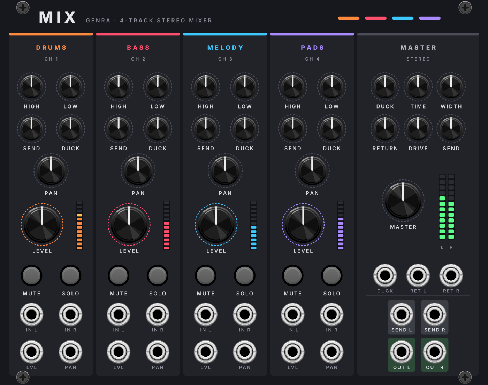

Mixer für die vier GENRA-Spuren, 28 HP. Jeder Kanal in der Farbe seiner Spur (DRUMS blau-violett, BASS säuregrün, MELODY
cyan, PADS rosa), der Master dunkel.

- **Pro Kanal:** IN L/R (R unbelegt = L; polyphone Eingänge werden summiert), HIGH/LOW (Kuhschwanz-EQ bei 6 kHz /
  120 Hz, ±12 dB), SEND A und SEND B (beide nach dem Fader), DUCK (wie stark der Kanal beim Duck-Trigger zurückgeht), PAN (Balance),
  LEVEL (0,75 = 0 dB, voll = +5 dB) mit Pegelanzeige, MUTE und SOLO (beleuchtet). CV: LVL (0–10 V, wie ein VCA),
  PAN (±5 V).
- **Master:** DUCK (Tiefe) und TIME (20 ms … 1 s, Erholzeit) – den KICK-Ausgang von GENRA in die DUCK-Buchse stecken,
  dann pumpen die anderen Spuren mit. zwei Effektwege A und B: SEND A/B (Pegel der Ausgänge SND A L/R bzw. SND B L/R) und RET A/B (Pegel der Rückwege
  RET A L/R bzw. RET B L/R, R unbelegt = L), z. B. A für Hall, B für Delay. WIDTH
  (Mono … doppelt breit), DRIVE (Sättigung), MASTER mit Stereo-Pegelanzeige, OUT L/R (weicher Limiter ab 8 V).

---

## Shoutouts 🙌

Ohne diese Leute und ihren offenen Code gäbe es einige Stimmen in diesem Plugin nicht.

### Juan Jiant – VOICE, DRUM-X, ANIMAL

Ein ganz besonderer Dank an **[Juan Jiant](https://github.com/juanjiant-bit)**! Seine Firmware [JIANT FM](https://github.com/juanjiant-bit/JIANT) steckt hinter VOICE, DRUM-X und ANIMAL – der singende Vokaltrakt, die Kit-Kolonie aus kleinen Kreaturen und die Tierrufe aus physikalischen Modellen sind seine Ideen und seine Arbeit. Ohne seinen offenen Code (GPL-3.0) gäbe es die drei Stimmen in diesem Plugin nicht. Gracias, Juan – schaut euch sein Repo an und lasst ihm einen Stern da! ⭐

### Omnipotard – K-WASUB

Ein grosses Dankeschön an **[Omnipotard (Guizmoh)](https://github.com/Guizmoh)**! Seine Firmware [K-WASUB](https://github.com/Guizmoh/K-WASUB_Firmware_for_FM1) für den M-VAVE FM-1 ist der komplette Klang des K-WASUB-Moduls: Die Bass-Engines und Effekte laufen hier als sein unveränderter Code (GPL-3.0). K-WASUB ist aus seinem KAWA entstanden und baut auf der FM-1-Plattform von Leo Kuroshita (Hügelton Instruments) auf. Merci, Omnipotard – schaut euch sein Repo an und lasst einen Stern da! ⭐

### L'Cronx – UMLAUF

Ein riesiges Dankeschön an **[L'Cronx](https://github.com/sunskiefer)**! UMLAUF ist die Engine seines Vektor-Synths [VADER](https://github.com/sunskiefer/VADER) für Akai Force und MPC: vier Klangquellen in den Ecken eines Quadrats und der Orbiter, der auf einer Form durch sie hindurch kreist und den Klang dabei morphen lässt. Die Idee, die Engine und die Formen sind seine Arbeit, und dank seines offenen Codes (MIT) laufen sie jetzt auch in VCV Rack. Danke, L'Cronx – schaut euch VADER an und lasst ihm einen Stern da! ⭐

---

## Installation unter Windows (über GitHub)

1. Änderungen ins Repository pushen (oder die Dateien hochladen).
2. Unter **Actions** startet der Build automatisch (4–6 Minuten).
3. Grünen Lauf öffnen → unten bei **Artifacts** `genra-windows` laden → Zip entpacken.
4. **Nur** die neue `Genra-2.x.x-win-x64.vcvplugin` nach `%LOCALAPPDATA%\Rack2\plugins-win-x64\` kopieren. Ältere `Genra-2.x-…vcvplugin`-Dateien und den Ordner `Genra` dort vorher löschen.
5. Rack neu starten.

Die Versionsnummer liest der Workflow selbst aus `plugin.json`; für eine neue Version genügt es, sie dort zu erhöhen (Hauptversion bleibt 2).

---

## Projektstruktur

```
src/Engine.hpp/.cpp   Theorie, Akkorde, Generierung, Auswertung pro Step
src/Genres.cpp        37 Genres / 83 Varianten (Wahrscheinlichkeitsraster), Tonleitern
src/Midi.cpp          MIDI-Export/-Import
src/Store.cpp         Speicherformat (pattern3) + Übernahme von v2-Patches
src/Edit.cpp          Bearbeiten: Einfrieren, Noten schreiben, Chord Follow, Snap, Copy/Paste
src/GenraModule.hpp   GENRA-Moduldefinition (auch vom Editor genutzt)
src/GenraGrid.cpp     Grid-Editor-Modul
src/Arranger.hpp/.cpp Song-Teile für ABLAUF (Intro, Build, … aus einem Pattern), ohne Rack testbar (test/test_ablauf.cpp)
src/ablauf/           ABLAUF: Modul (Ablauf.cpp), Frontplatte aus tools/ablauf_panel.py (real | preview <datei.png>)
res/GenraGrid.svg     Frontplatte des Editors (tools/grid_panel.py real)
src/Genra.cpp         Rack-Modul, Display, Menüs
res/Genra.svg         Frontplatte (tools/panel.py real), Vorschau: tools/panel.py preview <datei.svg>
tools/panellib.py     gemeinsame Panel-Bausteine (GENRA-Leiste)
src/jiant/            JIANT-Stimmen VOICE, DRUM-X, ANIMAL (Module, Kern-Lader, gemeinsamer Look JiantUI.hpp)
jiantcore/            die drei Firmware-Kerne als eigene kleine Bibliotheken (res/*core.dll beim Build)
jiant.tar.gz          Firmware-Quellen von JIANT FM (beim ersten Build nach jiant/ entpackt)
res/Jiant*.svg        Frontplatten (tools/jiant_panel.py real), Vorschau: tools/jiant_panel.py preview <ordner> <Rack>
src/monk/             MONK: Modul (Monk.cpp), Klang-Engine (MonkDsp.hpp), Sänger-Zeichnung der Firmware (monkface.c, fw/)
res/Monk.svg          Frontplatte (tools/monk_panel.py real), Vorschau: tools/monk_panel.py preview <ordner> [Rack]
src/mono/             GENRA MONO: Modul (GenraMono.cpp), Klang-Engine (MonoDsp.hpp, ohne Rack testbar), Presets (MonoPresets.hpp)
res/GenraMono.svg     Frontplatte (tools/mono_panel.py real), Vorschau: tools/mono_panel.py preview <datei.png> <Rack> [menu|presets]
src/funke/            FUNKE: Modul (Funke.cpp), Klang-Engine (FunkeDsp.hpp, ohne Rack testbar), Presets (FunkePresets.hpp), Frontplatte: tools/funke_panel.py
src/ui/GenraUI.hpp    GENRA-Look für SCHMELZ, MIX, K-WASUB, UMLAUF (Farben, Schriften, Lampenreihe)
src/ui/PresetBank.hpp Presets für FUNKE und SCHMELZ (Liste, Header-Feld, User-Presets, Kontextmenü)
src/schmelz/          SCHMELZ: Modul, Klang-Engine (SchmelzDsp.hpp, ohne Rack testbar), Presets (SchmelzPresets.hpp)
src/mix/              MIX: Modul und Engine (MixDsp.hpp, ohne Rack testbar)
src/kwasub/           K-WASUB und K-WASUB FX: Module, Kern-Lader (KwCore), Parameter-Ids der Firmware
kwcore/               der K-WASUB-Kern: die Firmware als Bibliothek (res/kwcore.dll beim Build)
kwasub/               die K-WASUB-Firmware, unverändert (GPL-3.0, Omnipotard)
src/umlauf/           UMLAUF und UMLAUF FX (Module, Schnittstelle zu VADER, eigene Presets: UmlaufPresets.h)
src/stotter/          STOTTER (Modul, Engine StotterDsp.hpp, Layout aus tools/stotter_panel.py)
vader/                VADER (MIT), gepatcht (tools/vader_vendor.sh, tools/vader_patch.py), in plugin.dll gelinkt
res/Schmelz.svg …     Frontplatten: tools/schmelz_panel.py, mix_panel.py, kwasub_panel.py, umlauf_panel.py,
                      umlauf_fx_panel.py (jeweils real | preview <datei.png> <Rack-Quellen>)
test/                 Engine- und MIDI-Tests (g++, ohne Rack); kwcore_test.c und vader_test.c (gcc), siehe Workflow
```

## Lizenz und Credits

GPL-3.0-only (siehe `LICENSE`).
- **VOICE, DRUM-X, ANIMAL:** [JIANT FM](https://github.com/juanjiant-bit/JIANT) von Juan Jiant, ein Fork von [Felucca](https://github.com/hugelton/Felucca) – GPL-3.0
- **MONK:** [MONK-1](https://github.com/charlesvestal/fm1-monk) von Charles Vestal – GPL-3.0; Klang [MonkSynth](https://github.com/JonET/monksynth) von Jonathan Taylor – MIT
- **K-WASUB:** [K-WASUB](https://github.com/Guizmoh/K-WASUB_Firmware_for_FM1) von Omnipotard – GPL-3.0 (`kwasub/`)
- **UMLAUF:** [VADER](https://github.com/sunskiefer/VADER) von L'Cronx – MIT (`vader/`)

Ausserdem enthalten: in VADER die LXRXXL-ZYNTH-Stimmen, Code von Mutable Instruments (MIT), stb_image (Public Domain/MIT) und der
FM-Algorithmus-Tabelle von music-synthesizer-for-android (Apache 2.0). Die Wavetables der LXR02-Firmware, die VADER
für TONE, METAL und BAZZ nutzt, sind nicht dabei (ihre Lizenz verbietet kommerzielle Nutzung): UMLAUF rechnet
gleichartige Tabellen selbst (`tools/umlauf_wavetables.py`).
