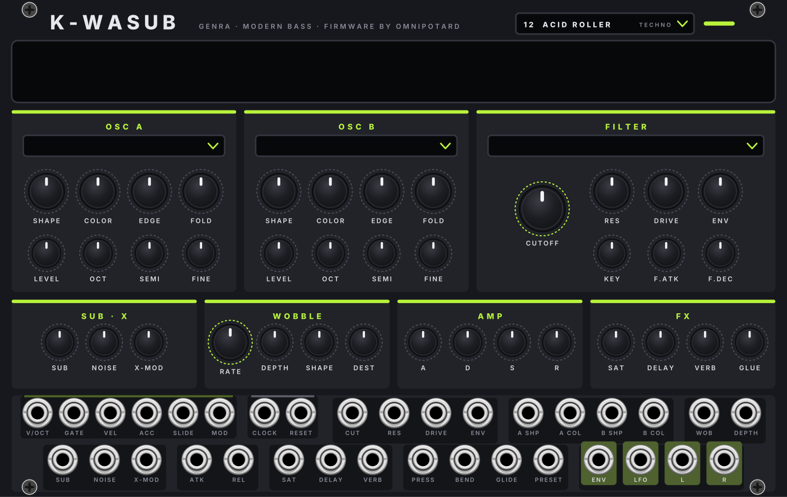
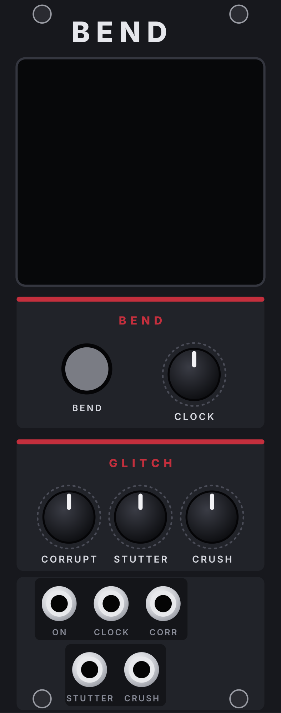
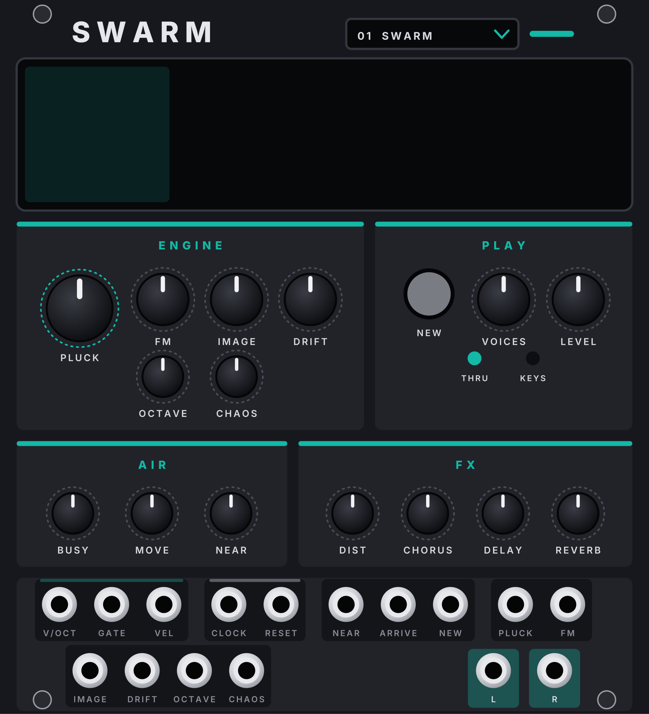
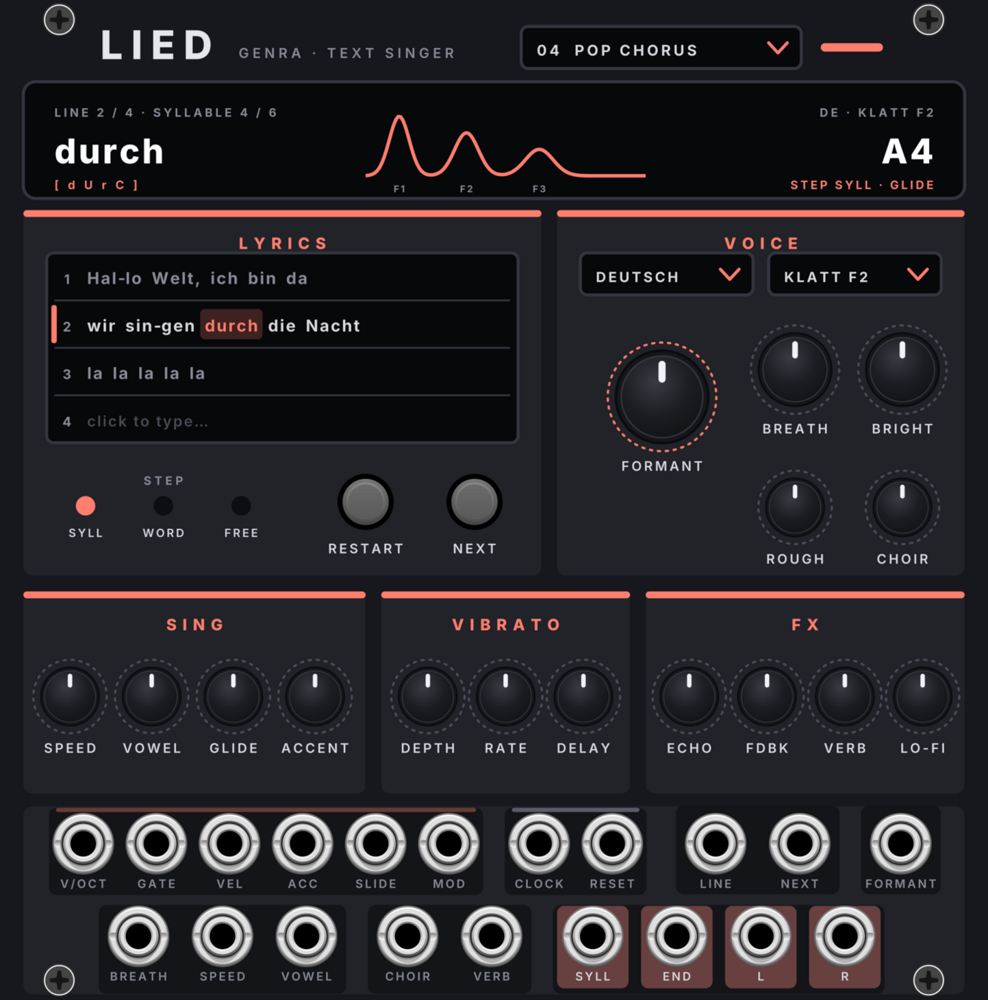
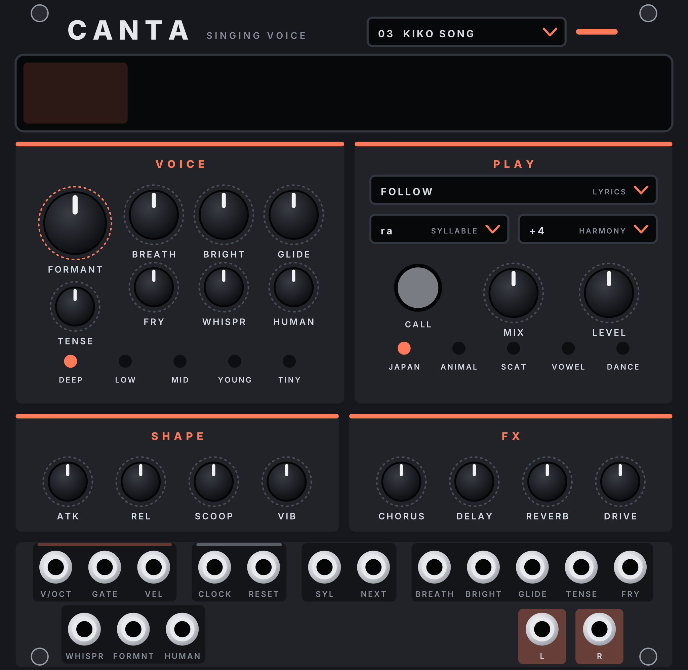
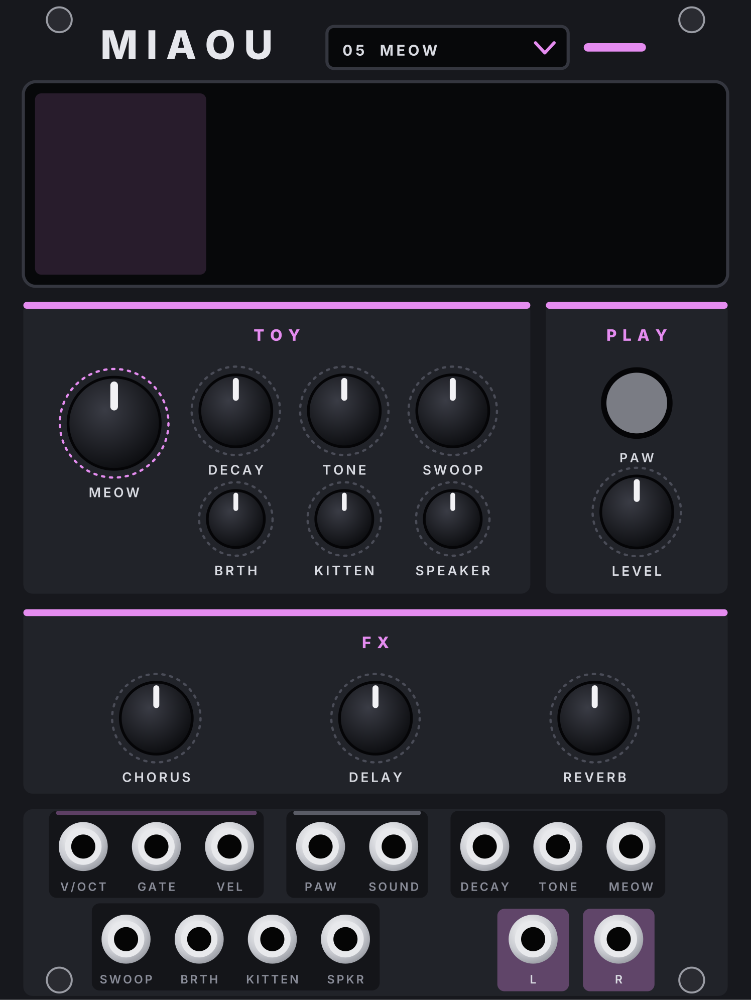
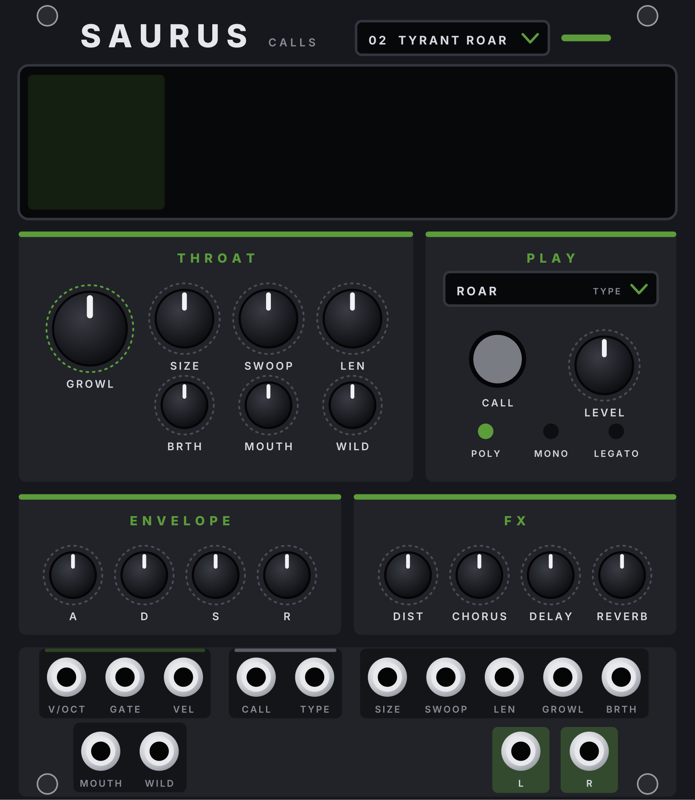
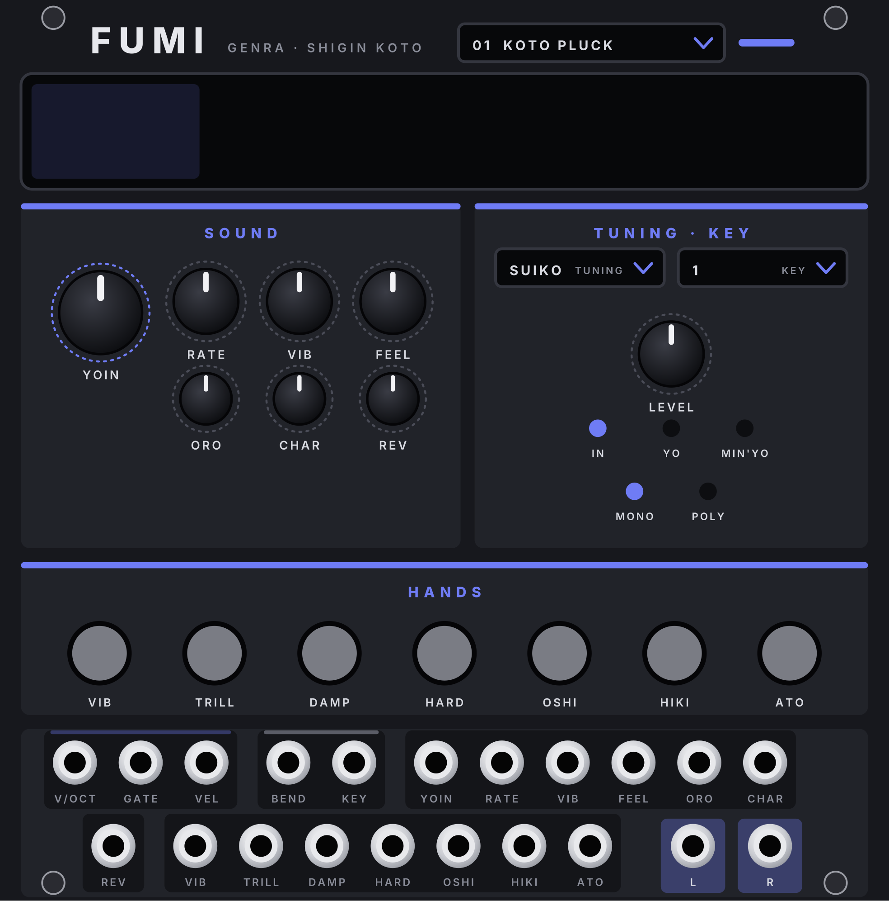
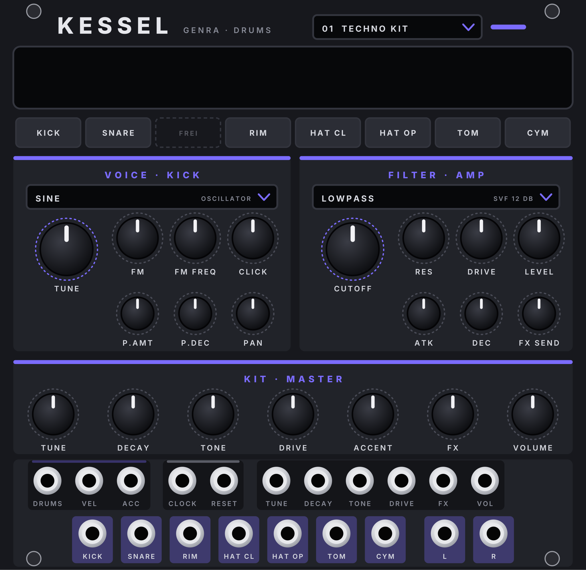
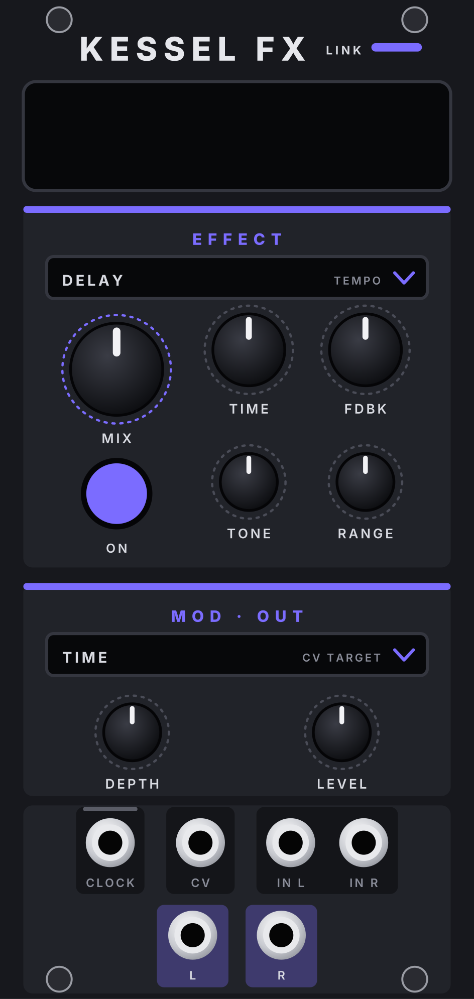

# GENRA Instruments – Plugin für VCV Rack 2

Die Instrumente der GENRA-Familie als eigenes Plugin: K-WASUB, GOLANA, UMLAUF, MONK, VOICE und ANIMAL (je mit ihren FX-Expandern, VOICE mit VOICE BEND), seit 2.38.0 dazu MATH, KURBEL, SWARM, LIED, CANTA, MIAOU, SAURUS, FUMI und KESSEL mit KESSEL FX (vorher im Testplugin GENRA Test). Im Rack-Browser stehen sie unter derselben Marke **Genra** wie das GENRA-Plugin (Sequencer, ABLAUF, GENRA BOX, ABLAUF MINI, MIX, GENRA FX, SCHLAG, DRUM-X, GRUND, MONO, FUNKE, SCHMELZ). Plugin-Version **2.38.0** (immer dieselbe wie GENRA; Windows und macOS); der Code liegt im Ordner `instruments/` des GENRA-Repos.

| Modul | Breite | Farbe | Was es ist |
|---|---|---|---|
| **K-WASUB** + **FX** | 38 / 41 HP | säuregrün | Modern-Bass-Synth aus der FM-1-Firmware K-WASUB, mit Effekt-Expander |
| **GOLANA** + **FX** | 45 / 14 HP | cyan | Analoger Poly-Synth aus der FM-1-Firmware Golana, mit Effekt-Expander |
| **JIANT VOICE** + **BEND** | 24 / 10 HP | rot | Formant-Sänger aus der JIANT-FM-Firmware, dazu SPELL (LPC-Sprechstimme aus SPELLBOX) mit Bending-Expander |
| **JIANT ANIMAL** | 22 HP | grün | Tierrufe aus physikalischen Modellen (JIANT FM) |
| **MONK** | 26 HP | safran | Vokal-Synth aus der FM-1-Firmware MONK-1 |
| **UMLAUF** + **FX** | 54 / 39 HP | Sith-Rot | Orbit-Vektor-Synth mit der Engine von VADER, mit Expander |
| **MATH** | 22 HP | Violett-Rosa | Bytebeat/Floatbeat aus der JIANT-FM-Firmware, gespielt (KEYS) oder frei laufend (THRU) |
| **KURBEL** | 24 HP | dunkles Orange | Drehleier (und Schalmei) aus ESTAMPIE, mit Kurbel per Regler und CV |
| **SWARM** | 23 HP | Petrol | Drone aus einem Schwarm virtueller Funkgeräte (JIANT FM) |
| **LIED** | 25 HP | – | Textsänger auf eSpeak NG: singt einen Liedtext in vielen Sprachen |
| **CANTA** | 26 HP | Koralle | Japanische Sing-Engine aus MIKU-FM, mit vier eigenen Pixel-Sängerinnen |
| **MIAOU** | 19 HP | Flieder | Spielzeug-Klänge und Miau-Stimme aus MIAOU |
| **SAURUS** | 22 HP | Echsengrün | Kreaturenrufe aus PALEOTONE |
| **FUMI** | 25 HP | Indigo | Shigin-Begleitung und Koto aus FuMi-1, mit alten Stimmungen |
| **KESSEL** + **FX** | 26 / 12 HP | Drumspur | Drum-Modul mit der Klang-Engine der LXR-Firmware, mit Effekt-Expander |

**Mit GENRA zusammen:** Ist auch das GENRA-Plugin installiert, folgen die Instrumente GENRA ohne Kabel (**Rechtsklick › Follow GENRA**), und MIX nimmt ihren Ausgang ohne Kabel (**CH n input from**) – genau wie bei den Instrumenten im GENRA-Plugin. Beide Plugins sollten aus demselben Release stammen: Passen sie nicht zueinander, bilden sich die kabellosen Verbindungen zwischen ihnen nicht (Kabel gehen immer).

> MATH bis KESSEL FX lagen bis 2.38.0 im Testplugin GENRA Test: Patches mit diesen Modulen aus GENRA Test finden sie nicht mehr, dort einmal aus GENRA Instruments neu einsetzen.

> Bis GENRA 2.28 waren K-WASUB bis ANIMAL Teil des GENRA-Plugins. Patches von damals finden sie nicht mehr: dort einmal aus GENRA Instruments neu einsetzen. User-Presets bleiben, sie liegen weiter im Rack-Benutzerordner unter `Genra/`.

---

## Installation unter Windows

Unter [Releases](https://github.com/Camillowup/Genra-for-Vcv/releases) liegen beide Dateien: `Genra-…-win-x64.vcvplugin` und `GenraInstruments-…-win-x64.vcvplugin`. Beide nach `%LOCALAPPDATA%\Rack2\plugins-win-x64\` kopieren (in Rack: *Help › Open user folder*) und Rack neu starten. Testversionen: unter **Actions** beim grünen Lauf das Artifact `genra-instruments-windows`.

---

## Die Instrumente

### K-WASUB: Modern-Bass-Synth (Firmware von Omnipotard)

Die Firmware [K-WASUB](https://github.com/Guizmoh/K-WASUB_Firmware_for_FM1) für den M-VAVE FM-1 von Omnipotard (GPL-3.0)
als Modul, 38 HP, Farbe **säuregrün**. Der Klang ist die Original-Firmware, unverändert (`kwasub/`): Sie läuft als
eigene kleine Bibliothek (`res/kwcore.*`, eine Kopie pro Modul) mit 44,1 kHz, das Modul rechnet auf die Rack-Rate um.

- **OSC A / OSC B:** ENGINE-Feld (Klick = Liste, Mausrad): ANALOG, 808, CS, WAVETABLE, FM, GROWL, ADDITIVE, PHASE DIST,
  HARD SYNC. SHAPE, COLOR, EDGE, FOLD sind die vier Klangregler der Engine (was sie bei der gewählten Engine heissen
  und welchen Wert sie haben, steht im Display und im Tooltip), LEVEL, OCT, SEMI, FINE.
- **FILTER:** Typ-Feld (LP 24, LP 12, BAND, HIGH, NOTCH, VOWEL, COMB), CUTOFF, RES, DRIVE, ENV, KEY, Filterhüllkurve.
- **SUB · X:** Sub, Rauschen, X-Mod · **WOBBLE:** LFO 1 im Tempo (RATE = Notenwert), DEPTH, SHAPE, DEST ·
  **AMP:** ADSR · **FX:** SAT, DELAY, VERB, GLUE (schalten ihren Effekt ein).
- **Presets:** das Feld im Kopf wie bei GRUND, FUNKE und SCHMELZ: Nummer, Name, Stil, ein Punkt, sobald ein Regler
  verstellt ist. Klick (auch auf den Namen im Display) öffnet die 97 Werksklänge nach Stil (DNB, DUB, DUBSTEP …, je ein
  Untermenü, Namen A–Z), das Mausrad blättert in dieser Reihenfolge; Laden lässt sich rückgängig machen. Eigene Presets
  per Rechtsklick (*Save preset as …*, löschen, Ordner `Rack2/Genra/KwasubPresets`): Sie speichern den ganzen Klang,
  auch was kein Regler zeigt, samt den Werten von K-WASUB FX.
- **Eingänge:** V/OCT, GATE, VEL (bis 4 Stimmen, auf Halbtöne gerundet), CLOCK (setzt das Tempo; Standard 16tel wie
  GENRA, im Menü 8tel, Viertel, 24 PPQN), RESET (Taktanfang), CV für CUT, RES, DRIVE, ENV, A/B SHAPE und COLOR, WOB,
  DEPTH, PRESET (0–10 V über alle Presets), SUB, NOISE, X-MOD, ATK, REL, SAT, DELAY, VERB, GLIDE; MOD (Modrad),
  PRESS (Druck), BEND (±5 V). **Ausgänge:** ENV, LFO, L, R.
- Rechtsklick: Presets (Liste, speichern, löschen, Ordner), Stimmen (Mono, Legato, Poly), Clock-Auflösung. Der ganze Klang wird im Patch gespeichert,
  auch was kein Regler zeigt (LFO 2, Matrix, OSC C …).

### K-WASUB FX: Effekt-Expander

Rechts neben K-WASUB setzen (LINK leuchtet), 41 HP: alle Einstellungen des Effekt-Racks der Firmware. SATURATE (Typ, Amount,
Mix), CRUSH, CHORUS, PHASER, DELAY (Typ, Zeit im Tempo, Feedback, Ton, Mix), REVERB (Typ, Grösse, Dämpfung, Mix),
COMPRESSOR (mit PUMP und PUMP RATE), MULTIBAND, EQ (4 Bänder), MASTER (Glue, Sub-Boost, Mono-Bass). Jeder Block mit
EIN-Taster; 16 CV-Eingänge unten in einer Reihe, nach Effekt gruppiert. Regler, die es auf beiden Panels gibt (SAT, DELAY, VERB, GLUE),
folgen einander. Ohne Expander gelten die Effekte des Presets.

### GOLANA: analoger Poly-Synth (Firmware von Gadlele)

Die Firmware [Golana](https://github.com/Gadlele/Golana) für den M-VAVE FM-1 von Gadlele (GPL-3.0, ein Fork von
Felucca) als Modul, 45 HP, Farbe **cyan** (GENRAs Melodiefarbe). Ein analoger Synth im Aufbau des microKORG. Der Klang
ist die Original-Firmware, unverändert (`golana/`): Sie läuft wie K-WASUB als eigene kleine Bibliothek
(`res/glcore.*`, eine Kopie pro Modul) mit 44,1 kHz, das Modul rechnet auf die Rack-Rate um.

- **OSCILLATORS:** OSC 1 mit Wellenform-Feld (SAW, PULSE, TRI, SINE, MORPH), CTRL 1 (je nach Welle: zweite Säge eine
  Oktave höher, Pulsbreite, Falten, Kreuzmodulation, Säge → Rechteck), CTRL 2 (LFO 1 auf CTRL 1, z. B. PWM), DRIFT
  (analoges Altern). OSC 2: Welle (SAW, SQR, TRI, MIX), SEMI, TUNE, MOD (OFF, RING, SYNC, R+S).
- **MIXER:** OSC 1, OSC 2, NOISE, SUB (Feld: −1/−2 Oktaven, Rechteck, Sinus, Säge, Mix) und FOLD (Wavefolder vor dem Filter).
- **FILTER:** Typ-Feld (LPF24, LPF12, BPF, HPF, MS20), CUTOFF, RESO, EG INT (±), KEY TRK, DIST (weicher Drive).
- **Display:** links der Klang als Spur mit Nachleuchten (TRAIL), die Filterkurve und die Noten, die gerade klingen;
  rechts Preset, Stil, Tempo, Stimmen-Modus und Arpeggio.
- **ENVELOPES:** Filter-EG und Amp-EG (ADSR). **LFO 1 · 2** (eine Sektion, oben LFO 1, darunter LFO 2): Welle (SAW, SQR, TRI, SIN, S&H), KEY SYNC (OFF, TIMBRE,
  VOICE), SYNC im Tempo (OFF, 4 BAR … 1/32, über CLOCK), FREQ und ein **RETRIG**-Eingang: Jeder Trigger startet den LFO
  von vorn, für alle Stimmen. **VOICE:** POLY 4, MONO, LEGATO, UNISON, DETUNE, PORTA.
- **PATCH:** die vier Modulationswege der Firmware, je Quelle (FEG, AEG, LFO1, LFO2, VELO, KBD, MODW, MW*LFO1, MW*LFO2,
  AFTER) → Ziel (PITCH, OSC2, CTRL1, NOISE, CUTOFF, AMP, LFO2F) mit INT. Die LFOs haben keinen eigenen Tiefe-Regler:
  die Tiefe ist das INT ihres Patch-Wegs.
- **VOICE · ARP:** Felder für den Stimmen-Modus, den Arp-Typ und die Rate. In den schmalen Feldern (OSCILLATORS, LFO,
  PATCH, VOICE · ARP) steht nur der Wert; welches Feld es ist, zeigt der Tooltip. ARP: Typ (UP, DOWN, ALT1, ALT2, RANDOM, TRIGGER, ORDER, CONVERGE, PEDAL, DOUBLE), Rate (1/32 … 1/4, im Tempo von
  CLOCK), RANGE (1–4 Oktaven), SWING, ON. Im Rechtsklick-Menü: Latch, Key Sync, Gate.
- **FX · OUT:** MOD FX, DELAY, REVERB als Summenregler (wie bei K-WASUB); die Einzelheiten stehen im Expander.
  Drehst du einen davon auf, schaltet er seinen Effekt im Expander ein.
- **Presets:** 55 im Feld oben rechts: 30 eigene nach Stil (wie bei FUNKE) und Golanas 25 Werksklänge als Gruppe
  GOLANA ORIGINALS. Eigene Presets per Rechtsklick (`Rack2/Genra/GolanaPresets`), samt den Werten von GOLANA FX.
- **Eingänge:** die GENRA-Leiste V/OCT, GATE (bis 4 Stimmen, auf Halbtöne gerundet), VEL, ACC, SLIDE, MOD (Modrad; ohne
  Patch-Weg ein Vibrato), CLOCK (setzt das Tempo; Standard 16tel wie GENRA), RESET (Arp und LFOs von vorn); CV für CUT,
  RESO, EG INT, CTRL 1, FOLD, LFO 1, LFO 2, AFTER (Aftertouch, eine Patch-Quelle). **Ausgänge:** L, R, dazu SPREAD
  (Stereobreite der Stimmen) und LEVEL.
- Rechtsklick ausserdem: EG Reset, Clock-Auflösung, Follow GENRA (Melody, für Flächen auch Pad). Der ganze Klang wird
  im Patch gespeichert.

| Stil | Presets |
|---|---|
| SOUL · JAZZ · LO-FI | WARM POLY KEYS · LO-FI CHORDS · SOFT SQUARE LEAD · DUSTY BELLS |
| HOUSE · GARAGE | HOUSE ORGAN · DEEP CHORD · GARAGE STAB · DISCO BRASS |
| DUB · REGGAE | DUB SIREN · DUB CHORD ECHO · MELODICA |
| TECHNO · ELECTRO | ACID LINE · HYPNOTIC ARP · DUB TECHNO CHORD · ELECTRO SYNC LEAD · MINIMAL BLIP |
| GRIME · DUBSTEP · DRILL | GRIME SQUARE · REESE · DRILL GLIDE · WOBBLE LEAD (für den Drop: GATE auf RETRIG 1) |
| POP · SYNTHWAVE · TRANCE | SUPERSAW · 80S BRASS · SYNTHWAVE POLY · GLIDE LEAD · TRANCE PLUCK · UNISON LEAD |
| AMBIENT | SOFT PAD · PHASE PAD · SLOW ARP · DRONE |
| GOLANA ORIGINALS | die 25 Werksklänge der Firmware, von FAT BASS bis SUPERSAW |

### GOLANA FX: Effekt-Expander

Rechts neben GOLANA setzen (LINK leuchtet), 14 HP: **MOD FX** (Typ: Chorus, Flanger, Ensemble, Phaser, Metal; RATE,
DEPTH), **DELAY** (Typ: Stereo, Cross, L/R; Zeit in Notenwerten im Tempo; FDBK, COLOR, MIX), **REVERB** (Typ: Room,
Spring, Hall; SIZE, DAMP) und **CHAIN** (die Reihenfolge der drei, neben dem REVERB-Typ). Jeder Block mit EIN-Taster,
die CV-Eingänge unten. Ohne Expander gelten die Effekte des Presets.

### MONK: die zwölf Sänger

Der Vokal-Synthesizer (26 HP) aus der FM-1-Firmware [MONK-1](https://github.com/charlesvestal/fm1-monk) (Charles Vestal, GPL-3.0), dessen Klang [MonkSynth](https://github.com/JonET/monksynth) ist (Jonathan Taylor, MIT; eine Hommage an Delay Lama). FOF-Formantsynthese: pro Periode ein Korn aus drei abklingenden Formant-Sinus plus Atem, fünf Vokale OO–OH–AH–EH–EE. Farbe: **safran**.

- **Display:** links singt der Sänger (eigene Zeichnungen, ab 2.21.0): der Mund formt den Vokal (OO, OH, AH, EH, EE), die Brauen heben sich mit der Lautstärke, bei BOLT glüht dazu die Antenne; ohne Ton blinzelt er ab und zu und probt Vokale. Rechts Name, Note, Stimmen, ob die Stimme bearbeitet ist, Vokal-Chips (Klick setzt VOWEL), PRESS und ENV. Die Werte der Regler zeigt Rack beim Darüberfahren.
- **Sänger-Feld** im Kopf (anklicken = Liste, Mausrad = blättern): die zwölf Sänger: **BOLT** (Blech-Tenor, ein Roboter), **CROAK** (Sumpf-Bass, ein Frosch), **DIVA** (Opernstar), **HOOT** (Nacht-Alt, eine Eule), **ZORP** (Weltraum-Sopran, ein Ausserirdischer), **BONES** (Grab-Crooner, ein Skelett), **SPIKE** (Wüsten-Ballade, ein Kaktus), **BLUB** (Tiefsee-Bariton, ein Wal), **LOOP** (Tape-Looper, eine Kassette), **LUNA** (Wiegenlied-Mond), **SPORE** (Waldchor, ein Pilz), **EMBER** (Feuer-Belterin, ein Drache). Die Stimmen sind dieselben wie bisher auf denselben Plätzen, alte Patches singen gleich. Ein Sänger lädt seine Stimme auf alle Regler. Auch per SINGER-CV (0–10 V) und Rechtsklick-Menü, dort auch *Stimme wie geliefert*.
- **SING · CHOIR** (je mit CV, ±5 V = ganzer Reglerweg): VOWEL, HEAD (Vokaltrakt in cm), BREATH, GLIDE, VOICES (Unisono 1–10), DETUNE (Cent), SPREAD (Kopfgrössen der Stimmen), TUNE (±12 Halbtöne).
- **PRESS** (Lämpchen VOWEL · PITCH · BOTH · INV): wohin der PRESS-Eingang (Aftertouch, 0–10 V) wirkt; DEPTH wie weit, VEL wie stark VEL die Lautstärke setzt, LEVEL.
- **ENVELOPE** ATK DEC SUS REL (bis 5 s), **VIBRATO · ECHO** DEPTH, RATE, ECHO (Menge), TIME, FDBK (neu, im Original fest 50 %).
- **Ein/Aus:** V/OCT (C4 = 0 V), GATE, VEL, PRESS, SINGER · ENV (0–10 V), DRY (mono ohne Echo), L, R. Einstimmig wie das Original: GATE startet die Note, V/OCT bei gehaltenem Gate gleitet ohne neuen Anschlag (GLIDE).
- Mit MIDI: MIDI-CV-Modul → V/OCT, GATE, VEL und AFT → PRESS.

### UMLAUF: Orbit-Vektor-Synth (Engine von VADER)

Die Engine von [VADER](https://github.com/sunskiefer/VADER) (L'Cronx, MIT) als Modul, 54 HP, Farbe **Sith-Rot**. Ein
Punkt, der **Orbiter**, läuft auf einer Bahn in einem Quadrat; in den vier Ecken spielt je ein Klang, und wo der
Orbiter gerade ist, entscheidet, wie viel man von jeder Ecke hört. Die Engine läuft wie im Original mit 44,1 kHz
(`vader/`, bis auf wenige markierte Änderungen, siehe `vader/README-UMLAUF.md`), das Modul rechnet auf die Rack-Rate um.

- **Display:** das Quadrat mit Bahn, Orbiter, Sub-Orbit-Punkt und den Bällen der Modi; daneben Form, Modus, Clock und
  der Anteil jeder Ecke, rechts die Live-Namen von M1–M8 (sonst die Engines der Ecken).
- **ORBIT · MODE:** SHAPE (15 eingebaute Formen, USER = eigene Datei, 35 Mathe-Formen), SPEED, SIZE, ROTATE, 3D SPIN,
  3D TILT (für Würfel, Ikosaeder, OBJ), SUB SIZE, SUB SPEED, ENV>SIZE (die Hüllkurve öffnet oder schliesst die Bahn).
  MODE: PATH (die Form) oder eine von 26 Simulationen (CHASE, KEPLER, LORENZ, PENDULUM, BOIDS, MEDUSA, THUNDER …);
  M1–M8 sind ihre Regler, die Namen stehen im Display.
- **CORNER A–D:** ENGINE: SYNTH (VADERs zwei Oberton-Generatoren mit je 32 Spektren und BLEND: MIX, AM, PM, AM+PM, PD,
  RING, FOLD), die 14 Stimmen ANALOG, TRIO, WAVE, CHIP, MACRO, WHEEL, VOICE, NOISE, TONE, METAL, BAZZ, DRONE,
  TEXTURE, FX oder WAV (ein Sample). Die Regler 1–5 wechseln mit der Engine, das Mini-Display zeigt ihre Namen
  (SYNTH: GEN 1, GEN 2, BLEND, B.MODE, G2 TUNE · Stimmen: ihre vier Klangregler + LIMIT · WAV: START, END, LENGTH,
  LIMIT). Darunter FILTER (LP12, LP24, BP, HP, LADDER), ON (nach dem Blend, auf GEN 1 oder GEN 2), CUTOFF, RES, OCT,
  LEVEL. Klick aufs Mini-Display: Engine- und Sample-Auswahl.
- **Eingänge:** V/OCT, GATE (polyphon, bis 16 Stimmen), VEL, CLOCK (Tempo und Takt für Arpeggiator, synchrone Bahnen,
  Delay; Standard 16tel wie GENRA), RESET, X/Y (steuern den Orbiter von Hand, ±5 V), CV für SHAPE, MODE, SPEED, SIZE,
  ROT, SUB, M1–M4, Pegel A–D, VOL, Cutoff A–D und Regler 1 jeder Ecke.
- **Ausgänge:** X, Y (wo der Orbiter ist, ±5 V), WT A–D (Anteil jeder Ecke, 0–10 V), ENV, A–D (jede Ecke einzeln,
  trocken), L, R.
- **Ordner:** Beim ersten Start legt UMLAUF `Rack2/Genra/Umlauf/` an: `Samples` (eigene WAVs, auch in
  Unterordnern) und `Shapes` (die 7 Beispiel-Formen von VADER; eigene SVG, OBJ, PNG, JPG dazulegen). Die
  Beispiel-Samples von VADER sind nicht dabei (sie stammen aus kommerziellen Sample-Packs).
- **Sample-Ordner (neu in 2.36.0):** Rechtsklick › *Choose the samples folder…* wählt einen eigenen Ordner, zum Beispiel
  deine Sample-Bibliothek, wie bei SCHLAG. Er gilt für alle Patches auf diesem Computer (gespeichert in
  `Rack2/Genra/umlauf.json`), es wird nichts kopiert; Unterordner werden mitgelesen. Der Patch speichert pro Ecke den
  Weg innerhalb dieses Ordners: Auf einem anderen Computer spielt er wieder, sobald dort der Ordner gesetzt ist. Fehlt
  ein Sample, zeigt das Mini-Display NO SAMPLE.
- **Presets:** das Feld im Kopf wie bei GRUND, FUNKE und SCHMELZ (Nummer, Name, Stil, Punkt bei verstellten Reglern;
  Klick = Liste nach Stil, Mausrad blättert, Laden lässt sich rückgängig machen). 28 eigene Werksklänge, dahinter als
  Gruppe *VADER* die 22 Presets von VADER (die sechs Sample-Presets brauchen eigene WAVs). Eigene Presets per
  Rechtsklick (*Save preset as …*, löschen, Ordner `Rack2/Genra/UmlaufPresets`): der ganze Zustand der Engine samt
  UMLAUF FX.

| Stil | Presets |
|---|---|
| TECHNO | HYPNO STAB, WAREHOUSE DRONE, ACID ORBIT, RAVE CHORD |
| HOUSE · DEEP | DEEP CHORD, ORGAN HOUSE, GARAGE PLUCK, DISCO STRINGS |
| DUB · DUB TECHNO | DUB TECHNO CHORD, DUB SKANK, MELODICA, SPACE ECHO |
| AMBIENT · DRONE | GLACIER PAD, TIDAL DRONE, CHOIR CLOUD, TEXTURE FIELD |
| BASS | SUB ORBIT, REESE ORBIT, FM BASS, WOBBLE ORBIT |
| KEYS · LEADS | ORBIT E-PIANO, SYNC LEAD, CHIP ARP, BELL TREE |
| CINEMATIC · FX | LORENZ STORM, BOIDS SWARM, THUNDER RISER, DARK HORIZON |
| VADER | INIT ORBIT, GLASS STAR, DARK FIGURE … SAMPLE TEXTURES (22) |

- **Rechtsklick:** Presets, Formdatei für USER wählen oder laden, pro Ecke Engine, Sample und Abspielart (One Shot, Loop 1–4 Takte), Ordner öffnen, neu einlesen,
  Clock-Auflösung, Delay im Takt.
- Pro Modul ein Timbre (VADERs Timbre B, Layer/Split, gibt es hier nicht: für Layer zwei UMLAUF nehmen).

### UMLAUF FX: Expander

Rechts neben UMLAUF setzen (LINK leuchtet), 39 HP. ENVELOPE (ADSR) · VOICE (UNISON 1/2/4/8, VOICES 8/16, DETUNE, GLIDE, OCTAVE,
VELOCITY, Vibrato und Tremolo mit Rate) · ARPEGGIATOR (ON, LATCH, Richtung UP/DOWN/U·D/RND/ORDER/CHORD, RATE im
Takt, OCT, LENGTH, STEPS, HUMAN und 16 Schritt-Taster in einer Reihe: Klick schaltet OFF → ON → ACCENT → TIE) · FX · MASTER (DRIVE,
CHORUS mit Rate, DELAY mit TIME und FEEDBACK, REVERB mit SIZE, M.RES = Resonanz aller Eckfilter, VOLUME) · 20
CV-Eingänge. Beim Andocken übernehmen die Regler den aktuellen Klang; ohne Expander gelten die Werte des Presets.

### JIANT-Stimmen: VOICE und ANIMAL

| VOICE | DRUM-X | ANIMAL |
|---|---|---|
|  |  |  |

Drei Klangerzeuger aus der Firmware von [JIANT FM](https://github.com/juanjiant-bit/JIANT) (Juan Jiant, ein Fork von [Felucca](https://github.com/hugelton/Felucca), GPL-3.0), im GENRA-Look und jeweils in einer eigenen Farbe: **VOICE rot**, **DRUM-X blau-violett** (GENRAs Drum-Farbe), **ANIMAL grün**. Das Display zeigt links die Zeichnung der Firmware (Vokaltrakt, Kit-Kolonie, Kreatur), rechts Preset bzw. Kit und die Einstellungen.

- **VOICE** (24 HP): Formant-Sänger. Preset-Feld im Kopf (15 Presets aus JIANT + 3 für SPELL), in ENGINE die Felder **LANG** (OFF singt Vokale, ES/EN/JA singen Wörter, **SPELL** ist die LPC-Sprechstimme aus SPELLBOX) und **SPELL** (SING / LETTER / SPEAK), in PLAY das Feld **LYRIC** (TEXT, W1–W16 oder S1–S8); das Textfeld unten im Display nimmt einen eigenen Text (bis 63 Zeichen). Alle Felder: anklicken = Liste, Mausrad = blättern. Jede neue Note singt die nächste Silbe, WORD ↺ startet den Text neu. 8 Klangregler mit CV, ihre Namen wechseln mit LANG.
- **SPELL** (in VOICE, nur Englisch, eine Stimme): im Feld SPELL **SING** (ein Wort auf der Note, der Vokal hält mit dem Gate), **LETTER** (jede Taste ihr Buchstabe, A auf F3) oder **SPEAK** (liest den Text im Lyrics-Feld, pro Note die nächsten Wörter). Regler: POS, WORD/LETTER/WORDS, ARTIC, SHIFT, SPEED, TONE, MONO, LOOP. Das Wort leuchtet türkis Buchstabe für Buchstabe.
- **VOICE BEND** (10 HP, rechts neben VOICE): Circuit Bending für SPELL. BEND (Taster oder Gate an ON) schaltet ein; CLOCK, CORRUPT, STUTTER, CRUSH je mit CV. Das Display zeigt, ob ein VOICE links steht und auf SPELL ist, und die vier Werte als Balken.
- **ANIMAL** (22 HP): Tierrufe aus physikalischen Modellen. Feld **MODE** in PLAY (CMOS, PULSE, WHSTL, WING, GLOTT), Preset-Feld im Kopf (24 Presets), 7 Klangregler mit CV, ihre Namen wechseln mit MODE.
- **Gemeinsam (VOICE, ANIMAL):** CALL spielt einen Ton ohne Kabel (auch per Gate am CALL-Eingang), POLY · MONO · LEGATO per Klick auf die Lampen, Hüllkurve ATK–REL, FX DIST–REVERB, V/OCT, GATE, VEL polyphon, LEVEL und Stereo-Ausgang (nur L gesteckt = Mono).
- Presets bzw. Kits gibt es auch im Rechtsklick-Menü. Alte Patches mit den einzelnen Plugins *JiantVoice*, *JiantDrumX*, *JiantAnimal* finden die Module hier nicht automatisch – dort einmal neu einsetzen.

---

### Aus GENRA Test (seit 2.38.0): MATH, KURBEL, SWARM, LIED, CANTA, MIAOU, SAURUS, FUMI, KESSEL

Diese Instrumente wurden im Testplugin GENRA Test gebaut und getestet und sind mit 2.38.0 hierher umgezogen (in GENRA Test gibt es sie nicht mehr).

### MATH

Die MATH-Engine aus der FM-1-Firmware **JIANT FM** von Juan Jiant: Bytebeat und Floatbeat. Die Musik steckt in einer
Formel der Zeit; daraus entstehen Klänge, Rhythmen und Melodien.

**Display:** links das Wesen der Engine (die Zeichnung der Firmware), rechts Preset, Einstellungen, Tempo und die
ersten Reglerwerte.

**Kopf:** das **Preset-Feld** (12 Werks-Presets; anklicken = Liste, Mausrad = blättern; auch per Rechtsklick › Preset).

**ENGINE:** oben die Felder **WAVE** (BYTE / FLOAT) und **CHIP** (4BIT, 4B/2, 8BIT bzw. FULL, 1BIT); jedes Feld
reagiert auch aufs Mausrad.

**PLAY:**
- **CALL**: bei KEYS spielt C4, bei THRU startet die Formel von vorn.
- **PLAY**:
  - **KEYS**: gespielt wie ein normales Instrument. V/OCT ist die Tonhöhe, GATE an = Ton, mit der Hüllkurve.
  - **THRU**: die Formel läuft von selbst durch, ohne Gate, wie ein Oszillator bzw. Loop. V/OCT verschiebt die
    Tonhöhe, ohne die Formel neu zu starten. Der Sustain steht dabei immer auf voll.
- **VOICE**: POLY, MONO, LEGATO.
- **LEVEL**.

**ENGINE** (je mit CV-Eingang, ±5 V = ± halber Bereich):
- **ALGO**: welche Formel (B01 … bei BYTE, F01 … bei FLOAT).
- **VAR**: verändert die Formel.
- **MOTION**: wie schnell sich die langsamen Teile (Rhythmus, Melodie) entwickeln. Ab der Hälfte **SYNC**: Rhythmus
  und Melodie laufen im Takt von CLOCK mit, die Note ändert nur noch die Tonhöhe.
- **GRIT** (bei FLOAT **FEEDBK**), **BEND**.
- **LOOP**: auf 0 entwickelt sich die Formel frei; hoch wird sie zu einem kurzen, gleichbleibenden Ton gefaltet.

**ENVELOPE** und **FX** wie bei VOICE und ANIMAL.

**Buchsen unten:** V/OCT · GATE · VEL (GENRA-Leiste), **CLOCK · RESET**, L/R.
- **CLOCK**: Tempo und Takt für MOTION SYNC. Standard sind 16tel wie GENRAs Clock-Ausgang; per Rechtsklick ›
  Clock input auch 8tel, Viertel oder 24 PPQN. Ohne Clock läuft die Zeit im letzten Tempo weiter (anfangs 120 BPM).
- **RESET**: setzt die Song-Position auf Anfang; bei THRU startet auch die Formel neu.
- **Ohne Kabel:** Rechtsklick › Follow GENRA. Dann kommen Noten, Clock und Reset direkt von GENRA.

### KURBEL

Die Drehleier aus der FM-1-Firmware **ESTAMPIE** (die GURDY-Engine von GHOULBOX) und dazu die Schalmei. Eine
Melodiesaite, zwei Bordun-Saiten (Grundton und Quinte), die schnarrende Trompette und ein Holzkörper.

**Display:** links das Rad mit den Saiten. Das Rad dreht sich mit der Kurbel (bei COUP CRANK) bzw. gleichmässig,
solange ein Ton klingt; die Melodiesaite leuchtet, die Trompette blitzt bei jedem Stoss. Rechts Preset, Einstellungen,
Tempo bzw. Kurbel.

**ENGINE:** oben die Felder **ENGINE** (WHEEL / REED: Drehleier / Schalmei) und **TEMP**, die Stimmung **EQUAL, PYTH,
MEAN, JUST** (gleichstufig, pythagoreisch, mitteltönig, rein; gezählt ab dem Bordun). Alle Felder: anklicken = Liste,
Mausrad = blättern.

**Kopf und PLAY:**
- **Preset-Feld** und **CALL**: 8 Werks-Klänge (Hurdy Gurdy, Drone Wheel, Dance Gurdy, Trompette, Vielle, Bagpipe, Trotto Gurdy,
  Shawm). Auch per Rechtsklick › Preset.
- **RING** (Taster mit Licht): die Bordun-Saiten klingen durch die Pausen weiter, wie bei einer echten Drehleier.
- **DRONE**: Tonart der Bordun-Saiten (C bis B), zugleich Grundton der Stimmung.
- **COUP**: die Handgelenk-Stösse, die das Schnarren anstossen: HOLD (immer), 1/4, 1/8, 1/8T, 1/16 im Tempo von
  CLOCK, oder **CRANK**.
- **CRANK**: wie schnell gekurbelt wird (Umdrehungen pro Minute, daneben angezeigt). Gilt bei COUP CRANK: die
  Geschwindigkeit ist der Bogendruck (Lautstärke, Helligkeit); still = stumm. Ein schneller Ruck nach oben ist ein
  Stoss (das Schnarren setzt kräftig ein).
- **LEVEL**.

**ENGINE** (je mit CV): bei WHEEL **DLVL** (Bordun), **5TH** (Quinte), **WHL** (Raddruck; bei CRANK: wie schnell
für vollen Druck), **BUZZ** (Schnarren), **BODY**, **WOBL** (Unruhe des Rads). Bei REED wechseln Namen und Funktion
(INT2, INT3, DTN, CUT, RES, PW der Schalmei); die Anzeige wechselt mit.

**Buchsen unten:** V/OCT · GATE · VEL (GENRA-Leiste; eine Melodiesaite: ein neuer Ton bei gehaltenem Gate gleitet),
**CLOCK · RESET** (Tempo der Stösse; RESET startet die Stösse eines gehaltenen Tons neu), **CRANK** (CV, zum Regler
addiert: 1 V = 24 rpm), **BUZZ** (Trigger: ein Stoss, bei COUP CRANK), L/R. Ohne Kabel: Rechtsklick › Follow GENRA.

**Kurbeln ohne Gate** (ab 2.2.1 Standard aus): Rechtsklick › *Crank plays without a gate* einschalten. Dann spielt
KURBEL bei COUP CRANK ohne Gate von selbst, solange gekurbelt wird: Bordune und Melodiesaite auf dem DRONE-Ton (C3 …),
mit V/OCT auf dessen Ton. Ein Gate spielt wie gewohnt die Note von V/OCT. Die Einstellung wird im Patch gespeichert.

**CALL** (ab 2.2.1): spielt die Melodiesaite, solange gedrückt (auf V/OCT, ohne Kabel D4), zum schnellen Anspielen.

**Kurbel-Tempo** (ab 2.2.1): 90 rpm (der Standard) geben bei jeder WHL-Einstellung vollen Bogendruck, darunter wird
es leiser bis still; vorher brauchte es je nach WHL deutlich mehr.

### SWARM

Der Schwarm aus der JIANT-Firmware: Jedes Gerät in der Nähe ist eine Stimme. Hier ohne echtes Bluetooth: die Geräte
sind **virtuell** und schicken der unveränderten Engine erfundene Funkpakete. Ihre Adresse ist der Ton, der
Hersteller die Klangfamilie (Glas/Glocken, Rohrblatt, Holz), die Datenbytes der FM-Modulator, der Sendeabstand der
Rhythmus (die Schwankung ein Vibrato), die Signalstärke die Nähe, der Funkkanal die Seite im Stereobild. Dazu spielt
eine Lead-Stimme eine Melodie im Tempo; sie folgt den Änderungen der Nähe.

**Display:** links der Schwarm, wie die Firmware ihn zeichnet (jedes Gerät ein Punkt, Linien zum lautesten, unten
FAR … NEAR). Rechts Preset, PLAY, Anzahl der Geräte, Tonart, die Nähe als Balken, Tempo.

**Kopf:** das Preset-Feld (SWARM, SWARM PLUCK, SWARM CHOIR; Mausrad = blättern). **PLAY:** **NEW** (ein neuer Schwarm: alle Geräte neu),
**PLAY** THRU (summt ständig) oder KEYS (spielbar: das Gate ist der Ton, seine Spannung die Lautstärke, kurze
Rampe gegen Klicks), **VOICES** (1–8 Geräte), **LEVEL**.

**ENGINE** (je mit CV): PLUCK, FM, IMAGE, DRIFT, OCTAVE, CHAOS. **AIR:** BUSY (wie oft sie senden), MOVE (sie laufen
herum, kommen und gehen), NEAR (wie nah sie sind). **FX:** DIST, CHORUS, DELAY, REVERB.

**Buchsen unten:** V/OCT (transponiert, C4 = Originallage) · GATE · VEL, CLOCK · RESET (das Raster der Lead-Stimme),
**NEAR** (CV, zum Regler addiert), **ARRIVE** (Trigger: ein neues Gerät kommt), **NEW** (Trigger: neuer Schwarm), L/R.
Rechtsklick: Follow GENRA, Clock-Eingang, Root und Scale der Geräte-Töne, Preset. Der Schwarm wird im Patch gespeichert.

### LIED

Ein Textsänger (25 HP): Du tippst bis zu vier Zeilen Liedtext direkt aufs Panel, **eSpeak NG** spricht sie, und LIED
singt sie Silbe für Silbe auf die Töne von V/OCT. Jedes Gate singt die nächste Silbe, der Vokal hält, solange das Gate
offen ist, beim Loslassen kommt der Rest der Silbe (z. B. das „cht“ von „Nacht“).

**Display:** links Zeile und Silbe, die gesungene Silbe gross und ihre Laute (eSpeaks Lautschrift), in der Mitte das
Spektrum ihres Vokals (die Formanten), rechts Sprache · Stimme, der Ton und STEP. „…“ heisst: eSpeak spricht gerade
eine geänderte Zeile.

**Kopf:** das **Preset-Feld** (16 Werks-Klänge, z. B. POP LEAD, SOUL DIVA, MONK CHANT, ANGEL CHOIR, ROBOT, WHISPER,
DUB ECHO, SPOKEN). Ein Preset stellt Stimme und Regler; Text, Sprache und STEP bleiben. Auch per Rechtsklick › Preset.

**LYRICS:**
- Vier Zeilen, direkt anklicken und tippen. Ein **Bindestrich** trennt Silben dort, wo du willst („sin-gen“); ohne
  Bindestrich teilt LIED nach eSpeaks Lauten (eine Silbe pro Vokal). Die Silbe, die gerade klingt, leuchtet.
- **Zeilennummer** anklicken = diese Zeile wird gesungen (der Balken links zeigt sie). Per **LINE**-CV auch von aussen
  (0–2,5 V Zeile 1, 2,5–5 V Zeile 2 …). Beim Zeilenwechsel geht es bei der ersten Silbe los.
- **STEP**: **SYLL** (jedes Gate eine Silbe), **WORD** (jedes Gate ein ganzes Wort, der letzte Vokal hält),
  **FREE** (ein Gate singt die ganze Zeile in einem Zug, V/OCT bleibt live).
- **RESTART**: zurück zur ersten Silbe (wie der RESET-Eingang). **NEXT**: eine Silbe überspringen (wie der
  NEXT-Eingang). Nach der letzten Silbe geht es wieder von vorn los.

**VOICE:**
- **Sprache**: Deutsch, English, English US, Français, Español, Italiano, Nederlands, Português, Svenska, Polski,
  Suomi, Latina. **Stimme**: KLATT 1–6, MALE 1/3/6, FEMALE 1/3/5, CROAK, WHISPER.
- **FORMANT** (mit CV): kleinerer / grösserer Sänger, ohne dass sich der Ton ändert. **BREATH** (mit CV): Hauch.
  **BRIGHT**: heller / dunkler. **ROUGH**: raue, unruhige Stimme. **CHOIR** (mit CV): drei weitere Sänger, leicht
  verstimmt und versetzt, links und rechts.

**SING:** **SPEED** (mit CV): wie schnell die Konsonanten kommen (0,5- bis 2-fach). **VOWEL** (mit CV): wie lange
der Vokal hält; ganz rechts so lange wie das Gate, ganz links wie gesprochen. **GLIDE**: Gleiten zum nächsten Ton.
**ACCENT**: wie stark ein ACC-Gate die Note anhebt (lauter, heller).

**VIBRATO:** DEPTH, RATE, DELAY (setzt nach der Verzögerung sanft ein). Der **MOD**-Eingang der GENRA-Leiste gibt
mehr Vibrato dazu (wie ein Modulationsrad).

**FX:** **ECHO** (punktierte Achtel im Tempo von CLOCK, Ping-Pong), **FDBK**, **VERB** (mit CV), **LO-FI**.

**Buchsen:** GENRA-Leiste V/OCT · GATE · VEL · ACC · SLIDE · MOD, dann CLOCK · RESET; LINE, NEXT, FORMANT, BREATH,
SPEED, VOWEL, CHOIR, VERB; Ausgänge **SYLL** (Trigger bei jeder gesungenen Silbe), **END** (Trigger bei der letzten
Silbe der Zeile), L/R (nur L gesteckt: Mono-Summe). **SLIDE**: ein Gate bei hohem SLIDE singt keine neue Silbe, der
Vokal gleitet zum neuen Ton weiter (Melisma). Ohne Kabel: Rechtsklick › Follow GENRA (z. B. GENRAs Melodiespur);
per Rechtsklick auch der Clock-Eingang (16tel wie GENRA, 8tel, Viertel, 24 PPQN).

**Wie es klingt:** eSpeak ist eine Formant-Sprachsynthese, keine Aufnahme eines Sängers; es klingt eher nach Roboter
oder Vocoder als nach einer echten Stimme. Am natürlichsten: eine KLATT- oder FEMALE-Stimme, etwas Vibrato, CHOIR
und Hall. Text und Einstellungen werden im Patch gespeichert.

### CANTA

Die Singstimme aus der FM-1-Firmware **MIKU-FM** (26 HP): eine Formant-Stimme, die japanische Silben (Morae) singt.
Nur die Stimme; die Band von MIKU-FM (Akkorde, Bass, Drums) und ihr Sequencer sind nicht dabei, das übernimmt GENRA.
Jedes Gate singt die nächste Silbe des Liedtexts, ein neuer Ton bei gehaltenem Gate gleitet.

**Display:** links die Sängerin der Sprache (eigene Pixel-Figuren, nichts aus MIKU-FM): **KIKO** (JAPAN),
**MOMO** (ANIMAL), **NANA** (SCAT), **SORA** (VOWEL). Sie öffnet den Mund je nach Vokal und blinzelt; mit **DANCE**
macht sie auf jeden Schlag einen Schritt (mit CLOCK im Takt, sonst bei jedem Gate). Daneben gross die Silbe, die
gerade klingt. In der Mitte Preset, Sprache · Charakter · Harmonie. Rechts die **Textzeile**: die Silbe, die als
nächste bzw. gerade klingt, leuchtet. **Anklicken** öffnet den Editor (auch Rechtsklick › Edit the lyrics…), Enter
übernimmt.

**Lämpchen:**
- In PLAY der Stil: **JAPAN** (der Text wie geschrieben), **ANIMAL** (Tierlaute-Gebabbel, solange das Gate offen
  ist, mit kleinen Tonsprüngen), **SCAT** (da ba bi do … in Achteln von CLOCK), **VOWEL** (nur die Vokale des Texts),
  dazu **DANCE** (an/aus).
- In VOICE **DEEP, LOW, MID, YOUNG, TINY**: die Grösse der Stimme (Formanten).

**Liedtext** (MIKU-FMs Schreibweise, in Romaji): Silben mit Bindestrich, Wörter mit Leerzeichen: `ka-ze ni no-ru`.
`_` hält den Vokal weiter (ohne Konsonant), `/` ist eine Pause, `|` das Ende einer Phrase (Pausen werden beim Singen
übersprungen), `!` nach einer Silbe setzt sie neu an. Gültig sind die 72 Silben von MIKU-FM (a i u e o, ka … n, ga …
po, sha, ja, rya); ein Fehler wird rot angezeigt, dann bleibt der alte Text. Nach der letzten Silbe geht es von vorn
los.

**Kopf:**
- **Preset-Feld** (Mausrad = blättern): 12 eigene Presets (KIKO, HANA, YUME, DUET, ROBO, SASAYAKI, MOMO, KUMA, NANA, BEBOP, SORA,
  CHOIR), jedes mit Sprache, Klang und Liedtext. LEVEL und LYRICS/SYLLABLE bleiben. Rechtsklick › *Presets keep the
  lyrics*: der eigene Text bleibt auch beim Presetwechsel.
- **CALL**: singt, solange gedrückt (auf V/OCT, ohne Kabel G4).
- **LYRICS**: **FOLLOW** (jedes Gate die nächste Silbe) oder **FIXED** (immer die SYLLABLE).
- **SYLLABLE**: die Silbe für FIXED (Liste aller 72).
- **HARMONY**: eine zweite Stimme im Intervall (OFF, −12, +3, +4, +5, +7, +12), mit eigenem Charakter und leicht
  verstimmt; **MIX** ihre Lautstärke. **LEVEL**.

**VOICE** (je mit CV, ±5 V = ± halber Bereich): **BREATH** (Hauch), **BRIGHT**, **GLIDE** (Gleiten zum neuen Ton,
0–500 ms), **TENSE** (weich ↔ gepresst, Mitte neutral), **FRY** (Knarren), **WHISPR** (Flüstern), **FORMNT** (feine
Verschiebung der Formanten, Mitte neutral), **HUMAN** (kleine Unruhe in Tonhöhe und Vibrato; 0 = maschinengenau).
**SHAPE:** ATK, REL, **SCOOP** (der Einsatz kommt von unten), **VIB** (Vibrato-Tiefe). **FX:** CHORUS, DELAY
(punktierte Achtel im Tempo), REVERB, DRIVE.

**Buchsen unten:** V/OCT · GATE · VEL (GENRA-Leiste), **CLOCK · RESET** (Tempo für SCAT, Delay und DANCE; RESET
springt an den Anfang des Texts), **SYL** (CV 0–10 V: bei FOLLOW wo im Text das nächste Gate singt, bei FIXED welche
Silbe), **NEXT** (Trigger: die nächste Silbe sofort, gebunden), L/R (nur L gesteckt: Mono). Ohne Kabel: Rechtsklick ›
Follow GENRA. Rechtsklick auch: Clock-Eingang (16tel wie GENRA, 8tel, Viertel, 24 PPQN) und *A new pitch under a held
gate sings the next syllable* (gebundene Silben bei Sequencern, die das Gate offen halten). Text und Einstellungen
werden im Patch gespeichert.

### MIAOU

Das Spielzeug-Keyboard aus der FM-1-Firmware **MIAOU** (19 HP): fünf Klänge, polyphon (bis 16 Stimmen über ein
Poly-Kabel). Nur die Klänge und der kleine Lautsprecher; Rhythmen, Kinderlieder, Recorder, Arpeggiator und Sequencer
von MIAOU sind nicht dabei, das übernimmt GENRA.

**Display:** links eine eigene Pixel-Katze (nichts aus MIAOU): die Augen folgen dem letzten Ton (tief links, hoch
rechts), sie blinzelt ab und zu, und beim Miauen geht das Maul auf. **Anklicken** = ein kurzes Miau. Rechts der Klang,
PAW an/aus, der letzte Ton, der Lautsprecher und 27 Tasten (C3–D5), die beim Spielen leuchten.

**Kopf:**
- **PAW**: alle Tasten miauen (rastet ein, leuchtet); nochmal drücken = zurück zum Klang.
- **SOUND** (das Feld oben, Mausrad = blättern): **PIANO** (Chip-Klavier), **BELLS** (FM-Glocken), **ORGAN**
  (Rechteck-Orgel), **BANJO** (gezupfte Saite, Karplus-Strong), **MEOW** (eine Stimme durch drei wandernde Formanten:
  m-i-a-ou). **LEVEL**.

**TOY** (je mit CV, ±5 V = ± halber Bereich): **DECAY** (Ausklang und Loslassen, 25–400 %), **TONE** (Helligkeit:
Filter von Klavier und Orgel, Glockenhelligkeit, Banjo-Anschlag), **MEOW** (Länge des Miaus, 0,2–1,55 s), **SWOOP**
(wie weit das Miau hoch- und runtergeht), **BRTH** (Hauch), **KITTEN** (Formanten in Halbtönen: höher = jüngere
Katze; +3 ist MIAOUs eigenes Kätzchen), **SPEAKER** (der Spielzeug-Lautsprecher: keine Bässe, weiche Höhen,
angezerrt, 8 Bit; 0 = sauber). Mitte bzw. Standard = wie in MIAOU. **FX:** CHORUS, DELAY (330 ms, Ping-Pong), REVERB
(Raum).

**Buchsen unten:** V/OCT · GATE · VEL (GENRA-Leiste, polyphon), **PAW** (Gate: miaut, solange es anliegt), **SOUND**
(CV, 2 V pro Klang, zum Schalter addiert), L/R (nur L gesteckt: Mono). Ohne Kabel: Rechtsklick › Follow GENRA.
### SAURUS

Die Kreaturenrufe aus der FM-1-Firmware **PALEOTONE** (die SAURUS-Engine, 22 HP): eine brummende Kehle durch drei
Formanten, von einem kleinen Vogel bis zum Sauropoden. Jeder Ton ist ein Ruf: Tonhöhe, Maul und Lautstärke folgen der
Form des Rufs über LEN.

**Display:** links eine von acht eigenen Pixel-Kreaturen (T-REX, RAPTOR, LONGNECK, CRESTED, PTEROSAUR, FRILLED,
TOAD, GIANT APE), je nach Preset; sie reisst das Maul auf, solange der Ruf laut ist. Beim KEYS-Kit zeigt sie die
Kreatur der zuletzt gespielten Taste. Rechts Preset, Kreatur · Ruf · Stimme und die Form des Rufs (Tonhöhe grün,
Maul gestrichelt), mit einem Strich, wo der Ruf gerade ist.

**Kopf:**
- **Preset-Feld** (Mausrad = blättern): 21 Werks-Klänge (Brachio Call, Tyrant Roar, Raptor Bark … Compy Pack, dazu CALL KIT). Auch per
  Rechtsklick › Preset.
- **CALL** (Taster mit Licht): ein Ruf, solange gedrückt (auf V/OCT, ohne Kabel C3; beim Kit die Kreaturen der
  Reihe nach).
- **TYPE**: die Form des Rufs: HOLD (wie gespielt), BELLOW, ROAR, BARK, HOOT, TRILL, CHIRP, MOAN, HISS, SNORT,
  **KEYS** (das Kit: ab C2 jede Taste eine der 20 Kreaturen, mit ihren eigenen Einstellungen; die Regler verschieben
  sie alle, Mitte = wie sie ist).
- **VOICE**: POLY, MONO, LEGATO. **LEVEL**.

**THROAT** (je mit CV, ±5 V = ± halber Bereich): **SIZE** (Grösse des Tiers: tiefe Kehle), **SWOOP** (wie weit die
Tonhöhe im Ruf wandert), **LEN** (Länge des Rufs), **GROWL** (Knurren, Rauheit), **BRTH** (Atem), **MOUTH** (wie
weit das Maul aufgeht), **WILD** (jeder Ruf etwas anders). **ENVELOPE** ATK DEC SUS REL, **FX** DIST, CHORUS,
DELAY, REVERB.

**Buchsen unten:** V/OCT · GATE · VEL (GENRA-Leiste, polyfon), **CALL** (Trigger: ein Ruf in der Länge von LEN),
**TYPE** (CV, zum Schalter addiert: 1 V je Rufform), L/R (nur L gesteckt: Mono). Ohne Kabel: Rechtsklick › Follow
GENRA; solange SAURUS einem GENRA folgt, läuft das Delay in dessen Tempo (sonst 120 BPM). Kein CLOCK/RESET.
### FUMI

Die Shigin-Begleitung aus der FM-1-Firmware **FuMi-1** (25 HP), nach dem Suiko ST-50: Koto und verwandte Klänge auf
einer 6-Operator-FM-Engine, gestimmt wie das Vorbild. Der Looper von FuMi-1 ist nicht dabei, das übernimmt GENRA.

**Klänge:** die sechs eigenen Instrumente von FuMi-1: **Koto Pluck** (爪音), **Koto Ring** (響), **Koto Warm** (名残),
**Harp** (箜篌), **Hyoshigi** (拍子木) und **Mokugyo** (木魚). Die 15 Community-DX7-Klänge von FuMi-1 (patches.fm) sind
nicht dabei: Ihre Autoren nennen keine Lizenz, darum werden sie hier nicht weitergegeben.

**Display:** links der japanische Name des Klangs gross mit Lesung, rechts Name, Nummer, **本数 · 三 · Stimmung ·
Tonleiter**, die 16 Tasten des ST-50 (mi fa la ti do dreimal und ein hohes mi; die Grundtöne dunkel hervorgehoben, was
klingt leuchtet), die Zahl der Stimmen und welche Verzierungen an sind (颪: Oroshi gesetzt).

**Kopf:**
- **Preset-Feld** (Mausrad = blättern): das Instrument (auch Rechtsklick › Instrument).
- **KEY** (Feld): der 本数 (S4 … S1 = 水4 … 水1, dann 1 … 12本; bei 1本 ist 三 = A3).
- **TUNING**: **EQUAL** (gleichstufig), **SUIKO** (die reine Stimmung des ST-50, aus Aufnahmen gemessen: fa −20,8,
  do −16 Cent), **KOTO** (reine Quinten), **USER** (gleichstufig, mit Fine verschoben).
- **SCALE**: **IN** (mi fa la ti do), **YŌ** (fa und do einen Halbton höher), **MIN'YŌ** (einen Ganzton höher).
- **VOICE**: **MONO** (letzte Note, gleitend) oder **POLY** (8 Stimmen). **LEVEL**.

**SOUND** (je mit CV, ±5 V = ± halber Bereich): **YOIN** (余韻, Nachklang nach dem Gate, 20 ms bis 8 s), **RATE**
(Triller-Tempo), **VIB** (Vibrato-Tiefe), **FEEL** (Triller: 0 = gleichmässig wie eine Maschine, 100 = paarweise wie
eine Hand), **ORO** (Oroshi: der Triller per Gate beginnt langsam und wird schneller), **CHAR** (Klangcharakter),
**REV** (Plattenhall).

**HANDS** (Taster und Gate-Buchse je Verzierung): **VIB** und **TRILL** rasten ein (Vibrato bzw. Triller dauernd an);
ihr Gate schaltet die Verzierung, solange es anliegt (TRILL dann mit Oroshi). **DAMP** (alle Töne sofort aus),
**HARD** (die nächsten Töne hart angeschlagen), **OSHI** (押し手: klingende Töne einen Ganzton hoch, solange
gehalten), **HIKI** (引き色: jeder neue Ton sinkt nach dem Anschlag kurz ab), **ATO** (後押し: jeder neue Ton wird kurz
nach dem Anschlag einen Halbton hochgedrückt) wirken, solange gedrückt bzw. das Gate anliegt.

**Buchsen unten:** V/OCT · GATE · VEL (GENRA-Leiste, polyfon), **BEND** (über +1 V die federnde Biegung nach oben,
unter −1 V nach unten), **KEY** (CV 1 V/Okt: jeder Halbton ein Schritt im 本数), L/R (nur L gesteckt: Mono). Ohne
Kabel: Rechtsklick › Follow GENRA. V/OCT spielt chromatisch, die Stimmung (SUIKO, KOTO) gilt für jeden Ton;
Rechtsklick › *Snap V/OCT to the scale* rastet auf die Töne der Tonleiter ein. Rechtsklick auch: **Fine** (±50 Cent)
und **A4** (430–445 Hz).

### KESSEL

 

Drum-Modul mit der Klang-Engine der Open-Source-Firmware des **LXR** von Erica Synths (26 HP; nicht von Erica
Synths, nur ihre freie Engine). Sechs Stimmen: drei Drum-Stimmen (Kick, Rim, Tom), Snare, Becken und Hi-Hat. Look wie
FUNKE und SCHMELZ, Farbe der Drumspur (wie DRUM-X).

**Spuren in GENRAs Reihenfolge:** KICK, SNARE, (frei), RIM, HAT CL, HAT OP, TOM, CYM. GENRAs Clap spielt die Snare
(beim LXR ist der Clap die Snare mit **REPEAT**), darum bleibt ihr Platz frei. HAT CL und HAT OP sind eine Stimme
(die offene wird von der geschlossenen abgewürgt); HAT OP hat ihren eigenen DEC.

**Spur-Tasten:** wählen die Spur, die die Regler darunter zeigen, und spielen sie an. Sie leuchten bei jedem Schlag.

**VOICE · <Spur>:** Oszillator per Dropdown (Mausrad geht), **TUNE** (gross), dazu je nach Stimme: Drum-Stimmen
**FM · FM FREQ · CLICK · P.AMT · P.DEC**, Snare **NOISE · N.FREQ · REPEAT** (0 = Snare, höher = Clap) **· P.AMT ·
P.DEC**, Becken **FM · FM FREQ · REPEAT · FM 2 · FREQ 2**, Hi-Hat **FM · FM FREQ · CLICK · FM 2 · FREQ 2**; **PAN**.
**FILTER · AMP:** Filtertyp per Dropdown, **CUTOFF** (gross), **RES**, **DRIVE**, **LEVEL**, **ATK**, **DEC**, **FX
SEND** (wie viel der Stimme in KESSEL FX geht).

**KIT · MASTER:** für alle Stimmen **TUNE** (±24 Halbtöne), **DECAY**, **TONE** (alle Cutoffs), **DRIVE**, **ACCENT**
(wie viel leiser die Schläge ohne ACC sind, wenn ACC gesteckt ist), **FX** (alle Sends), **VOLUME**.

**Kits:** 25 Werks-Kits nach Stil im Feld oben (Klick: Liste, Mausrad: nächstes), eigene über Rechtsklick › Save
preset as. Ein Punkt hinter dem Namen: verändert. NEW an GENRA kann ein Kit fürs Genre laden (Follow GENRA).

**Buchsen:** GENRA-Leiste **DRUMS** (GENRAs 8 Drum-Trigger, polyfon; Höhe = Velocity) **· VEL · ACC**, dann **CLOCK ·
RESET** (das Tempo für das Delay von KESSEL FX), CV für **TUNE** (1 V/Okt), **DECAY, TONE, DRIVE, FX, VOL**. Unten
die Einzelausgänge der Spuren (trocken, mono) und **L/R**. Ohne Kabel: Rechtsklick › Follow GENRA (Drums, Clock, Reset).

#### KESSEL FX

Expander rechts neben KESSEL (12 HP): **ein** Effekt aus dem Effektbus des LXR, gespeist von den FX-SEND-Reglern:
**DELAY**, **PING PONG**, **REVERB**, **TUBE**, **FOLD**, **RAT**, **RING MOD**, dazu eigene **BIT CRUSH** und **DJ
FILTER** (unter der Mitte Tiefpass, darüber Hochpass). Auswahl per Dropdown (Mausrad geht), **MIX** (gross), **ON**,
vier Regler, deren Beschriftung mit dem Effekt wechselt. Mit Clock (von KESSEL oder der eigenen CLOCK-Buchse) wählt
**TIME** beim Delay Notenwerte (1/32 bis 1/4). **MOD · OUT:** das Ziel des CV-Eingangs per Dropdown, **DEPTH**,
**LEVEL** (Rückweg). Buchsen: **CLOCK, CV, IN L/R** (fremdes Audio in den Effekt), Ausgänge **L/R**: der Rückweg allein;
sind sie nicht gesteckt, geht der Rückweg in KESSELs Mix.

## Shoutouts 🙌

### Juan Jiant – VOICE, DRUM-X, ANIMAL

Ein ganz besonderer Dank an **[Juan Jiant](https://github.com/juanjiant-bit)**! Seine Firmware [JIANT FM](https://github.com/juanjiant-bit/JIANT) steckt hinter VOICE, DRUM-X und ANIMAL – der singende Vokaltrakt, die Kit-Kolonie aus kleinen Kreaturen und die Tierrufe aus physikalischen Modellen sind seine Ideen und seine Arbeit. Ohne seinen offenen Code (GPL-3.0) gäbe es die drei Stimmen in diesem Plugin nicht. Gracias, Juan – schaut euch sein Repo an und lasst ihm einen Stern da! ⭐

### Omnipotard – K-WASUB

Ein grosses Dankeschön an **[Omnipotard (Guizmoh)](https://github.com/Guizmoh)**! Seine Firmware [K-WASUB](https://github.com/Guizmoh/K-WASUB_Firmware_for_FM1) für den M-VAVE FM-1 ist der komplette Klang des K-WASUB-Moduls: Die Bass-Engines und Effekte laufen hier als sein unveränderter Code (GPL-3.0). K-WASUB ist aus seinem KAWA entstanden und baut auf der FM-1-Plattform von Leo Kuroshita (Hügelton Instruments) auf. Merci, Omnipotard – schaut euch sein Repo an und lasst einen Stern da! ⭐

### Gadlele – GOLANA

Danke an **[Gadlele](https://github.com/Gadlele)**! Seine Firmware [Golana](https://github.com/Gadlele/Golana) macht aus dem M-VAVE FM-1 einen analogen Synth im Geist des microKORG – mit Sub-Oszillator, Drift, Wavefolder, MS-20-Filter, Arpeggiator und dem Bildschirm, der den Klang zeichnet. Im GOLANA-Modul läuft sein unveränderter Code (GPL-3.0); Golana baut auf Felucca von Leo Kuroshita (Hügelton Instruments) auf. Schaut euch sein Repo an und lasst einen Stern da! ⭐

### L'Cronx – UMLAUF

Ein riesiges Dankeschön an **[L'Cronx](https://github.com/sunskiefer)**! UMLAUF ist die Engine seines Vektor-Synths [VADER](https://github.com/sunskiefer/VADER) für Akai Force und MPC: vier Klangquellen in den Ecken eines Quadrats und der Orbiter, der auf einer Form durch sie hindurch kreist und den Klang dabei morphen lässt. Die Idee, die Engine und die Formen sind seine Arbeit, und dank seines offenen Codes (MIT) laufen sie jetzt auch in VCV Rack. Danke, L'Cronx – schaut euch VADER an und lasst ihm einen Stern da! ⭐

---

## Lizenz und Credits

GPL-3.0-only (siehe `LICENSE`).
- **VOICE, ANIMAL:** [JIANT FM](https://github.com/juanjiant-bit/JIANT) von Juan Jiant, ein Fork von [Felucca](https://github.com/hugelton/Felucca) – GPL-3.0
- **VOICE SPELL, VOICE BEND:** [SPELLBOX](https://github.com/pjac1810/spellbox) von pjac1810 (LPC-Sprechstimme, Daten mit espeak-ng erzeugt, Wortauswahl nach wordfreq) – GPL-3.0, siehe `licenses/SPELLBOX-LICENSING.md`
- **MONK:** Klang-Engine portiert aus [MONK-1](https://github.com/charlesvestal/fm1-monk) von Charles Vestal – GPL-3.0; DSP [MonkSynth](https://github.com/JonET/monksynth) von Jonathan Taylor – MIT. Die Sänger-Zeichnungen sind GENRAs eigene.
- **K-WASUB:** [K-WASUB](https://github.com/Guizmoh/K-WASUB_Firmware_for_FM1) von Omnipotard – GPL-3.0 (`kwasub/`)
- **UMLAUF:** [VADER](https://github.com/sunskiefer/VADER) von L'Cronx – MIT (`vader/`)
- **GOLANA:** [Golana](https://github.com/Gadlele/Golana) von Gadlele, ein Fork von [Felucca](https://github.com/hugelton/Felucca) – GPL-3.0 (`golana/`); darin DaisySP und Rings (MIT) und Instrument-Samples von Versilian Studios (CC0)

Alle Lizenztexte der Fremdteile liegen im Plugin-Ordner unter `licenses/` (Übersicht: `licenses/README.md`).

Ausserdem enthalten: in VADER die LXRXXL-ZYNTH-Stimmen, Code von Mutable Instruments (MIT), stb_image (Public Domain/MIT) und der
FM-Algorithmus-Tabelle von music-synthesizer-for-android (Apache 2.0). Die Wavetables der LXR02-Firmware, die VADER
für TONE, METAL und BAZZ nutzt, sind nicht dabei (ihre Lizenz verbietet kommerzielle Nutzung): UMLAUF rechnet
gleichartige Tabellen selbst (`tools/umlauf_wavetables.py`).
