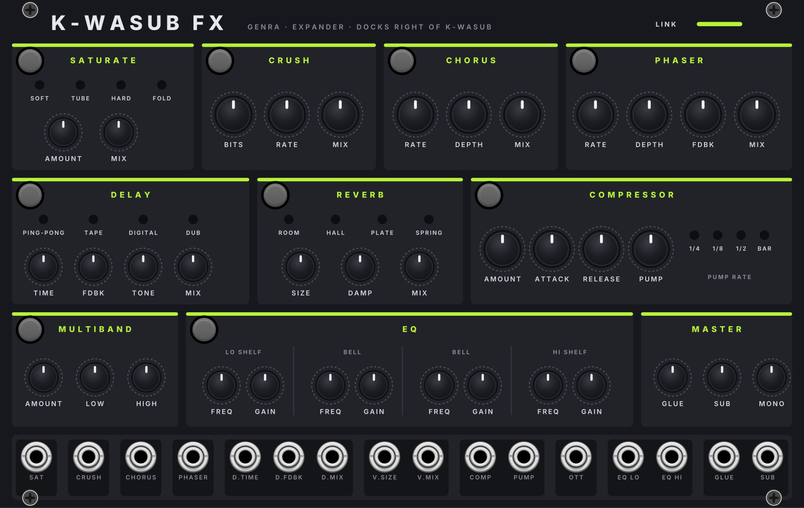
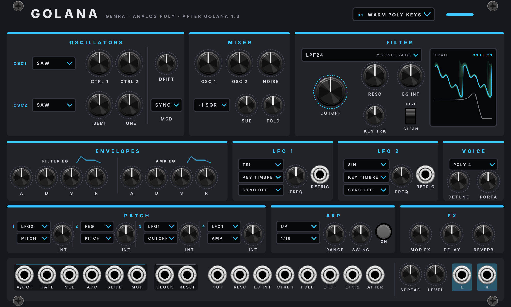
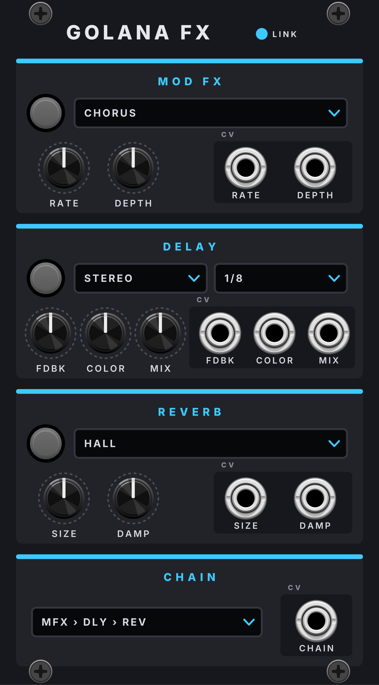
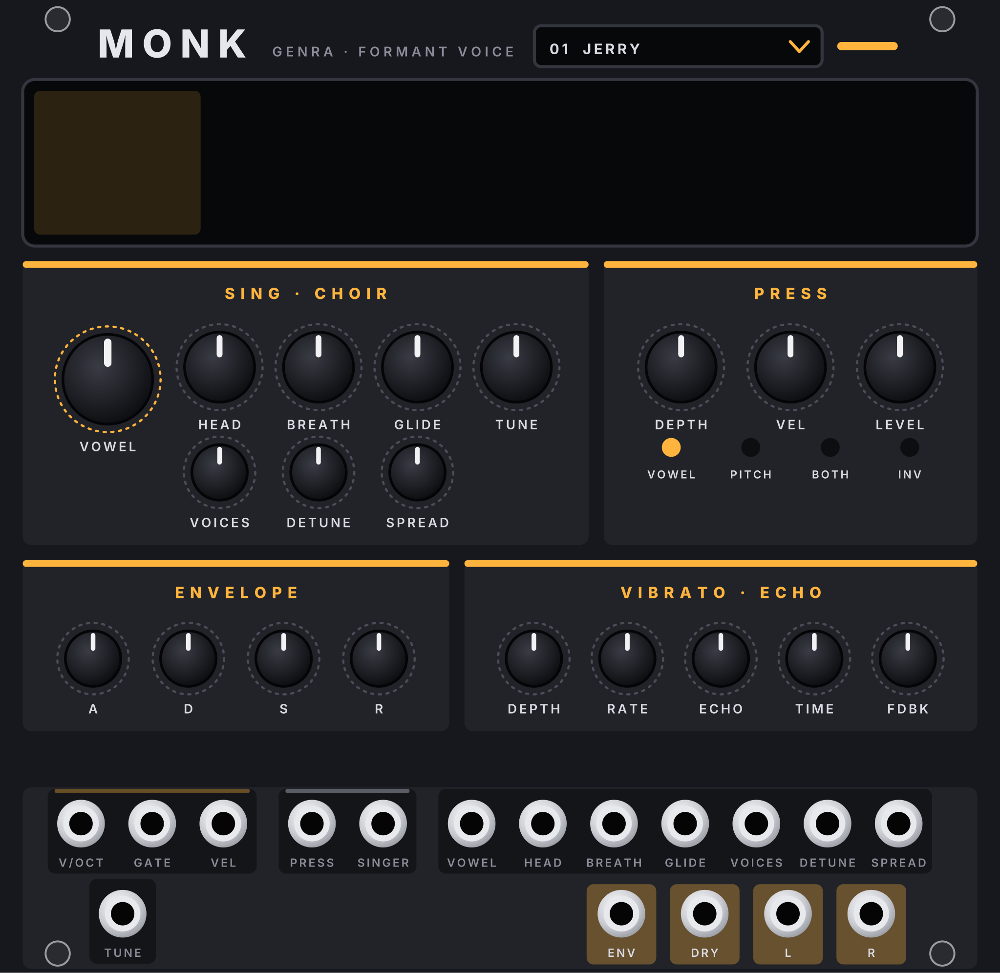
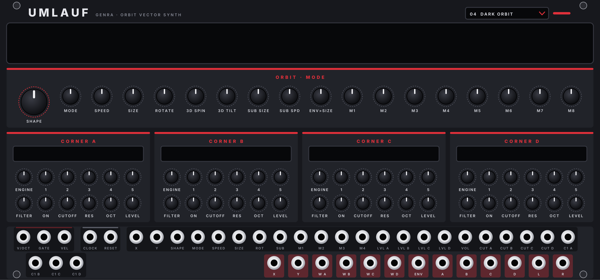
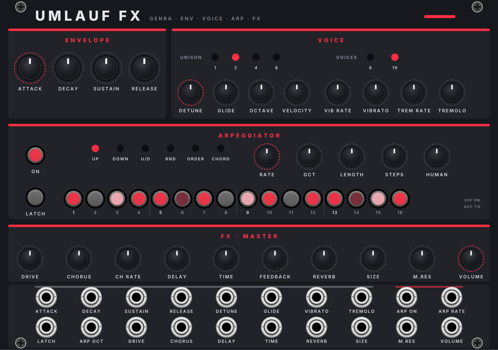
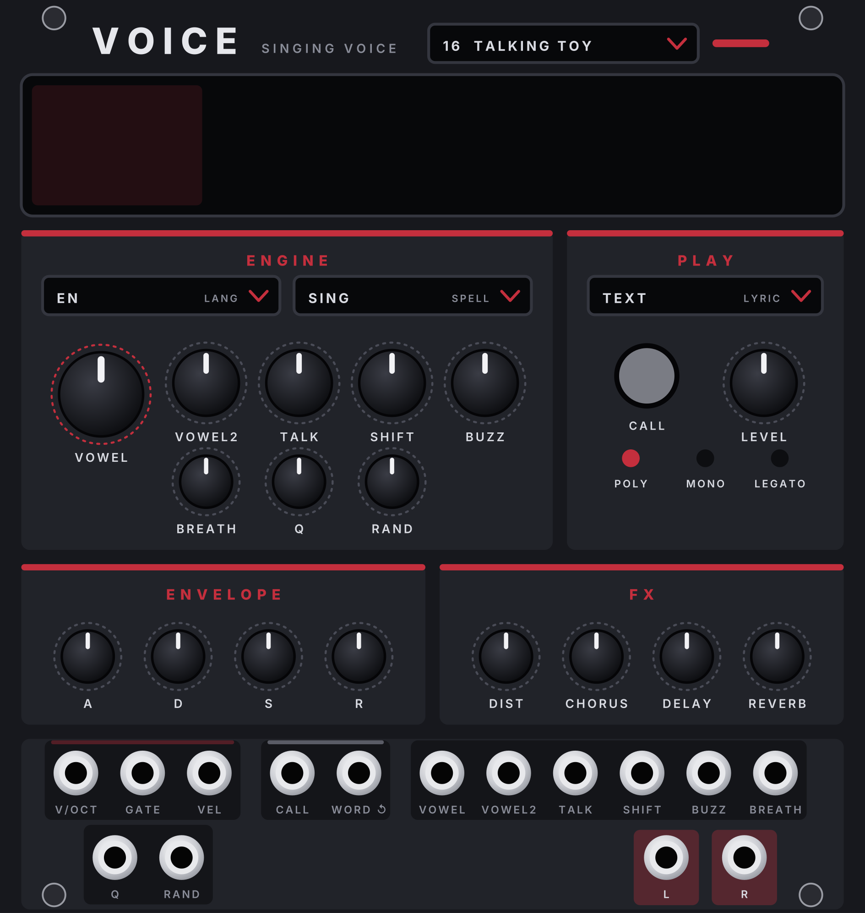
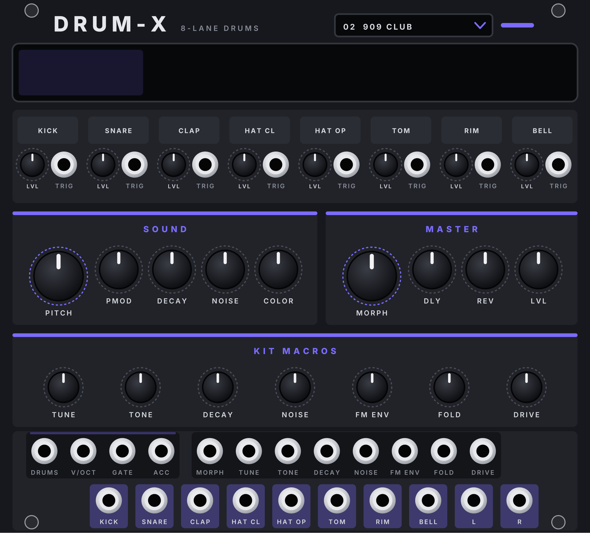
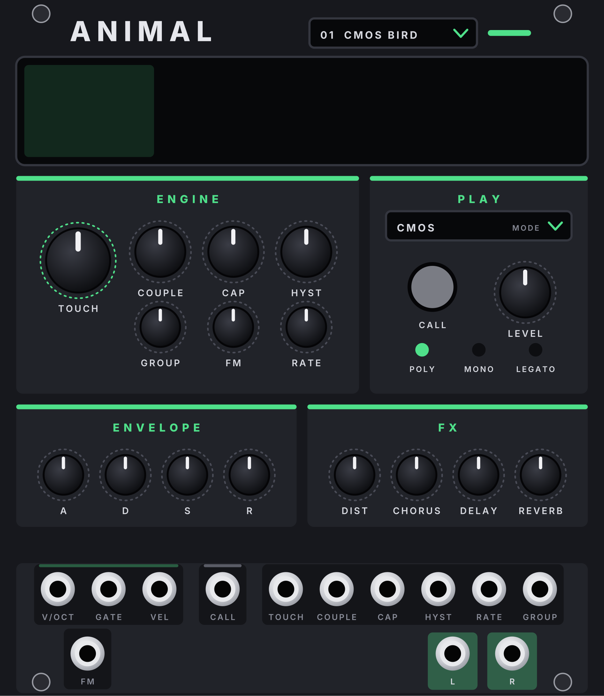

# GENRA Instruments – Plugin für VCV Rack 2

Die Instrumente der GENRA-Familie als eigenes Plugin: K-WASUB, GOLANA, UMLAUF, MONK, VOICE und ANIMAL (je mit ihren FX-Expandern). Im Rack-Browser stehen sie unter derselben Marke **Genra** wie das GENRA-Plugin (Sequencer, ABLAUF, GENRA BOX, ABLAUF MINI, MIX, GENRA FX, SCHLAG, DRUM-X, GRUND, MONO, FUNKE, SCHMELZ). Plugin-Version **2.33.0** (immer dieselbe wie GENRA; Windows und macOS); der Code liegt im Ordner `instruments/` des GENRA-Repos.

| Modul | Breite | Farbe | Was es ist |
|---|---|---|---|
| **K-WASUB** + **FX** | je 40 HP | säuregrün | Modern-Bass-Synth aus der FM-1-Firmware K-WASUB, mit Effekt-Expander |
| **GOLANA** + **FX** | 42 / 14 HP | cyan | Analoger Poly-Synth aus der FM-1-Firmware Golana, mit Effekt-Expander |
| **JIANT VOICE** | 26 HP | rot | Formant-Sänger aus der JIANT-FM-Firmware |
| **JIANT ANIMAL** | 26 HP | grün | Tierrufe aus physikalischen Modellen (JIANT FM) |
| **MONK** | 26 HP | safran | Vokal-Synth aus der FM-1-Firmware MONK-1 |
| **UMLAUF** + **FX** | 54 / 36 HP | Sith-Rot | Orbit-Vektor-Synth mit der Engine von VADER, mit Expander |

**Mit GENRA zusammen:** Ist auch das GENRA-Plugin installiert, folgen die Instrumente GENRA ohne Kabel (**Rechtsklick › Follow GENRA**), und MIX nimmt ihren Ausgang ohne Kabel (**CH n input from**) – genau wie bei den Instrumenten im GENRA-Plugin. Beide Plugins sollten aus demselben Release stammen: Passen sie nicht zueinander, bilden sich die kabellosen Verbindungen zwischen ihnen nicht (Kabel gehen immer).

> Bis GENRA 2.28 waren diese Module Teil des GENRA-Plugins. Patches von damals finden sie nicht mehr: dort einmal aus GENRA Instruments neu einsetzen. User-Presets bleiben, sie liegen weiter im Rack-Benutzerordner unter `Genra/`.

---

## Installation unter Windows

Unter [Releases](https://github.com/Camillowup/Genra-for-Vcv/releases) liegen beide Dateien: `Genra-…-win-x64.vcvplugin` und `GenraInstruments-…-win-x64.vcvplugin`. Beide nach `%LOCALAPPDATA%\Rack2\plugins-win-x64\` kopieren (in Rack: *Help › Open user folder*) und Rack neu starten. Testversionen: unter **Actions** beim grünen Lauf das Artifact `genra-instruments-windows`.

---

## Die Instrumente

### K-WASUB: Modern-Bass-Synth (Firmware von Omnipotard)

Die Firmware [K-WASUB](https://github.com/Guizmoh/K-WASUB_Firmware_for_FM1) für den M-VAVE FM-1 von Omnipotard (GPL-3.0)
als Modul, 40 HP, Farbe **säuregrün**. Der Klang ist die Original-Firmware, unverändert (`kwasub/`): Sie läuft als
eigene kleine Bibliothek (`res/kwcore.*`, eine Kopie pro Modul) mit 44,1 kHz, das Modul rechnet auf die Rack-Rate um.

- **OSC A / OSC B:** ENGINE-Feld (Klick = Liste, Mausrad): ANALOG, 808, CS, WAVETABLE, FM, GROWL, ADDITIVE, PHASE DIST,
  HARD SYNC. SHAPE, COLOR, EDGE, FOLD sind die vier Klangregler der Engine (was sie bei der gewählten Engine heissen
  und welchen Wert sie haben, steht im Display und im Tooltip), LEVEL, OCT, SEMI, FINE.
- **FILTER:** Typ-Feld (LP 24, LP 12, BAND, HIGH, NOTCH, VOWEL, COMB), CUTOFF, RES, DRIVE, ENV, KEY, Filterhüllkurve.
- **SUB · X:** Sub, Rauschen, X-Mod · **WOBBLE:** LFO 1 im Tempo (RATE = Notenwert), DEPTH, SHAPE, DEST ·
  **AMP:** ADSR · **FX:** SAT, DELAY, VERB, GLUE (schalten ihren Effekt ein).
- **Presets:** das Feld im Kopf wie bei GRUND, FUNKE und SCHMELZ: Nummer, Name, Stil, ein Punkt, sobald ein Regler
  verstellt ist. Klick (auch auf den Namen im Display) öffnet die 97 Werksklänge nach Stil (DNB, DUB, DUBSTEP …, je ein
  Untermenü, Namen A–Z), das Mausrad blättert in dieser Reihenfolge; Laden lässt sich rückgängig machen. Eigene Presets
  per Rechtsklick (*Save preset as …*, löschen, Ordner `Rack2/Genra/KwasubPresets`): Sie speichern den ganzen Klang,
  auch was kein Regler zeigt, samt den Werten von K-WASUB FX.
- **Eingänge:** V/OCT, GATE, VEL (bis 4 Stimmen, auf Halbtöne gerundet), CLOCK (setzt das Tempo; Standard 16tel wie
  GENRA, im Menü 8tel, Viertel, 24 PPQN), RESET (Taktanfang), CV für CUT, RES, DRIVE, ENV, A/B SHAPE und COLOR, WOB,
  DEPTH, PRESET (0–10 V über alle Presets), SUB, NOISE, X-MOD, ATK, REL, SAT, DELAY, VERB, GLIDE; MOD (Modrad),
  PRESS (Druck), BEND (±5 V). **Ausgänge:** ENV, LFO, L, R.
- Rechtsklick: Presets (Liste, speichern, löschen, Ordner), Stimmen (Mono, Legato, Poly), Clock-Auflösung. Der ganze Klang wird im Patch gespeichert,
  auch was kein Regler zeigt (LFO 2, Matrix, OSC C …).

### K-WASUB FX: Effekt-Expander

Rechts neben K-WASUB setzen (LINK leuchtet): alle Einstellungen des Effekt-Racks der Firmware. SATURATE (Typ, Amount,
Mix), CRUSH, CHORUS, PHASER, DELAY (Typ, Zeit im Tempo, Feedback, Ton, Mix), REVERB (Typ, Grösse, Dämpfung, Mix),
COMPRESSOR (mit PUMP und PUMP RATE), MULTIBAND, EQ (4 Bänder), MASTER (Glue, Sub-Boost, Mono-Bass). Jeder Block mit
EIN-Taster; 16 CV-Eingänge, nach Effekt gruppiert. Regler, die es auf beiden Panels gibt (SAT, DELAY, VERB, GLUE),
folgen einander. Ohne Expander gelten die Effekte des Presets.

### GOLANA: analoger Poly-Synth (Firmware von Gadlele)

Die Firmware [Golana](https://github.com/Gadlele/Golana) für den M-VAVE FM-1 von Gadlele (GPL-3.0, ein Fork von
Felucca) als Modul, 42 HP, Farbe **cyan** (GENRAs Melodiefarbe). Ein analoger Synth im Aufbau des microKORG. Der Klang
ist die Original-Firmware, unverändert (`golana/`): Sie läuft wie K-WASUB als eigene kleine Bibliothek
(`res/glcore.*`, eine Kopie pro Modul) mit 44,1 kHz, das Modul rechnet auf die Rack-Rate um.

- **OSCILLATORS:** OSC 1 mit Wellenform-Feld (SAW, PULSE, TRI, SINE, MORPH), CTRL 1 (je nach Welle: zweite Säge eine
  Oktave höher, Pulsbreite, Falten, Kreuzmodulation, Säge → Rechteck), CTRL 2 (LFO 1 auf CTRL 1, z. B. PWM), DRIFT
  (analoges Altern). OSC 2: Welle (SAW, SQR, TRI, MIX), SEMI, TUNE, MOD (OFF, RING, SYNC, R+S).
- **MIXER:** OSC 1, OSC 2, NOISE, SUB (Feld: −1/−2 Oktaven, Rechteck, Sinus, Säge, Mix) und FOLD (Wavefolder vor dem Filter).
- **FILTER:** Typ-Feld (LPF24, LPF12, BPF, HPF, MS20), CUTOFF, RESO, EG INT (±), KEY TRK, DIST (weicher Drive). Der
  **Screen** daneben zeigt den Klang als Spur mit Nachleuchten (TRAIL), die Filterkurve und die Noten, die gerade klingen.
- **ENVELOPES:** Filter-EG und Amp-EG (ADSR). **LFO 1 / LFO 2:** Welle (SAW, SQR, TRI, SIN, S&H), KEY SYNC (OFF, TIMBRE,
  VOICE), SYNC im Tempo (OFF, 4 BAR … 1/32, über CLOCK), FREQ und ein **RETRIG**-Eingang: Jeder Trigger startet den LFO
  von vorn, für alle Stimmen. **VOICE:** POLY 4, MONO, LEGATO, UNISON, DETUNE, PORTA.
- **PATCH:** die vier Modulationswege der Firmware, je Quelle (FEG, AEG, LFO1, LFO2, VELO, KBD, MODW, MW*LFO1, MW*LFO2,
  AFTER) → Ziel (PITCH, OSC2, CTRL1, NOISE, CUTOFF, AMP, LFO2F) mit INT. Die LFOs haben keinen eigenen Tiefe-Regler:
  die Tiefe ist das INT ihres Patch-Wegs.
- **ARP:** Typ (UP, DOWN, ALT1, ALT2, RANDOM, TRIGGER, ORDER, CONVERGE, PEDAL, DOUBLE), Rate (1/32 … 1/4, im Tempo von
  CLOCK), RANGE (1–4 Oktaven), SWING, ON. Im Rechtsklick-Menü: Latch, Key Sync, Gate.
- **FX:** MOD FX, DELAY, REVERB als Summenregler (wie bei K-WASUB); die Einzelheiten stehen im Expander.
  Drehst du einen davon auf, schaltet er seinen Effekt im Expander ein.
- **Presets:** 55 im Feld oben rechts: 30 eigene nach Stil (wie bei FUNKE) und Golanas 25 Werksklänge als Gruppe
  GOLANA ORIGINALS. Eigene Presets per Rechtsklick (`Rack2/Genra/GolanaPresets`), samt den Werten von GOLANA FX.
- **Eingänge:** die GENRA-Leiste V/OCT, GATE (bis 4 Stimmen, auf Halbtöne gerundet), VEL, ACC, SLIDE, MOD (Modrad; ohne
  Patch-Weg ein Vibrato), CLOCK (setzt das Tempo; Standard 16tel wie GENRA), RESET (Arp und LFOs von vorn); CV für CUT,
  RESO, EG INT, CTRL 1, FOLD, LFO 1, LFO 2, AFTER (Aftertouch, eine Patch-Quelle). **Ausgänge:** L, R, dazu SPREAD
  (Stereobreite der Stimmen) und LEVEL.
- Rechtsklick ausserdem: EG Reset, Clock-Auflösung, Follow GENRA (Melody, für Flächen auch Pad). Der ganze Klang wird
  im Patch gespeichert.

| Stil | Presets |
|---|---|
| SOUL · JAZZ · LO-FI | WARM POLY KEYS · LO-FI CHORDS · SOFT SQUARE LEAD · DUSTY BELLS |
| HOUSE · GARAGE | HOUSE ORGAN · DEEP CHORD · GARAGE STAB · DISCO BRASS |
| DUB · REGGAE | DUB SIREN · DUB CHORD ECHO · MELODICA |
| TECHNO · ELECTRO | ACID LINE · HYPNOTIC ARP · DUB TECHNO CHORD · ELECTRO SYNC LEAD · MINIMAL BLIP |
| GRIME · DUBSTEP · DRILL | GRIME SQUARE · REESE · DRILL GLIDE · WOBBLE LEAD (für den Drop: GATE auf RETRIG 1) |
| POP · SYNTHWAVE · TRANCE | SUPERSAW · 80S BRASS · SYNTHWAVE POLY · GLIDE LEAD · TRANCE PLUCK · UNISON LEAD |
| AMBIENT | SOFT PAD · PHASE PAD · SLOW ARP · DRONE |
| GOLANA ORIGINALS | die 25 Werksklänge der Firmware, von FAT BASS bis SUPERSAW |

### GOLANA FX: Effekt-Expander

Rechts neben GOLANA setzen (LINK leuchtet), 14 HP: **MOD FX** (Typ: Chorus, Flanger, Ensemble, Phaser, Metal; RATE,
DEPTH), **DELAY** (Typ: Stereo, Cross, L/R; Zeit in Notenwerten im Tempo; FDBK, COLOR, MIX), **REVERB** (Typ: Room,
Spring, Hall; SIZE, DAMP) und **CHAIN** (die Reihenfolge der drei). Jeder Block mit EIN-Taster, die CV-Eingänge sitzen
in ihrer Sektion. Ohne Expander gelten die Effekte des Presets.

### MONK: die zwölf Sänger

Der Vokal-Synthesizer (26 HP) aus der FM-1-Firmware [MONK-1](https://github.com/charlesvestal/fm1-monk) (Charles Vestal, GPL-3.0), dessen Klang [MonkSynth](https://github.com/JonET/monksynth) ist (Jonathan Taylor, MIT; eine Hommage an Delay Lama). FOF-Formantsynthese: pro Periode ein Korn aus drei abklingenden Formant-Sinus plus Atem, fünf Vokale OO–OH–AH–EH–EE. Farbe: **safran**.

- **Display:** links singt der Sänger (eigene Zeichnungen, ab 2.21.0): der Mund formt den Vokal (OO, OH, AH, EH, EE), die Brauen heben sich mit der Lautstärke, bei BOLT glüht dazu die Antenne; ohne Ton blinzelt er ab und zu und probt Vokale. Rechts Name, Note, Stimmen, ob die Stimme bearbeitet ist, Vokal-Chips (Klick setzt VOWEL), PRESS und ENV.
- **◀ SING ▶:** die zwölf Sänger: **BOLT** (Blech-Tenor, ein Roboter), **CROAK** (Sumpf-Bass, ein Frosch), **DIVA** (Opernstar), **HOOT** (Nacht-Alt, eine Eule), **ZORP** (Weltraum-Sopran, ein Ausserirdischer), **BONES** (Grab-Crooner, ein Skelett), **SPIKE** (Wüsten-Ballade, ein Kaktus), **BLUB** (Tiefsee-Bariton, ein Wal), **LOOP** (Tape-Looper, eine Kassette), **LUNA** (Wiegenlied-Mond), **SPORE** (Waldchor, ein Pilz), **EMBER** (Feuer-Belterin, ein Drache). Die Stimmen sind dieselben wie bisher auf denselben Plätzen, alte Patches singen gleich. Ein Sänger lädt seine Stimme auf alle Regler. Auch per SINGER-CV (0–10 V) und Rechtsklick-Menü, dort auch *Stimme wie geliefert*.
- **SING · CHOIR** (je mit CV, ±5 V = ganzer Reglerweg): VOWEL, HEAD (Vokaltrakt in cm), BREATH, GLIDE, VOICES (Unisono 1–10), DETUNE (Cent), SPREAD (Kopfgrössen der Stimmen), TUNE (±12 Halbtöne).
- **PRESS →** VOWEL · PITCH · BOTH · INV: wohin der PRESS-Eingang (Aftertouch, 0–10 V) wirkt; P.DEPTH wie weit, VEL wie stark VEL die Lautstärke setzt.
- **ENVELOPE** ATK DEC SUS REL (bis 5 s), **VIBRATO · ECHO** DEPTH, RATE, ECHO (Menge), TIME, FDBK (neu, im Original fest 50 %).
- **Ein/Aus:** V/OCT (C4 = 0 V), GATE, VEL, PRESS, SINGER · ENV (0–10 V), DRY (mono ohne Echo), L, R. Einstimmig wie das Original: GATE startet die Note, V/OCT bei gehaltenem Gate gleitet ohne neuen Anschlag (GLIDE).
- Mit MIDI: MIDI-CV-Modul → V/OCT, GATE, VEL und AFT → PRESS.

### UMLAUF: Orbit-Vektor-Synth (Engine von VADER)

Die Engine von [VADER](https://github.com/sunskiefer/VADER) (L'Cronx, MIT) als Modul, 54 HP, Farbe **Sith-Rot**. Ein
Punkt, der **Orbiter**, läuft auf einer Bahn in einem Quadrat; in den vier Ecken spielt je ein Klang, und wo der
Orbiter gerade ist, entscheidet, wie viel man von jeder Ecke hört. Die Engine läuft wie im Original mit 44,1 kHz
(`vader/`, bis auf wenige markierte Änderungen, siehe `vader/README-UMLAUF.md`), das Modul rechnet auf die Rack-Rate um.

- **Display:** das Quadrat mit Bahn, Orbiter, Sub-Orbit-Punkt und den Bällen der Modi; daneben Form, Modus, Clock und
  die Live-Namen von M1–M8 (sonst die Engines der Ecken), unten der Anteil jeder Ecke.
- **ORBIT · MODE:** SHAPE (15 eingebaute Formen, USER = eigene Datei, 35 Mathe-Formen), SPEED, SIZE, ROTATE, 3D SPIN,
  3D TILT (für Würfel, Ikosaeder, OBJ), SUB SIZE, SUB SPEED, ENV>SIZE (die Hüllkurve öffnet oder schliesst die Bahn).
  MODE: PATH (die Form) oder eine von 26 Simulationen (CHASE, KEPLER, LORENZ, PENDULUM, BOIDS, MEDUSA, THUNDER …);
  M1–M8 sind ihre Regler, die Namen stehen im Display.
- **CORNER A–D:** ENGINE: SYNTH (VADERs zwei Oberton-Generatoren mit je 32 Spektren und BLEND: MIX, AM, PM, AM+PM, PD,
  RING, FOLD), die 14 Stimmen ANALOG, TRIO, WAVE, CHIP, MACRO, WHEEL, VOICE, NOISE, TONE, METAL, BAZZ, DRONE,
  TEXTURE, FX oder WAV (ein Sample). Die Regler 1–5 wechseln mit der Engine, das Mini-Display zeigt ihre Namen
  (SYNTH: GEN 1, GEN 2, BLEND, B.MODE, G2 TUNE · Stimmen: ihre vier Klangregler + LIMIT · WAV: START, END, LENGTH,
  LIMIT). Darunter FILTER (LP12, LP24, BP, HP, LADDER), ON (nach dem Blend, auf GEN 1 oder GEN 2), CUTOFF, RES, OCT,
  LEVEL. Klick aufs Mini-Display: Engine- und Sample-Auswahl.
- **Eingänge:** V/OCT, GATE (polyphon, bis 16 Stimmen), VEL, CLOCK (Tempo und Takt für Arpeggiator, synchrone Bahnen,
  Delay; Standard 16tel wie GENRA), RESET, X/Y (steuern den Orbiter von Hand, ±5 V), CV für SHAPE, MODE, SPEED, SIZE,
  ROT, SUB, M1–M4, Pegel A–D, VOL, Cutoff A–D und Regler 1 jeder Ecke.
- **Ausgänge:** X, Y (wo der Orbiter ist, ±5 V), WT A–D (Anteil jeder Ecke, 0–10 V), ENV, A–D (jede Ecke einzeln,
  trocken), L, R.
- **Ordner:** Beim ersten Start legt UMLAUF `Rack2/GenraSynthis/Umlauf/` an: `Samples` (eigene WAVs, auch in
  Unterordnern) und `Shapes` (die 7 Beispiel-Formen von VADER; eigene SVG, OBJ, PNG, JPG dazulegen). Die
  Beispiel-Samples von VADER sind nicht dabei (sie stammen aus kommerziellen Sample-Packs).
- **Presets:** das Feld im Kopf wie bei GRUND, FUNKE und SCHMELZ (Nummer, Name, Stil, Punkt bei verstellten Reglern;
  Klick = Liste nach Stil, Mausrad blättert, Laden lässt sich rückgängig machen). 28 eigene Werksklänge, dahinter als
  Gruppe *VADER* die 22 Presets von VADER (die sechs Sample-Presets brauchen eigene WAVs). Eigene Presets per
  Rechtsklick (*Save preset as …*, löschen, Ordner `Rack2/Genra/UmlaufPresets`): der ganze Zustand der Engine samt
  UMLAUF FX.

| Stil | Presets |
|---|---|
| TECHNO | HYPNO STAB, WAREHOUSE DRONE, ACID ORBIT, RAVE CHORD |
| HOUSE · DEEP | DEEP CHORD, ORGAN HOUSE, GARAGE PLUCK, DISCO STRINGS |
| DUB · DUB TECHNO | DUB TECHNO CHORD, DUB SKANK, MELODICA, SPACE ECHO |
| AMBIENT · DRONE | GLACIER PAD, TIDAL DRONE, CHOIR CLOUD, TEXTURE FIELD |
| BASS | SUB ORBIT, REESE ORBIT, FM BASS, WOBBLE ORBIT |
| KEYS · LEADS | ORBIT E-PIANO, SYNC LEAD, CHIP ARP, BELL TREE |
| CINEMATIC · FX | LORENZ STORM, BOIDS SWARM, THUNDER RISER, DARK HORIZON |
| VADER | INIT ORBIT, GLASS STAR, DARK FIGURE … SAMPLE TEXTURES (22) |

- **Rechtsklick:** Presets, Formdatei für USER wählen oder laden, pro Ecke Engine, Sample und Abspielart (One Shot, Loop 1–4 Takte), Ordner öffnen, neu einlesen,
  Clock-Auflösung, Delay im Takt.
- Pro Modul ein Timbre (VADERs Timbre B, Layer/Split, gibt es hier nicht: für Layer zwei UMLAUF nehmen).

### UMLAUF FX: Expander

Rechts neben UMLAUF setzen, 36 HP. ENVELOPE (ADSR) · VOICE (UNISON 1/2/4/8, VOICES 8/16, DETUNE, GLIDE, OCTAVE,
VELOCITY, Vibrato und Tremolo mit Rate) · ARPEGGIATOR (ON, LATCH, Richtung UP/DOWN/U·D/RND/ORDER/CHORD, RATE im
Takt, OCT, LENGTH, STEPS, HUMAN und 16 Schritt-Taster: Klick schaltet OFF → ON → ACCENT → TIE) · FX · MASTER (DRIVE,
CHORUS mit Rate, DELAY mit TIME und FEEDBACK, REVERB mit SIZE, M.RES = Resonanz aller Eckfilter, VOLUME) · 20
CV-Eingänge. Beim Andocken übernehmen die Regler den aktuellen Klang; ohne Expander gelten die Werte des Presets.

### JIANT-Stimmen: VOICE und ANIMAL

| VOICE | DRUM-X | ANIMAL |
|---|---|---|
|  |  |  |

Drei Klangerzeuger aus der Firmware von [JIANT FM](https://github.com/juanjiant-bit/JIANT) (Juan Jiant, ein Fork von [Felucca](https://github.com/hugelton/Felucca), GPL-3.0), im GENRA-Look und jeweils in einer eigenen Farbe: **VOICE rot**, **DRUM-X blau-violett** (GENRAs Drum-Farbe), **ANIMAL grün**. Das Display zeigt links die Zeichnung der Firmware (Vokaltrakt, Kit-Kolonie, Kreatur), rechts Preset bzw. Kit und die Einstellungen.

- **VOICE** (26 HP): Formant-Sänger. ◀ PRE ▶ (15 Presets), LANG im Display (OFF singt Vokale, ES/EN/JA singen Wörter), ◀ LYR ▶ wählt TEXT, W1–W16 oder S1–S8, das Textfeld im Display nimmt einen eigenen Text (bis 63 Zeichen). Jede neue Note singt die nächste Silbe, WORD ↺ startet den Text neu. 8 Klangregler mit CV, ihre Namen wechseln mit LANG.
- **ANIMAL** (26 HP): Tierrufe aus physikalischen Modellen. MODE als Regler oder per Klick im Display (CMOS, PULSE, WHSTL, WING, GLOTT), ◀ PRE ▶ (24 Presets), 7 Klangregler mit CV, ihre Namen wechseln mit MODE.
- **Gemeinsam (VOICE, ANIMAL):** CALL spielt einen Ton ohne Kabel (auch per Gate am CALL-Eingang), POLY · MONO · LEGATO per Klick auf die Lampen, Hüllkurve ATK–REL, FX DIST–REVERB, V/OCT, GATE, VEL polyphon, LEVEL und Stereo-Ausgang (nur L gesteckt = Mono).
- Presets bzw. Kits gibt es auch im Rechtsklick-Menü. Alte Patches mit den einzelnen Plugins *JiantVoice*, *JiantDrumX*, *JiantAnimal* finden die Module hier nicht automatisch – dort einmal neu einsetzen.

---

## Shoutouts 🙌

### Juan Jiant – VOICE, DRUM-X, ANIMAL

Ein ganz besonderer Dank an **[Juan Jiant](https://github.com/juanjiant-bit)**! Seine Firmware [JIANT FM](https://github.com/juanjiant-bit/JIANT) steckt hinter VOICE, DRUM-X und ANIMAL – der singende Vokaltrakt, die Kit-Kolonie aus kleinen Kreaturen und die Tierrufe aus physikalischen Modellen sind seine Ideen und seine Arbeit. Ohne seinen offenen Code (GPL-3.0) gäbe es die drei Stimmen in diesem Plugin nicht. Gracias, Juan – schaut euch sein Repo an und lasst ihm einen Stern da! ⭐

### Omnipotard – K-WASUB

Ein grosses Dankeschön an **[Omnipotard (Guizmoh)](https://github.com/Guizmoh)**! Seine Firmware [K-WASUB](https://github.com/Guizmoh/K-WASUB_Firmware_for_FM1) für den M-VAVE FM-1 ist der komplette Klang des K-WASUB-Moduls: Die Bass-Engines und Effekte laufen hier als sein unveränderter Code (GPL-3.0). K-WASUB ist aus seinem KAWA entstanden und baut auf der FM-1-Plattform von Leo Kuroshita (Hügelton Instruments) auf. Merci, Omnipotard – schaut euch sein Repo an und lasst einen Stern da! ⭐

### Gadlele – GOLANA

Danke an **[Gadlele](https://github.com/Gadlele)**! Seine Firmware [Golana](https://github.com/Gadlele/Golana) macht aus dem M-VAVE FM-1 einen analogen Synth im Geist des microKORG – mit Sub-Oszillator, Drift, Wavefolder, MS-20-Filter, Arpeggiator und dem Bildschirm, der den Klang zeichnet. Im GOLANA-Modul läuft sein unveränderter Code (GPL-3.0); Golana baut auf Felucca von Leo Kuroshita (Hügelton Instruments) auf. Schaut euch sein Repo an und lasst einen Stern da! ⭐

### L'Cronx – UMLAUF

Ein riesiges Dankeschön an **[L'Cronx](https://github.com/sunskiefer)**! UMLAUF ist die Engine seines Vektor-Synths [VADER](https://github.com/sunskiefer/VADER) für Akai Force und MPC: vier Klangquellen in den Ecken eines Quadrats und der Orbiter, der auf einer Form durch sie hindurch kreist und den Klang dabei morphen lässt. Die Idee, die Engine und die Formen sind seine Arbeit, und dank seines offenen Codes (MIT) laufen sie jetzt auch in VCV Rack. Danke, L'Cronx – schaut euch VADER an und lasst ihm einen Stern da! ⭐

---

## Lizenz und Credits

GPL-3.0-only (siehe `LICENSE`).
- **VOICE, ANIMAL:** [JIANT FM](https://github.com/juanjiant-bit/JIANT) von Juan Jiant, ein Fork von [Felucca](https://github.com/hugelton/Felucca) – GPL-3.0
- **MONK:** Klang-Engine portiert aus [MONK-1](https://github.com/charlesvestal/fm1-monk) von Charles Vestal – GPL-3.0; DSP [MonkSynth](https://github.com/JonET/monksynth) von Jonathan Taylor – MIT. Die Sänger-Zeichnungen sind GENRAs eigene.
- **K-WASUB:** [K-WASUB](https://github.com/Guizmoh/K-WASUB_Firmware_for_FM1) von Omnipotard – GPL-3.0 (`kwasub/`)
- **UMLAUF:** [VADER](https://github.com/sunskiefer/VADER) von L'Cronx – MIT (`vader/`)
- **GOLANA:** [Golana](https://github.com/Gadlele/Golana) von Gadlele, ein Fork von [Felucca](https://github.com/hugelton/Felucca) – GPL-3.0 (`golana/`); darin DaisySP und Rings (MIT) und Instrument-Samples von Versilian Studios (CC0)

Alle Lizenztexte der Fremdteile liegen im Plugin-Ordner unter `licenses/` (Übersicht: `licenses/README.md`).

Ausserdem enthalten: in VADER die LXRXXL-ZYNTH-Stimmen, Code von Mutable Instruments (MIT), stb_image (Public Domain/MIT) und der
FM-Algorithmus-Tabelle von music-synthesizer-for-android (Apache 2.0). Die Wavetables der LXR02-Firmware, die VADER
für TONE, METAL und BAZZ nutzt, sind nicht dabei (ihre Lizenz verbietet kommerzielle Nutzung): UMLAUF rechnet
gleichartige Tabellen selbst (`tools/umlauf_wavetables.py`).
